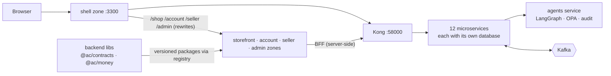

# agentic-commerce workspace

Amazon-style multi-vendor marketplace with **governed AI agents**, built as **microservices** and
**micro-frontends**, in one monorepo with three independent projects (each with its own workspace, lockfile and
path-filtered CI workflow in `.github/workflows/`):

| Folder | What | Deployables |
|---|---|---|
| [`platform/`](platform/README.md) | Architecture docs, local infra (Docker Compose), workspace CLI `ac`, k3s deployment on Oracle Cloud (Helm charts + OCI Terraform), load tests | — |
| [`backend/`](backend/README.md) | 12 NestJS microservices (each with its own database, Dockerfile and CI) incl. the agents service (LangGraph + AG-UI + OPA), versioned shared libs, OPA policies, agent evals | 12 images |
| [`frontend/`](frontend/README.md) | Next.js 16 Multi-Zones: `shell` + `storefront` (/shop), `account`, `seller`, `admin`; shared UI, AG-UI widget, BFF packages | 5 images |



## Start

```bash
./platform/setup.sh          # macOS / Linux: tools → repos → .env → infra → install → build → doctor
alias ac="node $PWD/platform/scripts/ac.mjs"
ac dev                       # everything → http://localhost:3300
ac doctor
```

Production: **k3s on one Oracle Cloud Always Free VM** — every service and zone is its own Kubernetes
Deployment (images on ghcr, linux/arm64), deployed and rolled back independently with `ac k8s deploy|rollback`
(see `platform/docs/06-dev-setup.md` §6.9). AWS is not used.

Docs: [platform/docs](platform/docs) — start with `01-hld.md`, `07-microservices.md`, `08-microfrontends.md`.
Claude Code: each folder has `CLAUDE.md` plus `.claude/skills` and `.claude/agents`; this folder's `CLAUDE.md`
explains cross-project work.

<!-- copied from platform/workspace/README.md by `ac repos` / `ac setup` — edit it there -->
