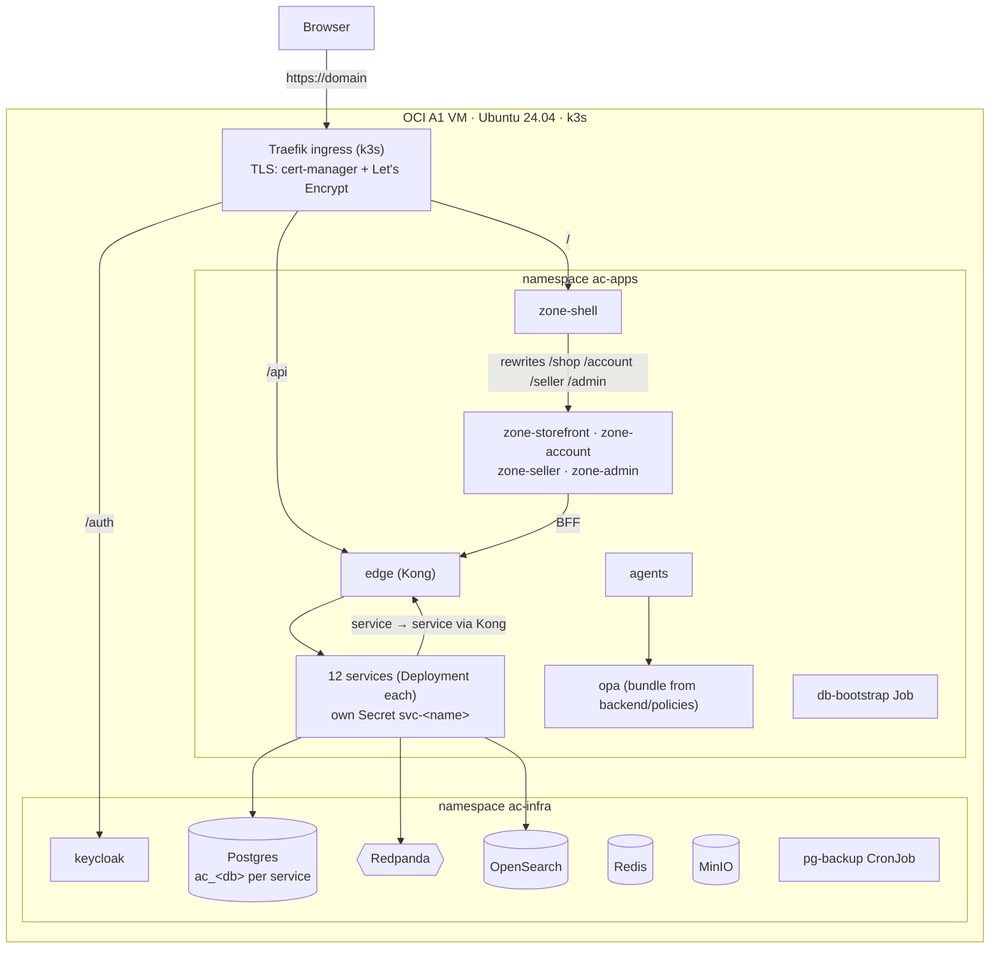

# Deployment — k3s on Oracle Cloud (and k3s in Docker locally)

AWS is not used ([ADR 0011](../docs/adr/0011-k3s-on-oracle-cloud.md); the old design is archived in
`../terraform-aws-archive/`). Production is **one Oracle Cloud Always Free Ampere A1 VM** (default 2 OCPU /
12 GB; the other half of the free allowance runs swarm-ai) with **k3s**. Every microservice and every zone is
its own Kubernetes Deployment, deployed and rolled back independently.



NetworkPolicies enforce the call graph: services accept traffic only from `edge`; zones only from the shell;
`edge` only from the ingress controller, zones and services; OPA only from `agents`; `ac-infra` only from
`ac-apps` (and Keycloak from the ingress).

## Layout

| Path | What |
|---|---|
| `helm/agentic-infra/` | Postgres 18 + pgvector (one database per service), Redis, Redpanda (+ topics Job), OpenSearch (+ index Job), Keycloak (prod mode, `/auth`, realms rendered with your domain), MinIO, optional Grafana LGTM, nightly `pg_dump` CronJob |
| `helm/agentic-commerce/` | one Deployment + Service per service and per zone (`zone-<name>`), `edge` (Kong DB-less), `opa`, `db-bootstrap` hook Job, Ingress, NetworkPolicies. `values.services.yaml` is **generated** (`ac k8s values`) from `backend/services/*/package.json` and `frontend/zones.json` |
| `terraform/oci/` | VCN, subnet, security list (80/443 open, 22 `ssh_cidr`, 6443 `admin_cidr` only), A1 VM with cloud-init: swap, OCI iptables fix, k3s, Traefik 300 s timeouts, cert-manager + `letsencrypt` ClusterIssuer |
| `k3s/traefik-config.yaml` | Traefik tuning for AG-UI streams (used by cloud-init and `ac k8s local up`) |
| `envs/` | `<env>.json` settings, `<env>.tags.json` release manifest (committed); `<env>.env` secrets, `<env>.kubeconfig` (gitignored) — see [envs/README.md](envs/README.md) |

## Try it locally (k3s in Docker)

```bash
ac k8s local up                 # k3s container ac-k3s · ingress http://localhost:8088 · API :6445
ac k8s local load --infra       # import third-party images already in Docker (no second download)
ac k8s local load               # build (if missing) + import every image: services and zone-<name>
ac k8s deploy local             # secrets + agentic-infra + agentic-commerce (≈ 5–8 min first time)
open http://localhost:8088/     # same routing as prod: /shop /account /seller /admin /api /auth
ac k8s status local
ac k8s local down
```
Needs ~6–7 GB free in Docker Desktop (Settings → Resources).

## Deploy to Oracle Cloud

1. **OCI account + API key**: console → Profile → API keys → *Add API key* → paste the snippet into
   `~/.oci/config`. Note your tenancy OCID and home region.
2. **VM**: `cp terraform/oci/terraform.tfvars.example terraform/oci/terraform.tfvars`, fill it in, then
   `ac tf oci init && ac tf oci plan && ac tf oci apply`. Output: `public_ip`.
   *Out of host capacity* → set `availability_domain_index = 1` (or 2) and apply again.
3. **DNS**: A record `domain → public_ip` (DuckDNS works). Wait for cloud-init: `ssh ubuntu@<ip> cloud-init status --wait`.
4. **Cluster access**: put `SSH_HOST=<ip>` in `envs/prod.env` (created by `ac k8s secrets prod` on first run),
   then `ac k8s kubeconfig prod`. Edit `envs/prod.json`: `publicUrl`, `host`, `imageRegistry` (`ghcr.io/<owner>/ac`).
5. **Secrets**: `ac k8s secrets prod` generates `envs/prod.env` (random passwords, one per service database) and
   applies them. Add `OPENAI_API_KEY`, `STRIPE_*`, `GHCR_USER`/`GHCR_TOKEN` (read:packages) and re-run.
6. **Images** (linux/arm64 — the A1 VM is ARM; Apple Silicon builds it natively):
   `ac docker build <name> --platform linux/arm64 && ac docker push <name> --tag 0.1.0` for every service and
   `zone-<name>` (CI does this on `ubuntu-24.04-arm` runners).
7. **Deploy**: `ac k8s deploy prod` (everything) — then `https://<domain>/`.

## Day-2

| Task | Command |
|---|---|
| Release ONE service/zone | `ac k8s deploy prod catalog --tag 1.4.0` · `ac k8s deploy prod zone-storefront --tag 2.1.0` — updates `envs/prod.tags.json`, only that Deployment rolls (`maxUnavailable: 0`) |
| Roll it back | `ac k8s rollback prod catalog` (previous tag from the manifest history) |
| Infra only | `ac k8s deploy <env> --infra-only` (backing services); `--infra` adds them to a per-service deploy |
| Change a secret | edit `envs/prod.env` → `ac k8s deploy prod` (pods roll on the secrets hash) |
| New service/zone | `ac new service …` / `ac new zone …` → build + push image → `ac k8s deploy prod` (catalogue regenerated, DB created by `db-bootstrap`) |
| Logs / pods | `KUBECONFIG=deploy/envs/prod.kubeconfig kubectl -n ac-apps logs deploy/catalog` · `ac k8s status prod` |
| Backups | CronJob `pg-backup` (02:30, 14 days on PVC `backups` in `ac-infra`); copy off the VM regularly |

## Limits (be honest)

Single node: no high availability — a VM outage takes the site down until it is back (k3s and all state live
on the boot volume; recovery = re-apply Terraform + `ac k8s deploy` + restore `pg_dump`s). Always Free instances
can be reclaimed by Oracle when idle; upgrading the tenancy to Pay-As-You-Go keeps them (still €0 within limits).
Next steps when it outgrows one node: add k3s agent nodes (another A1 VM or paid shapes), or move the same charts
to OKE (Oracle's managed Kubernetes).
