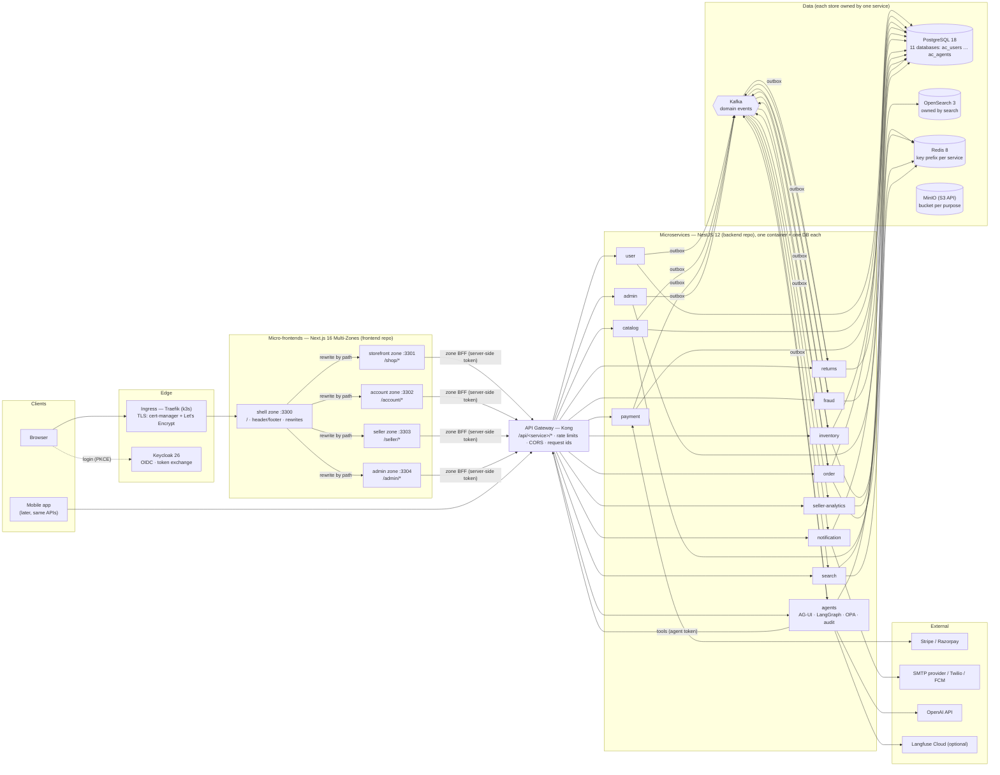
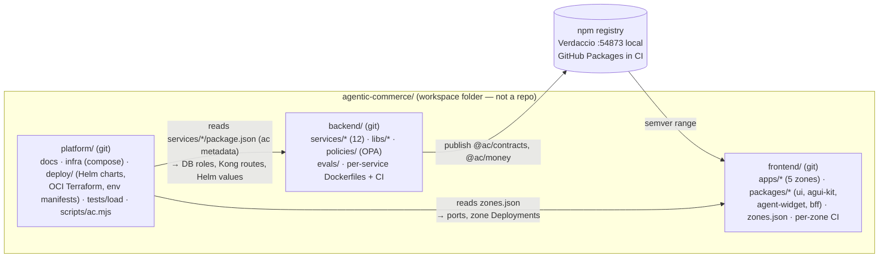
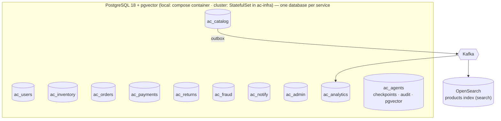
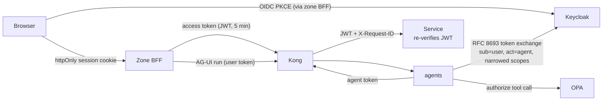
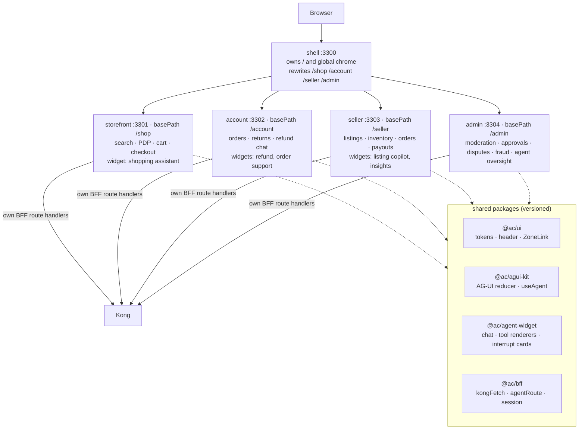
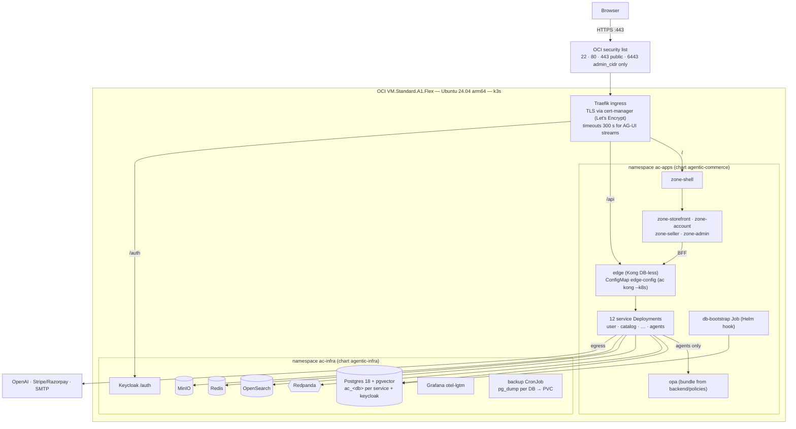
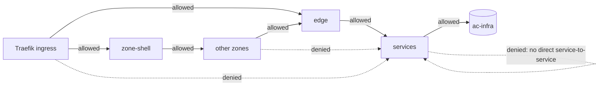

# 1. High-Level Design

Architecture style: **microservices with full isolation** (backend) + **micro-frontends with Next.js
Multi-Zones** (frontend), delivered from **three repositories**. Deep dives:
[07-microservices.md](07-microservices.md) · [08-microfrontends.md](08-microfrontends.md).

## 1.1 Architecture overview



**Key ideas**

1. **Every backend service is independently deployable**: own container image, own database (`ac_<db>`,
   login role `svc_<db>`, own secret), own CI pipeline and semantic version. No service reads another
   service's database; cross-service data travels through Kong (sync) or Kafka (async).
2. **Every UI domain is an independently deployable Next.js zone**. The **shell** owns `/` and the global
   chrome and rewrites `/shop`, `/account`, `/seller`, `/admin` to the owning zone. Zones talk to the
   backend **only through their own BFF route handlers** (tokens stay server-side).
3. **Agents are a microservice too** (`agents`): AG-UI endpoint + LangGraph runtime + tool registry +
   governance. It never touches other services' databases; its tools call domain APIs **through Kong**
   with an exchanged agent token, every call authorized by OPA and audited. The agent **widgets** live
   in the zone that owns the user journey (see [03 §3.4](03-agentic-ai.md#34-where-ag-ui-helps-and-where-it-doesnt)).
4. **Contracts are versioned libraries**: `@ac/contracts` (zod DTOs + event schemas) and `@ac/money` are
   published from the backend repo (Changesets → Verdaccio locally, GitHub Packages in CI) and consumed by
   the frontend at a pinned semver range.

## 1.2 Repository topology



| Repo | Owns | Release unit |
|---|---|---|
| `platform` | Architecture docs, local infra (`docker compose`), Kong config generation, Keycloak realms, **deploy/** (Helm charts `agentic-infra` + `agentic-commerce`, OCI Terraform, per-env values + release manifests), load tests, workspace CLI `ac`, `setup.sh` | VM via `ac tf oci apply`; cluster via `ac k8s deploy <env>` |
| `backend` | 12 microservices (`services/<name>`), shared libs (`libs/*`), OPA policies, agent eval datasets | **One image + version per service**; libs via Changesets |
| `frontend` | 5 zones (`apps/<zone>`), shared UI/agent/BFF packages | **One image + version per zone** |

Each repo has its own `CLAUDE.md` and `.claude/` (skills + subagents) scoped to that repo's work
([06 §6.7](06-dev-setup.md#67-claude-code-skills--subagents-per-repo)).

## 1.3 Service catalog

| Service | Port | Database | Responsibility | Sync API (`/v1`) | Publishes | Consumes |
|---|---|---|---|---|---|---|
| user | 4101 | `ac_users` | Profiles, addresses, seller onboarding/KYC status (identity in Keycloak) | `/users/me`, `/sellers/onboard` | `UserRegistered`, `SellerApproved` | — |
| catalog | 4102 | `ac_catalog` (+ S3 images) | Products, SKUs, categories, attributes, listing status | `/products`, `/categories` | `ProductCreated/Updated/Submitted/Published/Removed` | `ModerationDecided` |
| search | 4103 | — (owns OpenSearch `products` index) | Query, facets, autocomplete, hybrid retrieval | `/search`, `/search/suggest` | — | `Product*`, `InventoryUpdated` |
| inventory | 4104 | `ac_inventory` | Stock per SKU, reservations (TTL), movements | `/inventory/{sku}`, `/reservations` | `StockReserved/Released/Committed`, `InventoryUpdated`, `LowStock` | `OrderCancelled`, `PaymentFailed`, `PaymentSucceeded` |
| order | 4105 | `ac_orders` | Cart, checkout saga, order lifecycle, seller sub-orders | `/cart`, `/checkout`, `/orders` | `OrderCreated/Confirmed/Cancelled/Shipped/Delivered` | `PaymentSucceeded/Failed`, `FraudDecision`, `RefundCompleted` |
| payment | 4106 | `ac_payments` (encrypted cols; dedicated cluster in prod) | Intents, webhooks, refund execution, ledger, payouts | `/payments`, `/refunds` (internal), `/payouts` | `PaymentSucceeded/Failed`, `RefundSucceeded/Failed`, `PayoutPaid` | `OrderCreated`, `RefundApproved` |
| returns | 4107 | `ac_returns` (+ S3 evidence, pgvector) | Return requests, evidence, policy evaluation, refund cases, approvals | `/returns`, `/refund-cases` | `ReturnRequested`, `RefundApproved/Rejected`, `RefundCompleted` | `OrderDelivered`, `RefundSucceeded` |
| fraud | 4108 | `ac_fraud` | Rules engine, risk scores, alerts, blocklists | `/risk/score` (internal), `/alerts` | `FraudDecision`, `FraudAlertRaised` | `OrderCreated`, `PaymentFailed`, `ReturnRequested`, `UserRegistered` |
| notification | 4109 | `ac_notify` | Templated email/SMS/push/in-app, preferences | `/notifications/me` | — | most domain events |
| admin | 4110 | `ac_admin` | Moderation queue, disputes, sanctions, agent oversight config | `/admin/*` | `ModerationDecided`, `DisputeOpened/Resolved` | `ProductSubmitted`, `FraudAlertRaised`, `AgentEscalated` |
| seller-analytics | 4111 | `ac_analytics` (read model) | Sales, top products, payouts summary, restock signals | `/sellers/me/analytics/*` | — | order, payment, inventory, returns events |
| agents | 4300 | `ac_agents` (checkpoints, audit, pgvector) | AG-UI endpoint, LangGraph graphs, tools, OPA, audit | `/agents`, `/agents/{id}/run` (SSE) | `AgentActionExecuted`, `AgentEscalated` | `ReturnRequested`, `FraudAlertRaised`, `ProductSubmitted`, `DisputeOpened` |

### Deployables

One deployable per service (12) + one per zone (5) + `edge` (Kong) + `opa` = **19 Kubernetes Deployments**
in namespace `ac-apps` on the k3s cluster (§1.8), each with its own image (`ghcr.io/<owner>/ac/<service>`,
`ghcr.io/<owner>/ac/zone-<zone>`, linux/arm64), Service, Secret and rollout history. Locally, infra runs in
Docker and apps run on the host (`ac dev`), or a single app can be built and run as its production image
(`ac docker build <service|zone>`).

## 1.4 Data architecture — database per service



| Rule | How it is enforced |
|---|---|
| One database per service, owned by role `svc_<db>` with its own password/secret | `ac infra init` (local) and the `db-bootstrap` Helm hook Job (cluster) create DB + role; each service gets only its own `DATABASE_URL` (k8s Secret `svc-<name>`) |
| No cross-service SQL | Different databases + credentials; reviewers (`consistency-reviewer`) reject cross-service joins |
| Every service has the platform tables `outbox`, `processed_events`, `idempotency_keys` in its own DB | `@ac/nest-common` creates them on boot |
| Cross-service queries | API composition in the BFF/caller, or a **read model** fed by events (seller-analytics, search) |
| Sensitive data isolation | `CONNECT` revoked from `PUBLIC` on every `ac_<db>`; NetworkPolicy lets only `ac-apps` pods reach Postgres; per-service credentials. A dedicated Postgres instance for `payment` is a later option (second StatefulSet) |

| Store | Usage | Consistency |
|---|---|---|
| PostgreSQL (11 databases) | Transactional data of each service | Strong within a service; eventual across services (sagas) |
| pgvector (`ac_agents`, `ac_returns`) | Policy RAG, past-case similarity | Eventual |
| OpenSearch | Product search (owned by `search`) | Eventual (seconds) |
| Redis | Caches, guest carts, rate limits, BullMQ — keys prefixed `<service>:` | Best effort |
| MinIO (S3 API) | Product images, return evidence, audit exports | — |
| Kafka | Domain events, 7-day retention + archive | At-least-once; consumers idempotent |

## 1.5 Communication patterns

| Pattern | Where | Notes |
|---|---|---|
| Browser → zone | All UI | Shell rewrites by path; RSC renders in the zone; zone BFF calls Kong server-side |
| Sync REST (JSON, `/v1`) via Kong | Zone BFF → services; Order → Inventory / Payment / Fraud; Agent tools → services | Timeouts ≤ 2 s, retries with jitter only for idempotent calls, circuit breakers |
| Async events (Kafka) | State changes, read models, notifications, agent triggers | Transactional outbox → Kafka; CloudEvents; consumers dedupe on `id` |
| Background jobs (BullMQ) | Reservation expiry, image processing, email retries, payouts | Per-service queues |
| Webhooks in | Stripe/Razorpay → payment (via Kong) | Signature check, dedupe table, 2xx fast then async |
| AG-UI (SSE) | Agent widget → zone BFF `/<zone>/api/agents/<id>/run` → Kong → agents | Text, tool calls, state, native interrupts (`RUN_FINISHED` outcome `interrupt`) |

### Event envelope (CloudEvents 1.0)
```jsonc
{
  "specversion": "1.0",
  "id": "01JB8X…",              // consumer dedupe key
  "source": "order",
  "type": "order.created.v1",
  "subject": "order/ORD-2026-000123",
  "time": "2026-10-20T10:01:02Z",
  "traceparent": "00-…",       // OpenTelemetry propagation
  "data": { "orderId": "…", "buyerId": "…", "total": { "amountMinor": 459900, "currency": "INR" }, "lines": [] }
}
```

Topics: `user.events`, `catalog.events`, `inventory.events`, `order.events`, `payment.events`,
`returns.events`, `fraud.events`, `admin.events`, `agent.events`, `dlq.events` — partitioned by aggregate id.
Each topic has exactly **one producing service**; schemas live in `@ac/contracts`.

## 1.6 Security architecture



- **Identity:** Keycloak realms `customers` (buyer, seller) and `staff` (admin, support, fraud-analyst,
  finance, moderator, compliance, brand-team, category-team — see [10](10-marketplace.md)). Zones are served from **one origin** (via the shell), so the session cookie is
  shared; tokens never reach browser JS.
- **Zero trust between services:** Kong routes and rate-limits; **every service verifies the JWT itself**
  (JWKS of both realms) and checks roles/scopes. Service-to-service calls use client-credentials tokens.
- **Per-service secrets:** each service has its own DB credentials and only the secrets it needs (Stripe
  only in `payment`, OpenAI only in `agents`). In the cluster each service reads exactly one k8s Secret
  `svc-<name>` (created by `ac k8s secrets <env>` from a gitignored env file); zones read `zone-<name>`.
- **Network boundaries (NetworkPolicies):** services accept traffic only from `edge` (so even
  service-to-service calls go through Kong), zones only from the shell, `edge` only from the ingress
  controller and zones, and `ac-infra` (databases, Kafka, search) only from `ac-apps`.
- **TLS:** cert-manager + Let's Encrypt on the Traefik ingress; the k3s API (6443) is reachable only from
  `admin_cidr`; SSH by key only.
- **Agents act on behalf of users** with exchanged, narrowed tokens; services log principal **and** actor.
- **PCI:** hosted payment fields → SAQ-A; `payment` stores only gateway ids, last4, brand.
- **Data protection:** column encryption for PII/payment refs, GDPR export/erase per service (each
  service handles `UserErasureRequested`), PII redaction before prompts.
- **Edge:** Traefik ingress (TLS) → Kong rate limits per route; stricter limit + token budget on
  `/api/agents`. No WAF on the single VM — a CDN/WAF (e.g. Cloudflare free) in front is optional.

## 1.7 Frontend architecture — micro-frontends (Multi-Zones)



- **Ownership:** each zone owns its routes, pages, BFF handlers and agent widgets; it is built, tested,
  versioned and deployed alone. The shell only owns `/`, layout chrome and rewrites (`zones.json`).
- **Navigation:** within a zone `next/link`; across zones a hard navigation (`ZoneLink` from `@ac/ui`).
- **Rendering:** RSC + Cache Components/PPR per zone; product pages revalidated by tag on `ProductUpdated`.
- **State:** no shared client store across zones — URL, cookies and server data only.
- **AG-UI:** `useAgent(agentId, { baseUrl: <zone basePath> })` → zone BFF proxy → Kong → `agents`.
  Interrupts are native AG-UI (`RUN_FINISHED` with `outcome.type = "interrupt"`), resumed with
  `RunAgentInput.resume`.

Details, pros/cons: [08-microfrontends.md](08-microfrontends.md).

## 1.8 Deployment & infrastructure — k3s on Oracle Cloud

AWS is not available for this project (ADR [0011](adr/0011-k3s-on-oracle-cloud.md)); the earlier ECS design
is kept only as an archived alternative in `platform/terraform-aws-archive/`. The target is **one Oracle
Cloud Always Free Ampere A1 VM** (`VM.Standard.A1.Flex`, default 2 OCPU / 12 GB — the other half of the
free 4 OCPU / 24 GB allowance runs swarm-ai), Ubuntu 24.04 aarch64, running **k3s**.





*NetworkPolicies make the architecture rules physical: the only path into a service is through Kong.*

- **IaC:** `platform/deploy/terraform/oci/` (provider `oracle/oci`): VCN, public subnet, internet gateway,
  route table, security list, the A1 instance and a cloud-init that installs k3s, opens the OCI Ubuntu
  iptables for 80/443/6443, sets Traefik timeouts to 300 s, installs cert-manager + a Let's Encrypt
  ClusterIssuer and adds swap. `ac tf oci <init|plan|apply>`.
- **Traefik:** timeouts raised to 300 s by `platform/deploy/k3s/traefik-config.yaml` (HelmChartConfig).
- **Identity in-cluster:** issuer stays the public `https://<domain>/auth/realms/...`; services fetch JWKS
  in-cluster via `OIDC_JWKS_REWRITE` (→ `keycloak.ac-infra.svc.cluster.local:8080/auth`).
- **Charts:** `platform/deploy/helm/agentic-infra` (namespace `ac-infra`) and
  `platform/deploy/helm/agentic-commerce` (namespace `ac-apps`). The service/zone list is generated from
  repo metadata by `ac k8s values` into `values.services.yaml` (never hand-edited).
- **Per-deployable resources:** `Deployment` + `Service` (`<service>`; zones `zone-<zone>`) + `Secret`
  (`svc-<service>` / `zone-<zone>`), non-root pods, readiness/liveness on `/health` (zones
  `<basePath>/api/health`), requests/limits sized for the 12 GB VM.
- **Releases:** `platform/deploy/envs/<env>.json` (per-env settings: `publicUrl`, `host`, `imageRegistry`,
  `defaultTag`, `tls`, `imagePullSecret`, plus `infra` / `apps` chart overrides) and `<env>.tags.json` (release manifest:
  image tag per service/zone, committed). `ac k8s deploy prod catalog --tag 1.4.0` changes one entry and
  runs `helm upgrade` — only that Deployment rolls; `ac k8s rollback prod catalog` restores the previous
  tag from the manifest history.
- **CI/CD:** each repo's GitHub Actions detect changed services/zones (Turborepo affected), build **only
  those images** on `ubuntu-24.04-arm` runners, push to ghcr, then a `deploy` job (environment `prod`,
  manual approval) runs `ac k8s deploy prod <name> --tag <sha>`. Libs release via Changesets; agent evals
  gate agent changes. The OPA bundle ships inside the chart (ConfigMap).
- **Local dev:** `platform/infra/docker-compose.yml` (Postgres, Redis, Redpanda, OpenSearch, Keycloak, Kong,
  OPA, MinIO, Mailpit, Grafana LGTM, Verdaccio; Langfuse optional); apps run on the host. The charts can
  be tested on a laptop with `ac k8s local up|load|down` (k3s in Docker, container `ac-k3s`, ingress
  http://localhost:8088, API :6445; env name `local`).
- **Not in the cluster:** Langfuse (use Langfuse Cloud, optional) and Mailpit (use an SMTP provider).
- **Cost:** €0 inside Always Free. Oracle may reclaim *idle* Always-Free instances — keep it in use or
  upgrade the tenancy to Pay-As-You-Go (still free within the limits).
- **Scaling path:** add k3s agent nodes (another A1 VM) or move to OKE; charts stay the same.

## 1.9 NFR → design mapping

| NFR | Mechanism |
|---|---|
| Search < 300 ms | PPR + caching in the storefront zone (optional CDN in front); OpenSearch tuned for 500k docs; Redis hot-query cache; LLM query parsing only for long queries with 400 ms timeout |
| 10k concurrent / 100 RPS | Stateless services and zones scaled independently (replicas per Deployment, within the VM's 2 OCPU — add nodes for real load); connection pooling per service |
| 99.9 % | **Not achievable on one VM — single node = no HA** (VM, disk or k3s failure takes the site down). What we have: per-pod health checks and restarts, circuit breakers, bulkheads by isolation (a failing service/zone degrades only its feature: agents down → classic forms; search down → category browse), nightly per-database backups, and a full rebuild in well under an hour via `ac tf oci apply` + `ac k8s deploy`. Path to HA: multi-node k3s / OKE with replicated Postgres |
| Strong inventory consistency | Conditional `UPDATE` in `ac_inventory` inside the reservation transaction; TTL reservations; no cache in the write path |
| Security / PCI | Hosted payment fields, webhooks as truth, per-service secrets, zero-trust JWT checks, OPA for agents |
| Maintainability | Service and zone templates, versioned contracts, generated Kong routes, per-repo Claude Code skills, ADRs |
| Observability | OTel across HTTP + Kafka (traceparent in CloudEvents) + LangGraph spans → Grafana; Langfuse for agents |
| AI safety | Governance layer ([03 §3.3](03-agentic-ai.md#33-governance-model)): policies, budgets, HITL, kill switch, audit |
