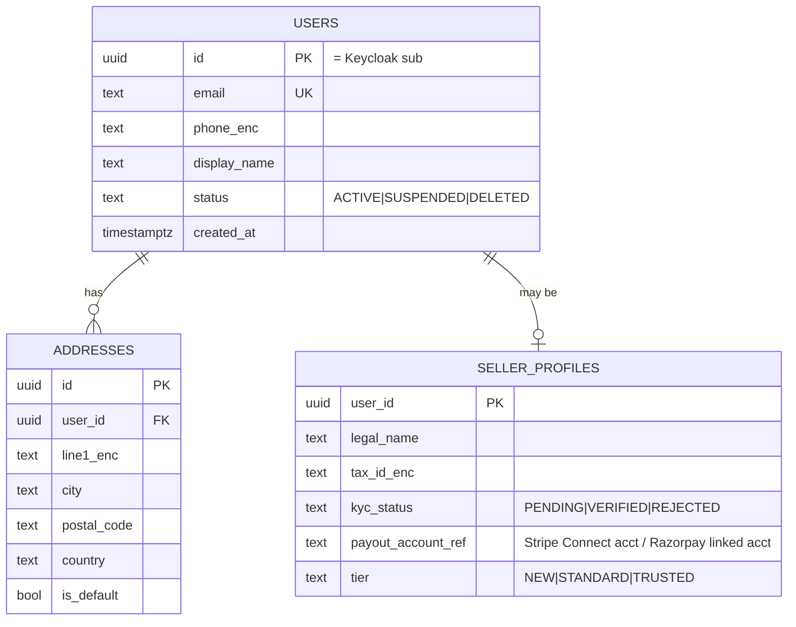
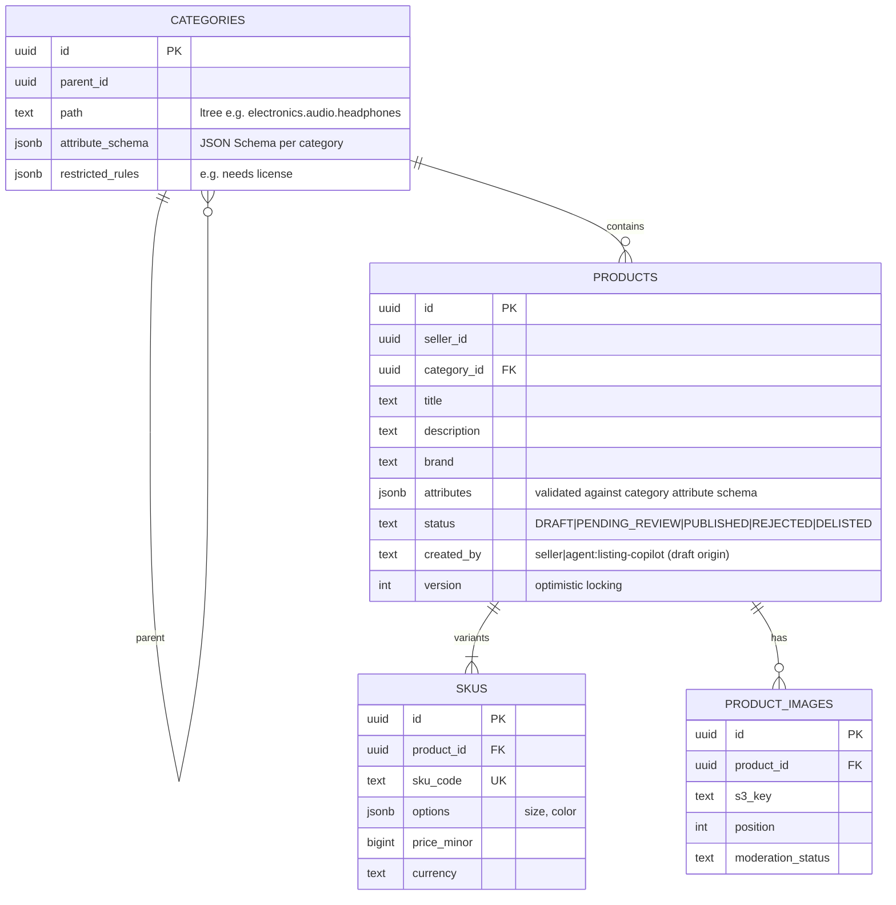
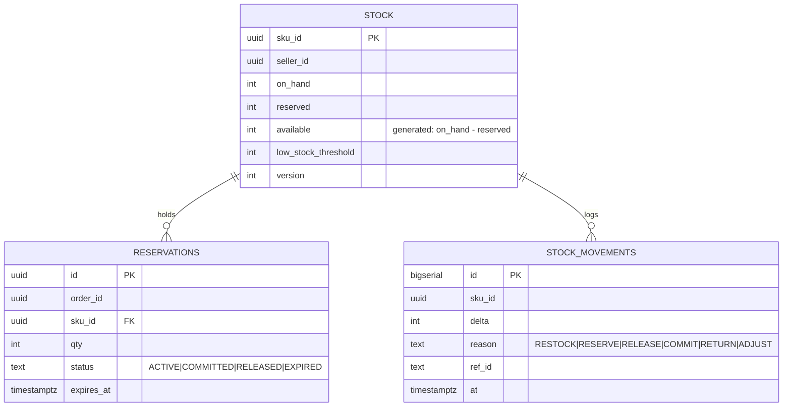
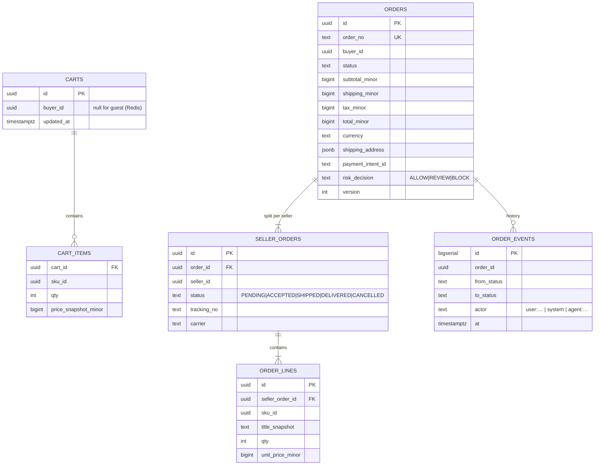
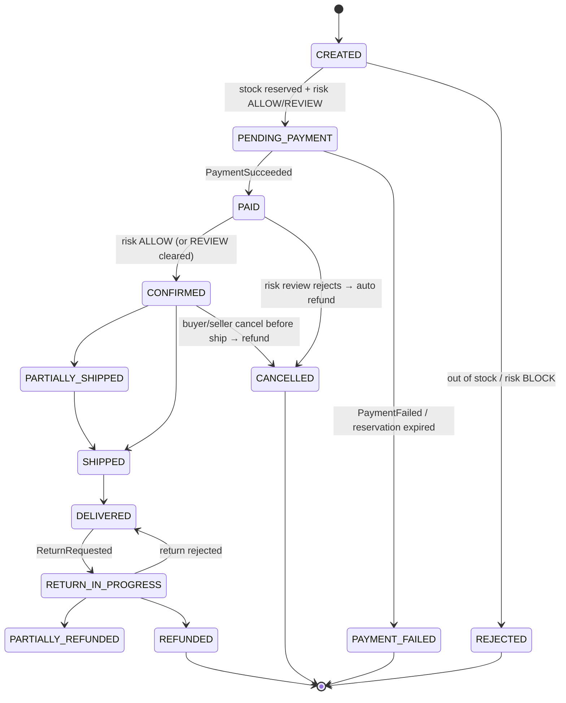
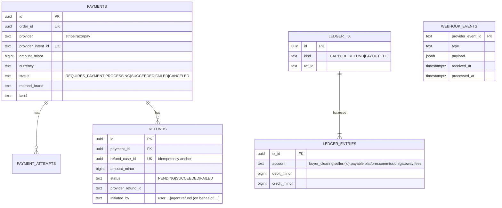
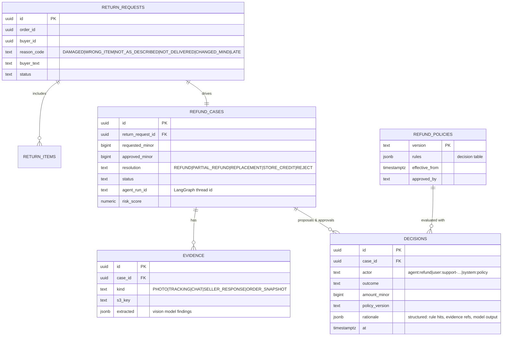
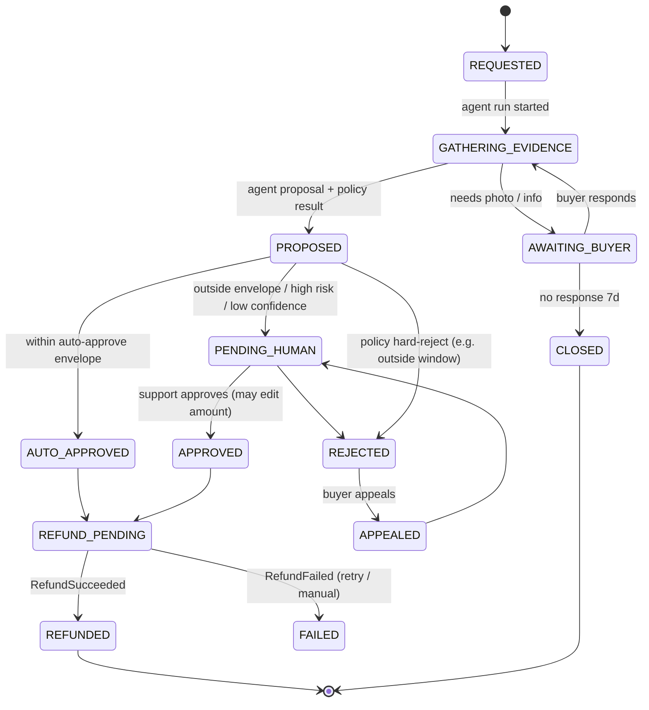
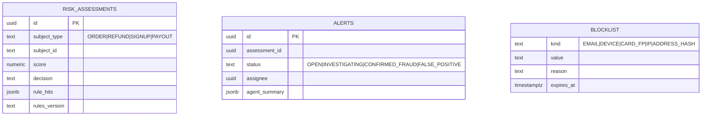
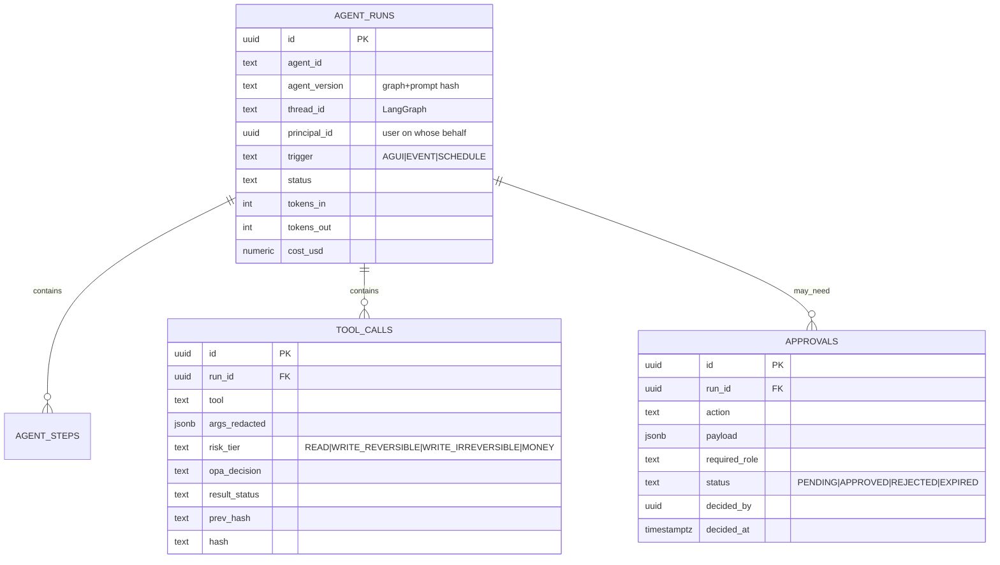

# 2. Low-Level Design

Every backend microservice lives in the **backend repo** at `backend/services/<name>/` and is
independently buildable, testable and deployable. Anatomy (generated by `pnpm gen service <name>` in the
backend repo, or `ac new service <name>` from the platform CLI):

```
backend/services/<service>/
  package.json               # name @ac/<service>, version (semver, per service), "ac" metadata ↓
  README.md                  # service card: owner, purpose, API, events, database, SLOs, runbook
  Dockerfile                 # multi-stage: pnpm deploy --filter @ac/<service> → node:24-alpine runtime
  .env.example               # PORT, DATABASE_URL, KAFKA_BROKERS, OIDC_ISSUERS … (no secrets)
  .env                       # generated locally by `ac configure` (gitignored) — this service's creds only
  src/
    main.ts                  # bootstrapService(AppModule, { name, port }) — Fastify, URI versioning /v1
    app.module.ts            # CoreModule.forService({ name, database: true }) + feature modules
    modules/<feature>/
      <feature>.controller.ts  # HTTP (thin)
      <feature>.service.ts     # use cases (transactions here)
      <feature>.repository.ts  # TypeORM repository / query builder
      entities/*.entity.ts
    events/consumers/*.ts    # EventConsumerService.subscribe(...) handlers (idempotent)
    migrations/*.ts          # TypeORM migrations for THIS service's database only
  test/                      # unit + Testcontainers integration tests
```

`"ac"` metadata in each `package.json` drives the platform tooling (DB/role creation, Kong routes,
Helm values via `ac k8s values`, CI matrix):

```jsonc
"ac": { "kind": "service", "port": 4102, "database": "ac_catalog", "owner": "team-catalog",
        "publishes": ["catalog.events"], "consumes": ["admin.events"] }
```

Shared libraries in `backend/libs/` (versioned with Changesets):

| Library | Published to registry? | Purpose |
|---|---|---|
| `@ac/contracts` | **yes** (frontend consumes it) | zod DTOs + CloudEvents schemas, `TOPICS`, `parseEvent` |
| `@ac/money` | **yes** | integer minor units + currency, allocation, formatting |
| `@ac/nest-common` | no (backend-internal) | `bootstrapService`, `CoreModule` (DB, JWT guard, `/health`, `/v1/whoami`, idempotency, outbox relay, consumers), `ZodPipe`, decorators |
| `@ac/kafka` | no | lazy-loaded Confluent Kafka client (producer/consumer) |

Kubernetes resources per service (chart `agentic-commerce`, namespace `ac-apps`; generated from the metadata):

| Resource | Name | Notes |
|---|---|---|
| Deployment + Service | `<service>` (e.g. `catalog`, port from `ac.port`) | image `ghcr.io/<owner>/ac/<service>:<tag>` (tag from `deploy/envs/<env>.tags.json`), non-root, readiness/liveness `GET /health`, requests/limits |
| Secret | `svc-<service>` | its own `DATABASE_URL` + only the secrets listed in `ac.secrets` (`ac k8s secrets <env>`) |
| Env (shared, non-secret) | chart `serviceEnv` (inline in each Deployment) | `KAFKA_BROKERS`, `OIDC_ISSUERS`, `OIDC_JWKS_REWRITE`, `OPA_URL`, `OPENSEARCH_URL`, `KONG_URL`, `MODEL_*` … |
| NetworkPolicy | `services-from-edge` (selects `ac/tier: service`) | ingress only from `edge` |
| Kong route | `/api/<service>` → `http://<service>.ac-apps.svc.cluster.local:<port>` | generated by `ac kong --k8s` |
| Database | `ac_<db>` / role `svc_<db>` in `ac-infra` Postgres | created by the `db-bootstrap` Helm hook Job |

Isolation rules: a service connects only with its own `DATABASE_URL` (database `ac_<db>`, role
`svc_<db>`); calls other services only through Kong (`/api/<service>/v1/...`) with timeouts and circuit
breakers; publishes only to its own topic. See [07-microservices.md](07-microservices.md).

### Shared mechanisms

**Idempotency interceptor** — any `POST` that creates money/stock effects requires `Idempotency-Key`.

```sql
CREATE TABLE idempotency_keys (
  key            text PRIMARY KEY,
  principal_id   uuid NOT NULL,
  request_hash   text NOT NULL,          -- sha256 of method+path+body
  status         text NOT NULL,          -- IN_PROGRESS | COMPLETED
  response_code  int,
  response_body  jsonb,
  created_at     timestamptz DEFAULT now()
);  -- TTL 24h via pg_cron
```
Same key + same hash → replay stored response; same key + different hash → `422`.

**Transactional outbox**

```sql
CREATE TABLE outbox (
  id            uuid PRIMARY KEY,         -- becomes CloudEvent id
  aggregate_id  text NOT NULL,            -- Kafka partition key
  topic         text NOT NULL,
  type          text NOT NULL,
  payload       jsonb NOT NULL,
  headers       jsonb NOT NULL DEFAULT '{}',
  created_at    timestamptz NOT NULL DEFAULT now(),
  published_at  timestamptz
);
CREATE INDEX outbox_unpublished ON outbox (created_at) WHERE published_at IS NULL;
```
Business row + outbox row written in **one transaction**; relay publishes and marks `published_at`.
Consumers store `event_id` in `processed_events` within their own transaction (exactly-once effect).

---

## 2.1 User Service

**Responsibilities:** profile, addresses, roles mirror, seller onboarding (business details, KYC status,
payout account link), GDPR export/erase. Credentials, MFA, social login live in **Keycloak**.



| API | Notes |
|---|---|
| `GET /v1/users/me`, `PATCH /v1/users/me` | |
| `POST /v1/users/me/addresses` … | |
| `POST /v1/sellers/onboard` | Creates seller profile, starts Stripe Connect onboarding link |
| `POST /v1/users/me/export`, `DELETE /v1/users/me` | GDPR; async job, emits `UserErasureRequested` |
| Keycloak webhook / event listener → `POST /internal/users/sync` | Creates user row on first login, emits `UserRegistered` |

PDF's `POST /register` and `POST /login` are delegated to Keycloak's hosted flows (safer, MFA for free).

---

## 2.2 Catalog Service



| API | Auth | Notes |
|---|---|---|
| `GET /v1/products/{id}` | public | Redis cache-aside `product:{id}` TTL 10 min, invalidated on update event |
| `GET /v1/categories` | public | cached 1 h |
| `POST /v1/products` | seller | creates `DRAFT` |
| `PATCH /v1/products/{id}` | seller (owner) | `If-Match: version` |
| `POST /v1/products/{id}/submit` | seller | → `PENDING_REVIEW`, emits `ProductSubmitted` (triggers moderation agent) |
| `POST /v1/uploads/images` | seller | returns S3 presigned POST; Lambda/BullMQ job creates thumbnails (sharp) |

**Lifecycle:** `DRAFT → PENDING_REVIEW → PUBLISHED | REJECTED`; `PUBLISHED → DELISTED`.
Publishing emits `ProductPublished`, consumed by Search (index) and Next.js revalidation webhook.

---

## 2.3 Search Service

**Index mapping (OpenSearch 3):**
```jsonc
{
  "settings": { "index.knn": true, "analysis": { /* edge_ngram for autocomplete, synonyms */ } },
  "mappings": { "properties": {
    "productId": {"type":"keyword"}, "title": {"type":"text","fields":{"ac":{"type":"text","analyzer":"autocomplete"}}},
    "description": {"type":"text"}, "brand": {"type":"keyword"}, "categoryPath": {"type":"keyword"},
    "attributes": {"type":"flat_object"}, "price": {"type":"long"}, "inStock": {"type":"boolean"},
    "rating": {"type":"float"}, "sellerTier": {"type":"keyword"},
    "embedding": {"type":"knn_vector","dimension":512,"method":{"engine":"faiss","name":"hnsw","space_type":"innerproduct"}}  // OpenAI embeddings are unit-normalised → inner product = cosine
  }}
}
```
- Embeddings: `text-embedding-3-small` with `dimensions: 512` over `title + brand + key attributes`,
  computed by the indexer consumer (batched, cached by content hash).
- **Hybrid query:** OpenSearch search pipeline with `hybrid` query (BM25 `multi_match` + `knn`) and
  normalization processor (min-max, weights 0.6/0.4). Filters (category, price, brand, inStock) apply to both.
- **Query understanding (optional step):** for queries with ≥ 4 words, a `gpt-4.1-mini` call with
  structured output turns *"waterproof running shoes under 3000 for women"* into
  `{text:"waterproof running shoes", filters:{price_lte:300000, gender:"women"}}`. Hard timeout 400 ms,
  result cached in Redis by normalized query; fall back to plain hybrid on timeout.

| API | Notes |
|---|---|
| `GET /v1/search?q=&category=&price_min=&price_max=&brand=&sort=&page=` | p95 target 150 ms |
| `GET /v1/search/suggest?q=` | edge-ngram, p95 50 ms |

**Indexer:** consumes `catalog.events` and `inventory.events` (`inStock` flag only), upserts by
`productId` with `version` as external version (out-of-order safe). Full reindex job uses alias swap.

---

## 2.4 Inventory Service



**Reservation algorithm (no overselling)** — `POST /v1/reservations` with `{orderId, lines[], ttlSec}`:

```sql
BEGIN;
-- lines sorted by sku_id to avoid deadlocks
UPDATE stock
   SET reserved = reserved + $qty, version = version + 1
 WHERE sku_id = $sku AND on_hand - reserved >= $qty
RETURNING sku_id;                      -- 0 rows → insufficient stock → ROLLBACK, 409 with sku list
INSERT INTO reservations (...) VALUES (..., now() + interval '15 minutes');
INSERT INTO stock_movements (...);
INSERT INTO outbox (... 'inventory.stock_reserved.v1' ...);
COMMIT;
```
- All-or-nothing across lines; the conditional `UPDATE` is atomic per row under READ COMMITTED.
- **Commit** on `PaymentSucceeded`: `on_hand -= qty, reserved -= qty`, reservation `COMMITTED`.
- **Release** on `PaymentFailed` / `OrderCancelled` / expiry: `reserved -= qty`.
- **Expiry sweeper:** BullMQ repeatable job every 30 s: `SELECT … WHERE status='ACTIVE' AND expires_at < now() FOR UPDATE SKIP LOCKED LIMIT 500`.
- **Flash-sale hot SKU protection:** a Redis Lua "admission token" counter per hot SKU (`DECR` if > 0)
  in front of Postgres to shed load early; Postgres remains the source of truth (token is returned on
  failure). Only enabled for SKUs flagged `hot`.
- **Display stock:** `InventoryUpdated` events refresh `stock:{sku}` in Redis; PDP shows "In stock / Only
  3 left" from cache — never used for decisions.

| API | Notes |
|---|---|
| `GET /v1/inventory/{skuId}` | from Redis, fallback DB |
| `POST /v1/reservations` | internal (Order Service), idempotent on `orderId` |
| `POST /v1/reservations/{orderId}/commit` / `release` | internal, also triggered by events |
| `PUT /v1/sellers/me/stock/{skuId}` | seller restock/adjust → movement + `InventoryUpdated`, `LowStock` |

**As built (P2, 2026-10-24):** SKU = catalog **offer** id (`catalog.offer_created.v1` creates the stock row). A
reservation is one `reservations` row per order (`ACTIVE|COMMITTED|RELEASED|EXPIRED`, `expires_at`) plus
`reservation_lines (order_id, sku_id, qty)`; `stock_movements` records `delta_on_hand`/`delta_reserved` with reasons
`SEED|LISTED|RESTOCK|ADJUST|RESERVE|RELEASE|EXPIRE|COMMIT|RETURN`. Endpoints: `POST /v1/internal/reservations`
(role `service`), `POST /v1/internal/reservations/{orderId}/commit|release`, public `GET /v1/stock?skuIds=`. The expiry
sweeper is an in-process interval (30 s, `SKIP LOCKED`, safe with replicas) instead of BullMQ. Cancelling an order
after payment returns the committed units (`RETURN`). Not built yet: the Redis admission token for hot SKUs and the
Redis display-stock cache — the flash-sale test shows Postgres alone keeps 0 oversell at 1,000 concurrent requests,
with p95 ≈ 19 s on a laptop because all requests serialise on one row (the admission token is the fix for latency).

---

## 2.5 Order Service (cart · checkout · order lifecycle)



**Order state machine**



Transitions are guarded in code by a transition table (`allowed[from] ⊇ to`) and `version` check;
every transition writes `order_events` + outbox.

**Checkout saga (orchestrated by Order Service)** — `POST /v1/checkout` (`Idempotency-Key` required):

| Step | Action | Compensation |
|---|---|---|
| 1 | Load cart, re-price from Catalog (price snapshot), compute tax/shipping | — |
| 2 | Create `ORDER(CREATED)` + seller sub-orders | mark `REJECTED` |
| 3 | `Fraud.score(order)` (sync, 300 ms timeout, default `REVIEW` on timeout) | — |
| 4 | `Inventory.reserve(orderId, lines, ttl=15m)` | `Inventory.release(orderId)` |
| 5 | `Payment.createIntent(orderId, amount)` → `clientSecret` | cancel intent |
| 6 | Return `{orderId, clientSecret}`; status `PENDING_PAYMENT` | expiry → release + `PAYMENT_FAILED` |
| 7 (async) | `PaymentSucceeded` → `PAID`; Inventory commits; if risk `ALLOW` → `CONFIRMED` + `OrderConfirmed` | refund on later cancel |

| API | Notes |
|---|---|
| `GET /v1/cart`, `POST /v1/cart/items`, `PATCH/DELETE /v1/cart/items/{skuId}` | Guest cart in Redis `cart:guest:{sid}` (7 d TTL), merged on login |
| `POST /v1/checkout` | saga above |
| `GET /v1/orders`, `GET /v1/orders/{id}` | buyer |
| `POST /v1/orders/{id}/cancel` | buyer before ship |
| `GET /v1/sellers/me/orders`, `POST /v1/seller-orders/{id}/ship` | seller (tracking no.) |

**As built (P2, 2026-10-24):** carts live in the order database — `cart_items` by buyer sub, `guest_cart_items` by a
32-hex `X-Cart-Session` id with a 7-day sliding TTL (Redis was dropped: the ioredis peer creates a second TypeORM
instance); `POST /v1/cart/merge` after sign-in. Cart lines are re-priced live (catalog `GET /offers?ids=`, inventory
`GET /stock`) and show `OK|PRICE_CHANGED|LOW_STOCK|OUT_OF_STOCK|UNAVAILABLE`; shipping ₹40 per seller below ₹499; GST
is included in prices. Checkout also needs `expectedTotalMinor` (409 `TOTAL_CHANGED` when prices moved). The order is
written in `CREATED` before scoring so rejected attempts are auditable (`REJECTED`, hidden from buyers). Seller
sub-orders use `PENDING_PAYMENT → CONFIRMED → SHIPPED → DELIVERED | CANCELLED`; the order rolls up to
`PARTIALLY_SHIPPED`/`SHIPPED`/`DELIVERED`. A demo carrier delivers `DEMO_DELIVERY_MINUTES` (3) after shipping. A failed
or expired payment puts the lines back in the cart. `GET /v1/orders/{id}` also accepts the order number. Calls to
catalog/fraud/inventory/payment use `ServiceClient` (`@ac/nest-common`, client-credentials token, breaker) declared in
`"ac": { "calls": [...] }`.

---

## 2.6 Payment Service (+ ledger, payouts)



- **Initiate:** `POST /internal/payments` (from Order) → Stripe `PaymentIntent` (idempotency key =
  orderId) → returns `clientSecret`. Razorpay: create order → `razorpay_order_id`.
- **Truth = webhooks:** `POST /v1/webhooks/stripe` verifies signature, inserts into `webhook_events`
  (PK dedupe), returns 200, BullMQ job processes → `payments.status` + ledger + outbox
  `PaymentSucceeded/Failed`. PDF's `POST /payments/verify` becomes Razorpay signature verification only.
- **Refund execution:** `POST /internal/refunds` `{refundCaseId, amount, reason}` — only callable with
  scope `refunds:execute` (Returns service or the refund agent's exchanged token *with* an approval
  reference). Checks `sum(refunds) + amount ≤ captured`. Idempotent on `refundCaseId`.
- **Ledger:** every capture/refund/payout creates a balanced transaction (`Σdebit = Σcredit`, enforced
  by a deferred constraint trigger). Seller payable = commission-adjusted capture minus refunds.
- **Payouts:** weekly BullMQ job → Stripe Connect transfers / Razorpay Route, hold period (e.g. 7 days
  after delivery) to cover returns.
- **Reconciliation:** nightly job compares gateway balance transactions with the ledger; diffs raise
  `FinanceAlert`.

### As built (P2, 2026-10-24)

- **Providers:** `testpay` (built-in TEST gateway, always available; cards `4242 4242 4242 4242` ok, `…0002` declined,
  `…9995` insufficient funds) and `stripe` (test mode, only when `STRIPE_SECRET_KEY`/`STRIPE_WEBHOOK_SECRET`/
  `STRIPE_PUBLISHABLE_KEY` are set). Razorpay is not built yet. [ADR 0014](adr/0014-testpay-and-webhook-truth.md).
- **APIs:** `POST /v1/internal/payments` and `POST /v1/internal/refunds` (realm role `service`), buyer
  `GET /v1/payments/:id` + `POST /v1/payments/:id/testpay` (202, brand + last 4 only), public
  `POST /v1/webhooks/testpay|stripe`.
- **Webhooks:** HMAC-SHA256 over the raw body (`t=…,v1=…`, 5-minute tolerance) → `webhook_events` inbox keyed by
  `(provider, provider_event_id)`; processed in the same transaction (no BullMQ). Replays → 200 no-op.
- **Ledger accounts:** `gateway:clearing`, `seller:<id>:payable`, `platform:shipping`, `platform:fees`,
  `tax:gst_payable`, `suspense:unallocated` (capture before order lines). Every transaction is balanced (checked in
  code before insert; unit-tested); the finance dashboard checks Σdebit = Σcredit. `order_fees.reversed_at` marks
  fees reversed by a cancellation before shipping.
- **Cancellation:** consumes `order.cancelled.v1` → paid: full refund (idempotent on the order) + fee reversal;
  unpaid: session `CANCELED`; success after cancellation: captured then refunded automatically.
- **Expiry:** in-process sweeper every 30 s cancels `REQUIRES_PAYMENT` sessions past `expires_at`.
- **Not yet:** payouts job, reconciliation, Stripe refund webhooks (`charge.refunded` is accepted but ignored —
  refunds are recorded when the API call succeeds), partial-refund fee adjustments.

---

## 2.7 Returns & Refunds Service

The deterministic backbone that the **Refund Agent** operates on.



**Refund case state machine**



**Policy decision table (versioned, deterministic)** — example rows:

| Rule | Condition | Outcome |
|---|---|---|
| R1 | `days_since_delivery > category.return_window` | `REJECT` (hard) unless `reason=DAMAGED` and ≤ 30 d |
| R2 | `reason=NOT_DELIVERED` and carrier says delivered and no photo-on-delivery | `PENDING_HUMAN` |
| R3 | `amount ≤ ₹2,000` and `risk < 0.3` and `buyer.refunds_90d ≤ 2` | auto-approve eligible |
| R4 | `category in (digital, perishable)` | `REPLACEMENT` or `STORE_CREDIT` only |
| R5 | `seller.tier = TRUSTED` and seller disputes within 48 h | `PENDING_HUMAN` |
| R6 | `buyer.refund_rate_180d > 30 %` | `PENDING_HUMAN` + fraud alert |

The **LLM never overrides a hard rule**; it classifies, extracts evidence and proposes within the
outcomes the rules allow.

| API | Notes |
|---|---|
| `POST /v1/returns` | buyer; creates request + case, emits `ReturnRequested` → agent run |
| `GET /v1/returns/{id}` | buyer timeline |
| `POST /v1/refund-cases/{id}/evidence` | presigned upload |
| `POST /internal/refund-cases/{id}/proposal` | agent-only scope `refunds:propose` |
| `POST /v1/refund-cases/{id}/approve` / `reject` | staff `support` role; amount > ₹25k requires `finance` second approver (dual control) |
| `POST /internal/refund-cases/{id}/execute` | system/agent with `refunds:execute:auto` *only* if case is `AUTO_APPROVED` |

### As built (P3, 2026-10-24)

- **Tables (own DB `ac_returns`):** `return_requests` (+ `snapshot` jsonb: order status, captured total, seller, carrier,
  delivered date, **city + pincode only**, orders in 180 d; `signals`), `return_items`, `refund_cases` (extended: `version`,
  `resolution`, `policy` jsonb + `policy_version`, `dual_control`, `first_approver`/`first_approval`, `refund_id`,
  `explanation`), `evidence` (PHOTO in MinIO bucket `ac-returns` + TRACKING / ORDER_SNAPSHOT / BUYER_TEXT facts),
  `decisions` (every transition: actor, outcome, amount, note, from → to), `refund_policies` (versioned, one active;
  v1 seeded), `proposals` (agent proposals **kept apart from decisions**, `mode` SHADOW | RECOMMEND | LIVE, unique per run).
  Statuses gained `FAILED` and `APPEALED`; `decided_by` gained `policy`.
- **Policy v1 (pure `evaluatePolicy`, 30+ table-driven tests):** R1 window per category (electronics 7 d, fashion 10, home 10,
  grocery 0 — DAMAGED/WRONG_ITEM ≤ 3 d, beauty 7, books 10, jewellery 7, outdoor 10, default 10; DAMAGED/WRONG_ITEM ≤ 30 d;
  not for NOT_DELIVERED/LATE) · R2 not delivered + carrier delivered + no photo → human · R3 envelope ≤ ₹2,000, risk < 0.3,
  ≤ 2 refunds/90 d · R4 grocery → replacement/store credit · R5 seller disputes (inactive: no data) · R6 refund rate > 30 % →
  human · R7 > ₹25,000 → dual control · R8 `injection_attempt` / `reused_photo` signals → human · R9 beauty changed-mind:
  unopened only. Allowed outcomes per reason (e.g. LATE → partial refund or store credit). A hard rule always wins.
- **Default path (agent at L1):** the service evaluates the policy itself with a returns-local risk heuristic (fraud has no
  refund scoring yet): hard reject → `REJECTED` + buyer explanation (appealable → `APPEALED` → `PENDING_HUMAN`), everything
  else → `PENDING_HUMAN` (support). Requests > 90 days after delivery are refused (`OUTSIDE_WINDOW`).
- **Order data:** fetched at request time from the order service with the **buyer's own token** (ownership enforced
  twice); categories from catalog `GET /products/:id`; captured = order total for paid orders; refunded = this service's
  approved refunds on the order (payment has no per-order read API yet). The agent context is served from the snapshot.
- **Agent proposals:** the service re-evaluates the policy (risk = max(agent, local)) and never trusts the agent's claims.
  SHADOW → stored only (admin + shadow report; invalid ones are stored with `violations`); RECOMMEND/LIVE → shown to support,
  422 if outside the policy, 409 on a stale `version`; LIVE auto-approves only if R3 holds, outcome is a refund, confidence
  ≥ 0.8 and no human has acted. Internal endpoints accept realm role `service` or agent tokens (`act.sub = agent:*`) with
  `refunds:read` / `refunds:propose` / `refunds:execute`.
- **Execution:** `AUTO_APPROVED | APPROVED → REFUND_PENDING` → payment `POST /v1/internal/refunds` (idempotent on the case)
  → `payment.refunded.v1` → `REFUNDED` (matched by refund id, else order + amount); payment errors → `FAILED` (retryable).
  Replacement / store credit → `CLOSED` (replacement orders and the wallet are not built yet).
- **Events:** `returns.return_requested.v1`, `returns.case_proposed.v1`, `returns.case_decided.v1`, `returns.refund_executed.v1`.
- **Shadow report:** latest SHADOW proposal vs final human outcome (amount agreement ±5 %), by reason, with disagreements;
  the seed adds 40 modelled cases (7 disagreeing) so it has data.

---

## 2.8 Fraud Service

- **Rules engine** (`json-rules-engine`, rules stored versioned in DB, hot-reloaded): velocity
  (orders/cards/addresses per hour per user/IP/device), mismatched billing/shipping country, new account +
  high value, disposable email, BIN country vs IP country, refund abuse ratio, seller self-purchase.
- `POST /internal/risk/score` → `{score 0..1, decision ALLOW|REVIEW|BLOCK, hits[]}` p95 < 100 ms (Redis
  counters for velocity via sliding windows).
- Emits `FraudAlertRaised` for REVIEW/BLOCK → triggers the **Fraud Investigation Agent**; analyst
  decisions feed back as labeled data (future ML model — PDF says "no ML yet").



---

## 2.9 Notification Service

- Consumes events → resolves template (`order.confirmed`, `refund.approved`, `seller.new_order`, …) →
  channels by user preference → BullMQ per-channel queues with retry/backoff → SES / Twilio / FCM;
  in-app notifications in Postgres + SSE to Next.js.
- Templates in React Email (shared with FE design system). Optional **Notification Composer** agent fills
  *only* designated free-text slots (e.g. apology line for a delayed order) — see agentic doc.
- Dedupe key = `eventId + channel`. Quiet hours and rate caps per user.

**As built (P2):** consumes `order.events` + `payment.events` (`order.confirmed/shipped/delivered/cancelled`,
`payment.failed/refunded`) → `notifications` rows, one per event × channel (`in_app` always, `email` when the order's
`notifyEmail` is known — remembered in `order_contacts`), `UNIQUE(event_id, channel)`. The table is the email outbox:
a sender loop (2 s) delivers over SMTP (`SMTP_URL`; Mailpit locally) with exponential backoff, `FAILED` after 5
attempts. Plain HTML/text templates (escaped, ₹ en-IN) instead of React Email for now; no SMS/push, preferences,
quiet hours or SSE yet; no SMTP in k8s yet (in-app only there).

---

## 2.10 Admin Service

- **Moderation queue:** products in `PENDING_REVIEW` with Moderation Agent's verdict, reasons, and
  highlighted spans/images; admin actions `approve|reject|request_changes` emit `ModerationDecided`.
- **Disputes:** buyer↔seller disputes (from rejected refunds/appeals, seller chargeback disagreements)
  with Dispute Agent summary + recommended resolution; admin decides.
- **Seller sanctions:** warnings, listing limits, payout holds, suspension.
- **Agent oversight console:** live runs, pending HITL approvals, per-agent metrics (auto-approval
  rate, override rate, cost), **kill switch** & autonomy level per agent, policy version management.

---

## 2.11 Seller Analytics Service

- CQRS read model fed by `order.events`, `payment.events`, `inventory.events`, `returns.events`:
  `daily_sales(seller_id, sku_id, day, units, gross, refunds)`, `payout_summary`, `stock_snapshot`.
- `GET /v1/sellers/me/analytics/sales?from&to&granularity`, `/top-products`, `/payouts`,
  `/restock-suggestions` (simple moving-average days-of-cover; agent explains & what-ifs on top).
- Read-only Postgres role; also the data source for the Seller Insights agent's SQL tools (through
  parameterized, allow-listed queries — never free-form SQL).

---

## 2.12 Agent Service (LLD summary — details in [03-agentic-ai.md](03-agentic-ai.md))

```
backend/services/agents/src/
  gateway/
    agui.controller.ts         # POST /v1/agents/:agentId/run → SSE (RunAgentInputSchema, EventEncoder); per-agent auth
    agents.controller.ts       # GET /v1/agents — registry + effective autonomy
    budget.service.ts          # per-principal daily run budget (in-memory now → Redis before >1 replica)
    auth/token-exchange.ts     # (P3) user JWT → scoped agent token (Keycloak RFC 8693)
  runtime/
    agent-runtime.service.ts   # compiles graphs with PostgresSaver (ac_agents), streams updates → AG-UI events,
                               # native interrupts (RUN_FINISHED outcome "interrupt"), resume via Command
    context.ts                 # per-run context registry (token never checkpointed) + toolkit(cfg).call()
    models.ts · prompting.ts   # env-pinned model tiers · untrusted() wrapper, injection heuristics
    graphs/index.ts            # registry (markers for `pnpm gen agent`)
    graphs/<agent>/agent.config.ts · graph.ts · prompts/
    triggers/*.consumer.ts     # (P3) Kafka-triggered runs (ReturnRequested, FraudAlertRaised, ProductSubmitted)
  tools/
    define-tool.ts · registry.ts · invoke-tool.ts   # zod → kill switch → OPA → handler → audit → AG-UI tool events
    definitions/*.ts           # one tool per file
    clients/*.client.ts        # typed HTTP clients → Kong /api/<service>/v1 (agent token + Idempotency-Key)
  governance/
    opa.client.ts              # POST /v1/data/agents/tools/decision (fail closed)
    killswitch.service.ts      # autonomy level per agent (env now → Admin config/Redis later)
    audit.service.ts           # append-only hash-chained tool_calls in ac_agents (+ daily export to MinIO, copied off-box)
  evals/run.ts                 # offline eval runner (datasets in backend/evals/<agent>/)
```

Policies (`backend/policies/agents/*.rego` + `data.json`) are owned by the backend repo next to the
agents service and loaded by the OPA container from the platform compose stack. The agents service
**does not call other services directly**: tool clients go through Kong like any other consumer.



