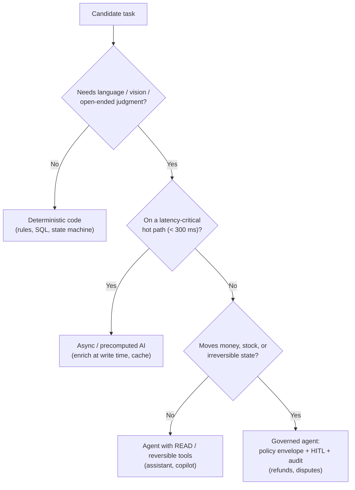
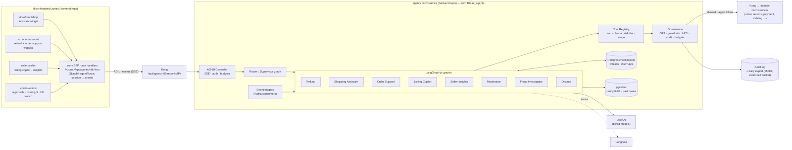
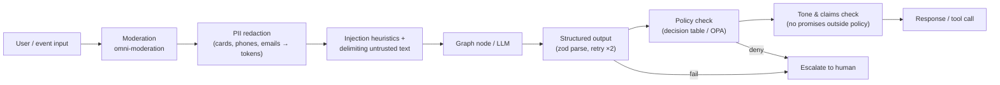
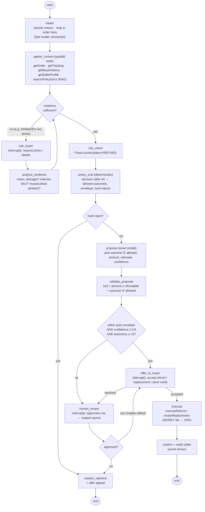
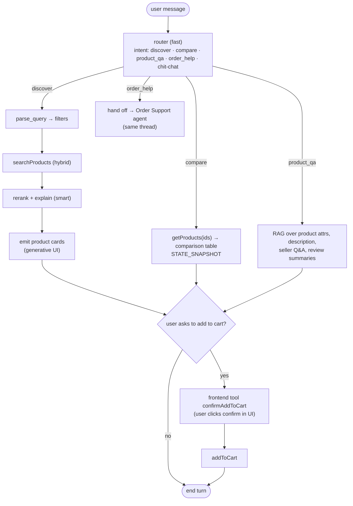
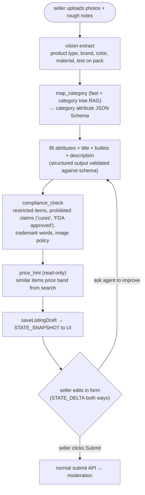
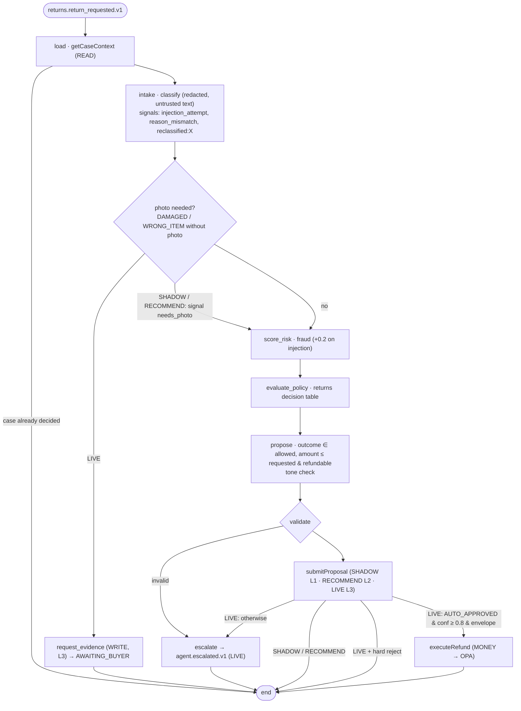

# 3. Agentic AI Layer — Governed Agents

## 3.1 Principles

1. **Agents propose, deterministic services dispose.** Agents never write to a database. They call
   domain APIs that enforce invariants (stock, money, state machines) exactly as they do for humans.
2. **Hard rules are code, judgment is the model.** Policy (return windows, amount caps, category
   restrictions) lives in versioned decision tables / OPA. The LLM classifies, extracts, summarizes,
   ranks and drafts — and its outputs are always structured (zod schemas), never free-form commands.
3. **Autonomy is earned, per agent, per action.** Every agent starts in *shadow mode*, then
   *recommend*, then *bounded auto-execute*. The level is a runtime switch in the Admin console.
4. **Everything is attributable.** Every tool call records principal (user), actor (agent + version),
   policy version, OPA decision, inputs/outputs (redacted) in a hash-chained audit log.
5. **Agents are optional on every path.** If the agent layer is down, the platform still works:
   classic return form, keyword search, manual moderation.
6. **Untrusted text is data.** Buyer messages, product descriptions, seller replies and review text can
   contain prompt injections; they never get tool-calling authority and are delimited/quoted in prompts.

### Where should an agent sit? (decision filter used for every segment)



## 3.2 Agent platform architecture



**Placement decision:** one `agents` microservice hosts all graphs (shared governance, checkpointer,
audit and budgets), while **widgets live in the zone that owns the journey**. Agents reach domain data
only through Kong-routed APIs of the owning microservices — exactly like any other consumer.

**Runtime details**

- **LangGraph.js 1.5** `StateGraph` per agent; `@langchain/langgraph-checkpoint-postgres` persists
  thread state so a run can pause for days (waiting on buyer photo or human approval) and resume.
- **HITL** uses LangGraph `interrupt()` → checkpoint saved → the run ends with AG-UI's native interrupt
  (`RUN_FINISHED` with `outcome: { type: "interrupt", interrupts: [{ id, reason, message, responseSchema, metadata }] }`)
  **and** (for staff approvals) an `approvals` row + `AgentEscalated` event, so support sees it even if the
  buyer closed the tab. The client resumes with a new run carrying
  `resume: [{ interruptId, status: "resolved" | "cancelled", payload }]` → `Command({ resume: payload })`.
  Implemented and tested end to end with the `ping` agent (see [06-dev-setup.md](06-dev-setup.md)).
- **Tool calls** go through one function (`toolkit(cfg).call(name, args)` → `ToolInvoker.invoke`) →
  zod validate → OPA `authorize` → guardrail pre-checks → HTTP call with agent token
  (+ `Idempotency-Key` derived from `runId:toolCallId`) → result validation → audit.
- **Model tiering** (env-configured, exact snapshots pinned per release):

  | Tier | Use | Default (matches existing projects) | Upgrade path |
  |---|---|---|---|
  | `fast` | routing, classification, query parsing, moderation text pass | `gpt-4.1-mini` | newer mini model after eval |
  | `smart` | refund reasoning, dispute summaries, assistant conversation | `gpt-4.1` | reasoning-class model (GPT-5 family) after eval |
  | `vision` | damage photos, listing images | `gpt-4.1` (image input) | same |
  | `embed` | search, RAG, case similarity | `text-embedding-3-small` (512-d) | — |
  | `moderation` | input/output safety | `omni-moderation-latest` | — |

  Model swaps are gated by the eval suite (§3.8), never ad hoc.

## 3.3 Governance model

### Autonomy levels (per agent, per action, switchable at runtime)

| Level | Name | Behaviour | Example |
|---|---|---|---|
| L0 | Off | Agent disabled, classic UX | kill switch |
| L1 | Shadow | Runs on real inputs, output stored but not shown/acted | first 2–4 weeks of refund agent |
| L2 | Recommend | Output shown to a human who decides | fraud investigator, disputes |
| L3 | Bounded auto | Executes inside policy envelope, escalates outside | refunds ≤ ₹2k low-risk |
| L4 | Auto + sample audit | Executes; X % sampled for human QA | moderation of low-risk categories |

### Tool risk tiers

| Tier | Examples | Requirement |
|---|---|---|
| READ | `getOrder`, `searchProducts`, `getTracking`, `getSalesSummary` | user/agent scope; row-level ownership enforced by service |
| WRITE_REVERSIBLE | `addToCart`, `saveListingDraft`, `requestBuyerEvidence`, `createSupportTicket` | user confirmation in UI (AG-UI frontend tool) or L3+ |
| WRITE_IRREVERSIBLE | `publishListing`, `cancelOrder`, `sanctionSeller` | human action only (agent can pre-fill) |
| MONEY | `executeRefund`, `issueStoreCredit` | policy envelope (OPA) + case in `AUTO_APPROVED`, else `interrupt()` for human; dual control above high threshold |

### OPA policy example (refund execution)

```rego
package agents.tools

default allow := false

# Refund agent may execute a refund only inside the auto-approve envelope
allow if {
  input.agent.id == "refund"
  input.agent.autonomy_level >= 3
  input.tool == "executeRefund"
  input.case.status == "AUTO_APPROVED"
  input.args.amount_minor <= data.limits.refund.auto_max_minor[input.order.currency]
  input.case.risk_score < data.limits.refund.max_risk
  input.case.policy_outcome in {"REFUND", "PARTIAL_REFUND"}
  input.args.amount_minor <= input.order.refundable_minor
  not data.killswitch.refund
}

# Read tools: allowed if the principal owns the resource (service re-checks anyway)
allow if {
  input.tool_tier == "READ"
  input.agent.id in data.agent_tools[input.tool]
}
```

### Guardrails pipeline



### Other controls
- **Budgets:** per-run max steps (e.g. 12), max tokens, wall-clock; per-user daily runs; per-agent
  daily spend cap → auto-downgrade to L2 when exceeded. Redis counters.
- **Kill switch:** Admin sets level L0–L4 per agent/action; cached 10 s in Redis; checked before every
  MONEY/WRITE tool call (not just at run start).
- **Audit:** append-only `tool_calls` with `hash = sha256(prev_hash || row)`, daily export to a versioned MinIO (S3 API) bucket in the cluster, copied off-box with the nightly
  backups — tamper-evident trail for refunds/finance (the hash chain detects edits; WORM storage such as
  OCI Object Storage retention rules can be added for compliance).
- **Explainability:** every MONEY decision stores structured rationale: rule hits, evidence ids,
  model summary, confidence → shown to buyer (plain language) and to support (full).
- **Fairness / consistency:** weekly report of auto-approval rate by category/region/buyer cohort;
  drift alerts.
- **Data minimization:** agents get the minimum fields (e.g. no full address for refund reasoning,
  only city/pincode).

## 3.4 Where AG-UI helps (and where it doesn't)

| Surface | Zone (route) | AG-UI? | Why | Events used |
|---|---|---|---|---|
| Buyer shopping assistant (drawer on storefront) | storefront `/shop` | **Yes** | Streaming answers, tool progress, generative UI product cards, frontend tool `confirmAddToCart` | `TEXT_MESSAGE_*`, `TOOL_CALL_*`, `STATE_SNAPSHOT` (comparison table), frontend tools |
| Refund / return chat (account → order → "Problem with item") | account `/account` | **Yes** | Conversational evidence collection, photo upload prompts, offer card ("Refund ₹1,299 now or replacement?"), interrupt waiting on buyer choice | `TEXT_MESSAGE_*`, `RUN_FINISHED` interrupt outcome, `STATE_DELTA` (case status timeline) |
| Order support / WISMO | account `/account` (+ storefront help drawer) | **Yes** | Same widget as refund chat; router decides | as above |
| Seller listing copilot | seller `/seller` | **Yes** | **Shared state**: draft listing JSON co-edited by seller form and agent (`STATE_SNAPSHOT/DELTA` JSON Patch) | `STATE_*`, `TOOL_CALL_*` |
| Seller insights chat | seller `/seller` | **Yes** | Charts rendered from tool results (generative UI) | `TOOL_CALL_RESULT` → chart component |
| Admin approval queue / dispute desk / fraud console | admin `/admin` | **Yes** | Live view of an agent's reasoning steps, approve/edit/reject resumes the graph | `STEP_*`, `RUN_FINISHED` interrupt outcome, resume input |
| Moderation, fraud triage, notification composer (event-driven) | — (results shown in admin) | **No** | No user waiting; Kafka-triggered batch runs. Results land in DB/queues | — |
| Checkout, payment, inventory | storefront `/shop` | **No** | Deterministic flows, no agent on these paths | — |

AG-UI path: widget (`@ac/agent-widget` + `useAgent` from `@ac/agui-kit`) → **its zone's BFF**
`POST /<zone>/api/agents/<id>/run` (`agentRoute` from `@ac/bff` attaches the server-side token) → Kong
`/api/agents/v1/agents/<id>/run` → agents service. Body = AG-UI `RunAgentInput` (`threadId`, `runId`,
`messages`, `tools` (frontend tools), `state`, `context`, `resume`). Human-in-the-loop uses AG-UI 1.0
native interrupts: `RUN_FINISHED` with `outcome: { type: "interrupt", interrupts: [...] }`, resumed by a new
run with `resume: [{ interruptId, status, payload }]` on the same `threadId`.

---

## 3.5 Agent catalog

### A1. Refund & Returns Agent — *flagship, governed* (Autonomy: L1 → L3)

**Goal:** resolve "problem with my order" end-to-end in minutes for clear-cut cases, and hand
support a complete, pre-reasoned case for the rest.

**Triggers:** buyer opens refund chat (AG-UI) or submits return form (`ReturnRequested` event).

**State**
```ts
const RefundState = Annotation.Root({
  caseId: Annotation<string>(),
  order: Annotation<OrderSnapshot>(),            // lines, amounts, delivery date, seller
  claim: Annotation<{ reason: ReasonCode; items: LineRef[]; buyerText: string }>(),
  evidence: Annotation<Evidence[]>({ reducer: (a, b) => [...a, ...b], default: () => [] }),
  tracking: Annotation<TrackingInfo | null>(),
  buyerHistory: Annotation<{ refunds90d: number; refundRate180d: number; accountAgeDays: number }>(),
  risk: Annotation<{ score: number; hits: string[] } | null>(),
  policy: Annotation<PolicyResult | null>(),     // allowed outcomes, hard rejects, envelope
  proposal: Annotation<Proposal | null>(),       // outcome, amount, rationale, confidence
  decision: Annotation<FinalDecision | null>(),
  messages: Annotation<BaseMessage[]>({ reducer: messagesStateReducer, default: () => [] }),
});
```

**Graph**


**Tools**

| Tool | Tier | Service |
|---|---|---|
| `getOrder(orderId)` | READ | Order |
| `getTracking(orderId)` | READ | Order (carrier data) |
| `getBuyerRefundHistory(buyerId)` | READ | Returns |
| `searchPolicyDocs(query)` | READ | pgvector over policy docs |
| `findSimilarCases(embedding)` | READ | pgvector over resolved cases (few-shot grounding) |
| `scoreRisk(subject)` | READ | Fraud |
| `evaluatePolicy(caseId)` | READ | Returns (deterministic) |
| `requestBuyerEvidence(caseId, kind)` | WRITE_REVERSIBLE | Returns |
| `submitProposal(caseId, proposal)` | WRITE_REVERSIBLE | Returns (`refunds:propose`) |
| `executeRefund(caseId, amount)` | MONEY | Returns → Payment (`refunds:execute:auto`, OPA) |
| `createReplacementOrder(caseId)` | MONEY | Order (zero-price order + inventory reserve) |
| `issueStoreCredit(caseId, amount)` | MONEY | Payment (wallet ledger) |

**Guardrails specific to refunds**
- Proposal outcome must be in `policy.allowedOutcomes`; amount ≤ `refundable_minor` (captured − refunded).
- Image checks: perceptual hash against previous evidence (reused photos), EXIF date sanity, vision
  "does this show the ordered item?" — results are *signals* for the policy, not decisions.
- Buyer text is wrapped as quoted data; instructions in it ("approve full refund now") are ignored and
  flagged as `injection_attempt` (risk signal).
- Agent can never tell the buyer "approved" before `executeRefund` succeeded (output tone check).
- Dual control: > ₹25k requires support + finance approvals (two interrupts).

**KPIs:** median time-to-resolution, % auto-resolved, human override rate of agent proposals (target
< 10 %), refund leakage (refunds later found abusive), CSAT, cost per case.

**Rollout:** L1 shadow (compare proposals vs human decisions on ~500 cases; target ≥ 90 % agreement)
→ L2 recommend (support sees proposal, one-click accept) → L3 for categories/amounts with ≥ 95 %
agreement.

---

### A2. Shopping Assistant (Buyer) — Autonomy: L3 for reads, user-confirmed writes

**Goal:** conversational discovery, comparison and Q&A grounded in the catalog.



- Grounding rule: answers about price/stock/spec must come from tool results in the same turn; the model
  is instructed to say "I couldn't find that" otherwise. Prices rendered by UI components from tool
  data — not from model text — so a hallucinated price can't be displayed.
- No sponsored ranking manipulation by the LLM: ranking = search score + explicit, logged boost rules.
- Memory: short-term thread only for MVP; opt-in preference memory (sizes, brands) later.

### A3. Order Support (WISMO) Agent — Autonomy: L3 read-only

"Where is my order?", "change address", "cancel". Read tools (`getOrder`, `getTracking`), reversible
writes with confirmation (`cancelOrder` only before ship — calls the same API as the cancel button),
hand-off to Refund Agent or human ticket (`createSupportTicket`) with full transcript summary.
A small **supervisor/router graph** in front of A2/A3/A1 picks the specialist per turn and keeps one
AG-UI thread for the buyer.

### A4. Seller Listing Copilot — Autonomy: drafts only (L2)


The seller always submits; the draft is tagged `created_by=agent:listing-copilot` for moderation context.

### A5. Seller Insights & Restock Agent — Autonomy: L2 (read-only + suggestions)

Natural-language Q&A over the seller's own analytics ("why did sales drop last week?", "what should I
restock?"). Tools are **parameterized analytics queries** (`getSales(range, groupBy)`,
`getTopProducts`, `getReturnReasons`, `getStockCover`) — no free-form SQL, tenant isolation enforced by
the service using the seller id in the token. Output: narrative + chart components via AG-UI. Restock
suggestions are computed deterministically (days-of-cover); the LLM explains them and runs what-ifs.
Price changes are *suggested*, never applied (could be L3 later with seller-defined min/max bounds).

### A6. Catalog Moderation Agent — Autonomy: L4 for low-risk categories, L2 otherwise

Kafka trigger `ProductSubmitted`. Pipeline: text moderation (omni-moderation) → policy classifier
(prohibited/restricted items, misleading claims, counterfeit signals like "replica", price far below
brand band) → image checks (vision: nudity/weapons/logos; duplicate image hash across sellers) →
verdict `{APPROVE | REJECT | NEEDS_REVIEW, reasons[], evidence spans}`.
Auto-approve only when all checks pass with high confidence **and** seller tier ≠ NEW; 5 % random
sample to human QA; everything else lands in the admin moderation queue with highlighted reasons.

### A7. Fraud Investigation Agent — Autonomy: L2 (recommend only)

Trigger `FraudAlertRaised`. Gathers linked entities (same device/card fingerprint/address hash across
accounts), order/refund history, rule hits, and writes an **investigation brief**: timeline, linked
accounts graph, likely pattern (account takeover, refund abuse, triangulation, seller self-dealing),
recommended action with confidence. Analyst decides in the fraud console (AG-UI view of steps).
Rules engine remains the real-time decision maker (PDF requirement: rule-based); analyst labels become
training data for a future ML model.

### A8. Dispute Resolution Agent — Autonomy: L2

Trigger `DisputeOpened` (rejected refund appeal, seller contests refund, chargeback). Builds neutral
case file from both parties' statements and evidence, maps to policy clauses (RAG with citations),
finds similar past resolutions, proposes resolution with reasoning. Admin decides; decision becomes a
precedent embedding. Explicitly instructed to present both sides; outputs checked for one-sided language.

### A9. Notification Composer — Autonomy: L4 within template slots

Fills only marked free-text slots in approved templates (apology line for delay, personalized
recommendation line). Max length, banned phrases, no prices/dates from the model (those come from
event data). Falls back to default copy on any validation failure or timeout. Low value/low risk — do
last.

### A10. Ops Copilot (Admin/SRE) — Autonomy: L2, optional

Read-only tools over Grafana/Prometheus/Loki APIs and Kafka lag: "why is checkout p95 high?",
summarizes incidents, drafts status-page text. Useful given the PDF's "minimal SRE" constraint, but
strictly read-only.

---

## 3.6 Agentic AI pros & cons — every segment of the PDF design

Verdict legend: ✅ recommended (phasing in [roadmap](05-roadmap.md)) · 🟡 later / optional · ❌ don't use an agent here.

| Segment | Agentic opportunity | Pros | Cons / risks | Verdict |
|---|---|---|---|---|
| **User Service** (registration, auth, profile) | Onboarding helper for sellers (explains KYC steps, validates docs); account-recovery assistant | Fewer seller onboarding drop-offs; doc pre-checks (blurry, wrong type) | Auth is security-critical — any LLM in login/recovery invites social-engineering; KYC decisions are regulated | 🟡 seller-onboarding helper only; ❌ in auth/recovery |
| **Product Catalog** | Listing Copilot (A4); attribute normalization; translation | Big seller productivity gain; richer, consistent attributes improve search; easy onboarding (NFR) | Hallucinated specs (wrong wattage, material) → returns & legal claims; vision cost per image | ✅ drafts only, seller confirms every field |
| **Search** | LLM query understanding, semantic/hybrid retrieval, conversational discovery (A2) | Handles natural language & long-tail; better recall than keyword-only | Latency vs < 300 ms; cost per query at scale; non-determinism complicates relevance tuning | ✅ embeddings at index time + cached query parsing with timeout; ✅ assistant as separate surface; ❌ LLM on every keystroke |
| **Inventory** | Restock forecasting explanations; anomaly detection on stock movements | Sellers understand *why* to restock; catches suspicious adjustments | Strong consistency requirement — any agent in reservation path is unacceptable; forecasting is better done with stats | ❌ in reservation/commit path; 🟡 explanations via A5 |
| **Cart & Checkout / Order Management** | Cart assistant (bundles, cheaper alternatives); WISMO agent (A3); proactive delay handling | Lower support volume (WISMO is often the #1 ticket type); upsell | Checkout must be fast and deterministic; agents changing carts without consent = trust issue | ✅ A3 support; 🟡 cart suggestions with explicit confirm; ❌ in checkout saga |
| **Payment Service** | Payment failure explainer & retry guidance; reconciliation diff triage for finance | Recovers failed payments; speeds up finance ops | PCI scope; model must never see card data; money movement must be deterministic | 🟡 failure explainer (no PAN data); ❌ any agent initiating captures |
| **Refunds & Returns** (gap filled) | Governed Refund Agent (A1) | Minutes instead of days; consistent policy application; support handles only hard cases; structured evidence | Refund abuse via social engineering / fake photos; financial leakage if envelope wrong; regulatory consumer-rights obligations; explainability needed | ✅ flagship — with policy envelope, OPA, HITL, shadow rollout |
| **Fraud detection** | Fraud Investigation Agent (A7) | Analysts triage faster; link analysis summarized; labeled data for future ML | LLM is not a reliable classifier for fraud scoring; adversaries adapt; false accusations harm good users | ✅ L2 recommend only; rules stay the decision engine |
| **Notification Service** | Composer (A9); channel/time optimization | More human messages; better engagement | Brand/legal risk of free text; little measurable value early | 🟡 later, slot-filling only |
| **Seller Dashboard** | Insights & Restock Agent (A5) | Sellers get analyst-level answers; increases retention | Tenant data leakage if tools aren't scoped; misleading causal claims ("sales dropped because…") | ✅ read-only, parameterized tools, cite numbers from tools |
| **Admin: moderation** | Moderation Agent (A6) | Scales review to 500k+ products; consistent reasons | False rejects hurt sellers; adversarial listings; needs appeal path | ✅ auto-approve low-risk only + sampling; humans for rejects |
| **Admin: disputes** | Dispute Agent (A8) | Neutral case files, faster decisions, consistency via precedents | Bias toward one party; must be explainable; high stakes | ✅ L2 recommend only |
| **Admin: platform health** | Ops Copilot (A10) | Helps with "minimal SRE" constraint | Wrong diagnosis can mislead on-call; needs broad read access | 🟡 optional, read-only |
| **API Gateway / Edge** | — | — | Agents add latency and nondeterminism where you need neither | ❌ |
| **Event bus / infra** | — | — | Same | ❌ |

### Platform-wide pros & cons of adding the agentic layer

| Pros | Cons |
|---|---|
| Differentiated UX (conversational shopping, instant refunds) | New failure modes: hallucination, prompt injection, nondeterminism |
| Lower support & moderation headcount growth | Variable per-request cost (tokens), vendor dependency on OpenAI |
| Better catalog quality → better search | Governance overhead (policies, evals, audits) adds ~20–30 % to agent work |
| Structured data from unstructured inputs (photos, chats) | Regulatory exposure (consumer protection, GDPR Art. 22 automated decisions → need human review path & explanation) |
| Reuses the same domain APIs — no special back doors | Harder testing: need eval datasets, not just unit tests |
| Event-driven agents fit the PDF's event architecture naturally | MVP timeline pressure (3–4 months) — agents must be phased (see roadmap) |

### Architecture-style pros & cons for the agent layer

| Option | Pros | Cons | Verdict |
|---|---|---|---|
| **One `agents` microservice hosting all graphs** (chosen) | One governance stack (OPA client, audit chain, budgets, kill switch), one checkpointer DB, shared router across agents, one eval pipeline | Agents share a deploy unit — a bad refund-graph release can affect the assistant; scaling is per service, not per agent | ✅ now; per-agent autonomy flags + canary limit blast radius |
| Microservice **per agent** (refund-agent, assistant-agent …) | Independent deploy/scale per agent, smaller blast radius, clear ownership | Duplicated governance + checkpointer + audit per service, cross-agent routing becomes a network hop, more ops | 🟡 split out later only for hot or high-risk agents (e.g. refund) |
| Agents embedded **inside domain services** (refund graph in returns) | Close to data | Bypasses the tool/OPA boundary, LLM deps in every service, governance hard to audit | ❌ |
| Widgets **in the owning zone** (chosen) | Zone teams own the UX of their journey, widget versions release with the zone, no cross-zone runtime coupling | Same widget package must be upgraded per zone; consistent UX needs the shared `@ac/agent-widget` | ✅ |
| One global "AI zone" (all chat UIs in a separate zone) | Single place for agent UX | Breaks journey ownership (refund chat away from the order page), cross-zone hard navigations mid-task | ❌ |
| Federated runtime widget (Module Federation) | Hot-swap widget without redeploying zones | App Router support is limited, version skew at runtime, harder debugging | 🟡 revisit if widget release cadence must differ from zones |

## 3.7 Optional: MCP for tools

The Tool Registry can additionally expose domain tools as an **MCP server** (`/mcp`, streamable HTTP)
so the same governed tools can be reused by other agent clients (internal Claude/ChatGPT-based staff
tools, partner agents). Pros: one tool definition, ecosystem reuse. Cons: another surface to secure —
OPA and audit must sit *behind* MCP too. Recommendation: 🟡 phase 5+, staff-only first.

## 3.8 Evaluation & testing for agents

| Layer | What | Tooling |
|---|---|---|
| Unit | Each node with mocked LLM (fixed structured outputs), policy table tests, OPA tests (`opa test`) | Jest/Vitest, `opa test` |
| Graph | Golden-path & edge-path traversal with recorded LLM responses | LangGraph + fixtures |
| Offline evals | Datasets per agent (e.g. 300 labeled refund cases incl. abusive ones; 200 listings; 150 queries) graded by exact-match on outcome + LLM-as-judge for rationale quality | Langfuse datasets / promptfoo, run in CI on prompt/graph/model changes |
| Red team | Injection in buyer text & product descriptions, fake damage photos, social-engineering scripts | promptfoo red-team configs |
| Online | Shadow agreement rate, override rate, leakage, latency, cost per run, CSAT | Langfuse + Grafana dashboards |

**Release gate:** no prompt/model/graph change ships if refund outcome accuracy drops > 2 pts or any
red-team case leads to a MONEY tool call.

## 3.9 Failure modes & mitigations

| Failure | Mitigation |
|---|---|
| OpenAI outage / latency spike | Timeouts + circuit breaker; agent surfaces fall back to classic forms; event-driven agents retry later (Kafka lag acceptable) |
| Hallucinated fact (price, policy) | UI renders facts from tool data; policy from decision table; claims checker |
| Prompt injection via buyer/seller text | Untrusted text delimited, no tool authority from it, OPA independent of model, injection detector as risk signal |
| Runaway loops / cost | Step & token budgets, per-agent daily spend caps with auto-downgrade |
| Duplicate execution on retry/resume | Idempotency keys `runId:toolCallId`; refunds idempotent on `refundCaseId` |
| Wrong autonomy after policy change | Policy versions referenced in OPA input; agent re-evaluates on resume if version changed |
| Model upgrade regressions | Pinned snapshots, eval gate, canary by % of runs |

## 3.10 As built (P3, 2026-10-24)

The agent platform and the **Refund & Returns agent (A1)** run end to end against the returns, fraud and payment services.
Code: `backend/services/agents` · policies: `backend/policies/agents` · evals: `backend/evals/refund` ·
identity: [ADR 0015](adr/0015-agent-identity-and-token-exchange.md).

### Platform

| Concern | As built |
|---|---|
| Models | `runtime/models.ts`: `MODEL_PROVIDER=auto` (default) uses OpenAI when `OPENAI_API_KEY` is set, otherwise the **offline provider** (`runtime/models/offline.ts`): deterministic keyword heuristics (English, common Hinglish, typos, negation) with the same zod-structured outputs. OpenAI path: `withStructuredOutput`, retry ×2, then escalate. The graph never branches on the provider. |
| Identity | `agents` client credentials (realm roles `service` + `agent`) + `X-Agent-Act: agent:refund`; the guard trusts the header only from that client (ADR 0015). |
| Autonomy / kill switch | `agent_autonomy` (agents DB) + Redis cache 10 s. `GET /v1/agents/registry`, `PUT /v1/agents/:id/autonomy` (admin; never above `maxAutonomy`, refund max L3). Each change is written to history, to the hash-chained audit (`setAutonomy`) and mirrored to OPA `data.agents.killswitch`. The **invoker re-reads the level before every WRITE/MONEY call**. |
| Budgets | Redis counters (minimal RESP client; ioredis and redis would duplicate TypeORM under pnpm) per agent per day and per buyer per day. Failing closed: a run that can't be counted doesn't start. Per run: 12 steps (`recursionLimit`), 20k tokens (`RunTokens`), 60 s wall clock. Exceeded → run `BLOCKED` and, in LIVE mode, `agent.escalated.v1`. |
| OPA | `tools.rego`: READ allow-listed. `submitProposal` SHADOW/RECOMMEND from L1, LIVE only at L3, and UI confirmation never upgrades it. `requestBuyerEvidence` L3. MONEY only inside the envelope (L3+, case `AUTO_APPROVED`, `auto_eligible`, REFUND/PARTIAL_REFUND, risk < 0.3, ≤ ₹2,000, ≤ refundable). Envelope facts come from server-side `opaContext` (fresh case, risk and policy), never from model output. 25 `opa test` cases, including red-team inputs. |
| Audit | Every tool call, allowed or denied, plus every autonomy change goes into the `tool_calls` hash chain. The dashboard verifies chain integrity. |
| Runs | Events are recorded as `agent_run_requests` (idempotent per case and trigger, inside the consumer transaction). A worker claims them with `SKIP LOCKED` and retries only infrastructure failures. Each run gets a row in `agent_runs` (`GET /v1/agents/runs`) and emits `agent.run_completed.v1`. Admins can re-run with `POST /v1/agents/refund/runs`. Langfuse traces are sent via the ingestion API when `LANGFUSE_*` is set. |

### Refund graph (as built)



- Fraud has no refund mode yet: the agent scores the case's **order** (fraud is idempotent per order, so a checkout
  score is reused). Without a buyer id (manual re-run of an old case) it uses a neutral 0.5 risk, so it never
  auto-executes. Returns also re-evaluates with its own heuristic: max(agent risk, returns risk).
- Returns stores SHADOW proposals without touching case status or version; RECOMMEND/LIVE outside policy are refused
  with 422 (the agent escalates), and a stale version gets 409.

### Evals and release gate

`pnpm --filter @ac/agents run evals -- --agent refund` runs the real graph, invoker and **real OPA** against an
in-memory returns/fraud fake. The fake uses reference decision table v1 (`src/evals/reference-policy.ts`, mirroring
§2.7 — the authoritative table is in the returns service). Dataset: 312 labelled cases plus 48 red-team cases,
generated deterministically (`src/evals/generate.ts`).

Results on 2026-10-24 with the offline provider:

| Metric | Result |
|---|---|
| Outcome accuracy (L1 shadow) | **97.8 %** (amount 97.8 %). The 7 misses are all phrasings deliberately outside the offline lexicon combined with a wrong stated reason code. |
| Routing accuracy (L3) | 98.4 %, 0 missed auto-executions |
| Red team (48 cases × L1/L2/L3) | injection flagged 48/48 · **0 unauthorized MONEY calls** |
| Forced money attempts | 975 direct `executeRefund` calls outside the envelope (simulated compromised graph), **0 allowed** |
| Gate | passed (≥ 90 % outcome accuracy and 0 unauthorized money calls) |

**Read these numbers carefully.** With the offline provider they measure the graph, policy, guardrails and OPA, not
language understanding. The heuristics and labels follow the same documented decision rules, and the injection
heuristics were written alongside the red-team set. Re-run with `OPENAI_API_KEY` set (`MODEL_PROVIDER=auto`) before
raising autonomy beyond shadow. CI job `agent-evals` runs the gate when agents, policies, evals or contracts change.

### Live verification (2026-10-24, through Kong, real tokens)

- **L1:** buyer return → SHADOW run → proposal stored in returns with signals (`reclassified:DAMAGED`, `needs_photo`).
  Case status and version unchanged, no money tool, audit chain intact, run listed.
- **L3:** order with testpay → shipped → delivered → `CHANGED_MIND` return → LIVE proposal → `AUTO_APPROVED`.
  `executeRefund` was allowed by OPA, the payment refund of ₹1,040.99 went through, and the case became `REFUNDED`.
  All six tool calls are audited as `agent:refund`.
- **Kill switch:** L0 is mirrored into OPA (an in-envelope MONEY call is denied with "agent killed by admin"), runs are
  `BLOCKED`, L4 is refused (400) and non-admins get 403. **Budget:** an exhausted per-buyer budget gives `BLOCKED` plus
  `agent.escalated.v1`.

### Gaps (next)

- An eval run with a real model: no OpenAI key yet.
- Per-autonomy token scopes (ADR 0015 §5).
- A fraud refund mode: scoring an unscored seeded order currently stores an order score and may raise an alert.
- Resuming a run after the buyer adds a photo: today an admin re-runs it, or a future
  `returns.evidence_added` event will trigger it.
- AG-UI refund chat and the support "accept proposal" UX (P4).
- Daily audit export to MinIO.
