# 4. Flow Diagrams

All UI traffic enters through the **shell zone**, which rewrites to the owning zone; zones call the
backend only through their BFF route handlers → Kong → the owning microservice (see 4.11). Participants
named "zone" below include that path.

## 4.1 Browse & search (hot path, < 300 ms)

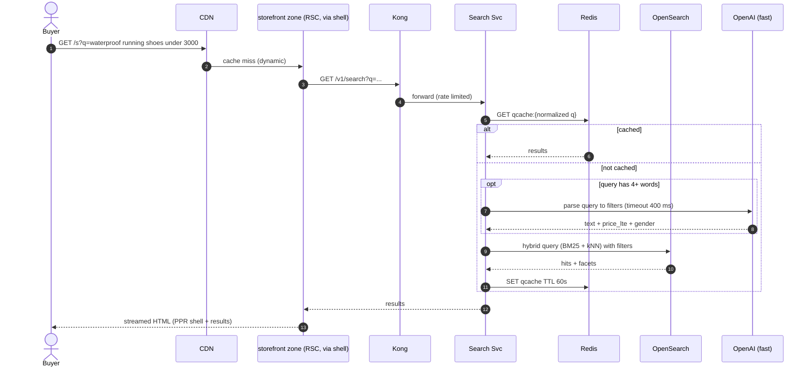

## 4.2 Checkout saga + payment (strong inventory consistency)

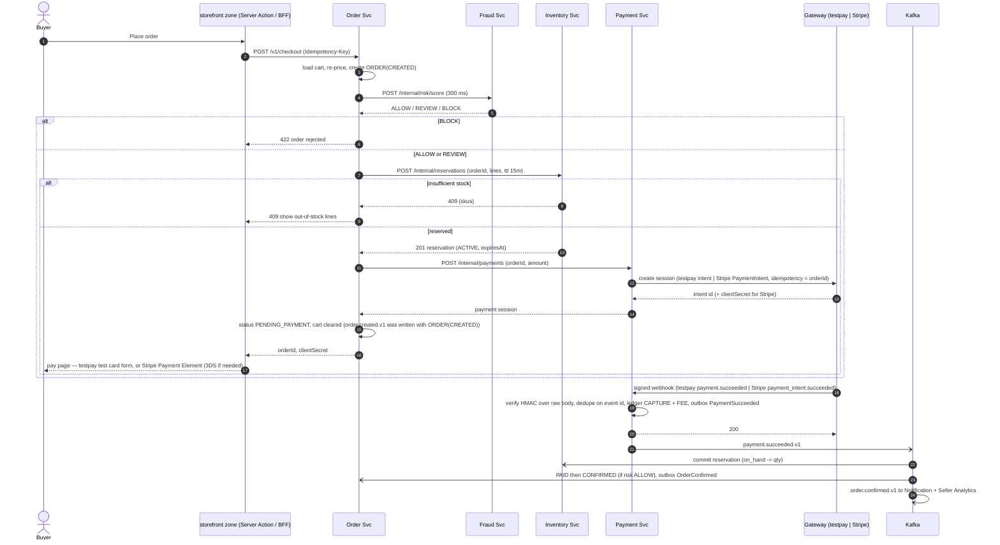

Payment notes (as built, [ADR 0014](adr/0014-testpay-and-webhook-truth.md)): **testpay** is a built-in TEST gateway
(no real money) that delivers signed webhooks ~1 s after a card is submitted — sometimes twice, to prove dedupe —
so the webhook-truth path runs locally and in demos; **Stripe** test mode switches on when its keys are set. A
declined card ends the session (`payment.failed.v1`). A capture that arrives before `order.created.v1` is parked in
`suspense:unallocated` and allocated when the order lines arrive. `order.cancelled.v1` refunds a paid order in full and
reverses its marketplace fees (`payment.refunded.v1`); emails go out from the notification service (Mailpit locally).

Order/inventory notes (as built): all service-to-service calls go through Kong with a client-credentials token of the
customers-realm `services` client (realm role `service`; `ServiceClient` in `@ac/nest-common` — token cache, timeouts,
retries only for GET/idempotent calls, a circuit breaker per target). Internal endpoints are `/v1/internal/…`. The order
row is written **before** the risk/stock/payment steps so rejected attempts stay auditable (`REJECTED`, hidden from
"Your Orders"); a failed step after the reservation releases it (idempotent). Stock is reserved per **offer** (SKU =
offer id) with one conditional `UPDATE … WHERE on_hand - reserved >= qty` per line in one transaction — the k6
`flash-sale.js` test (1,000 concurrent buyers, 100 units) gets exactly 100 reservations and 900 clean 409s. REVIEW
orders are confirmed but keep `risk_decision = REVIEW` for the fraud analyst (an analyst hold is future work).
Guest carts live in the order database (`guest_cart_items`, 7-day sliding TTL) rather than Redis.

### 4.2.1 Failure / expiry path

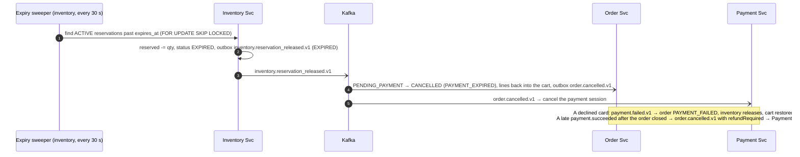

## 4.3 Governed refund — happy path with auto-approval (AG-UI)

> **As built (P3, 2026-10-24):** while the refund agent runs at **L1 shadow**, every return first takes the
> deterministic path in the returns service (policy → hard reject or `PENDING_HUMAN`); the agent's proposals are stored
> as SHADOW and compared with the human decision (shadow report). The auto-approval below applies once the agent is
> switched to LIVE (L3): the returns service re-evaluates the policy and only auto-approves inside the R3 envelope on a
> case no human has touched. See [02 §2.7 as built](02-lld.md#as-built-p3-2026-10-24).

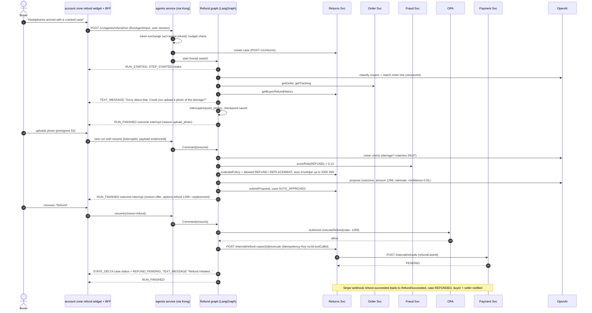

## 4.4 Governed refund — escalation to human (HITL)

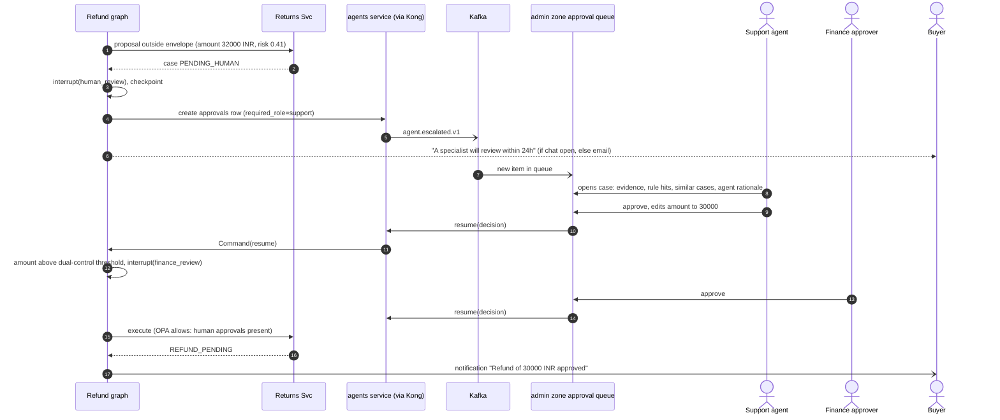

## 4.5 Shopping assistant with generative UI + frontend tool confirmation

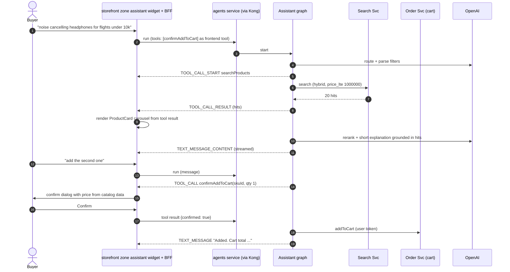

## 4.6 Seller listing copilot (shared state)

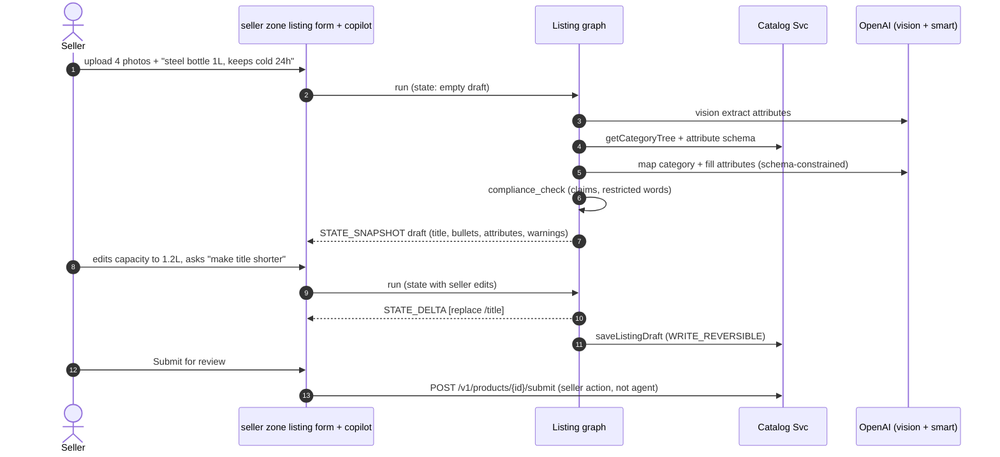

## 4.7 Event-driven moderation

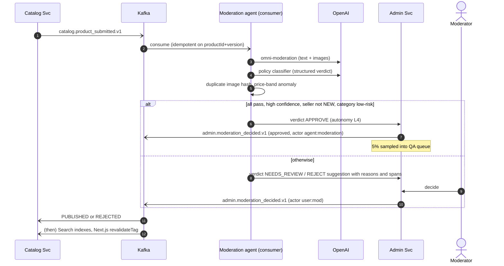

## 4.8 Fraud alert → investigation agent → analyst

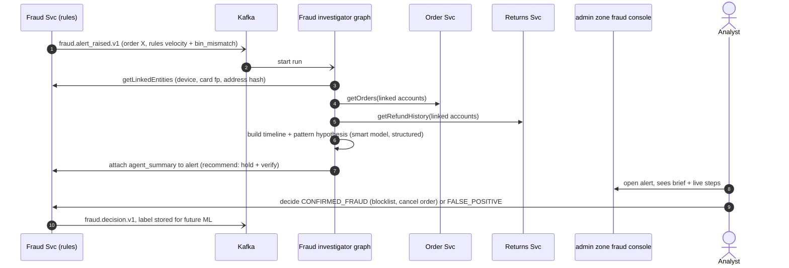

## 4.9 Dispute resolution

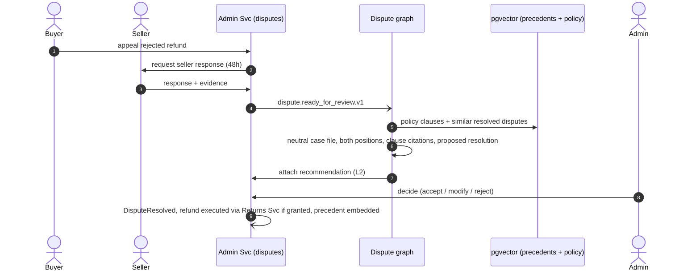

## 4.10 Seller payout

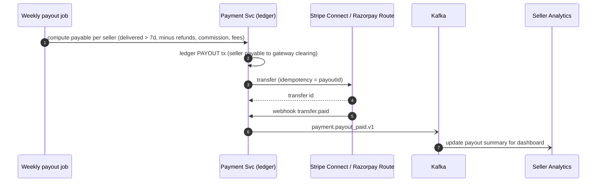

## 4.11 Micro-frontend request flow (page + data)

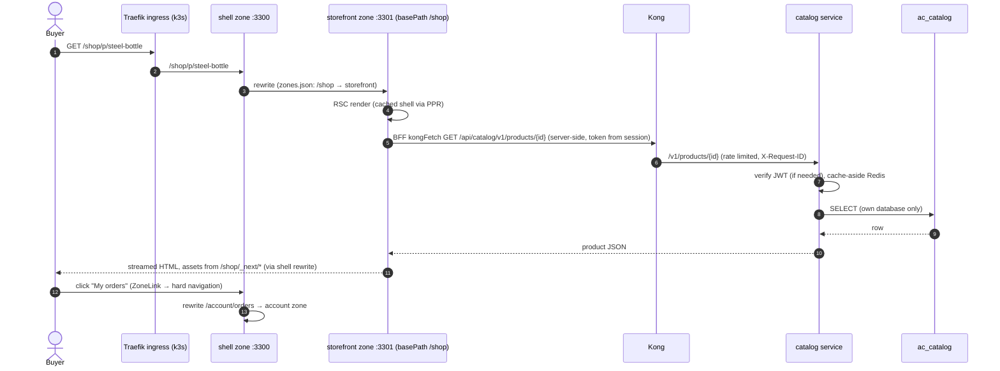

## 4.12 Agent widget through the zone BFF

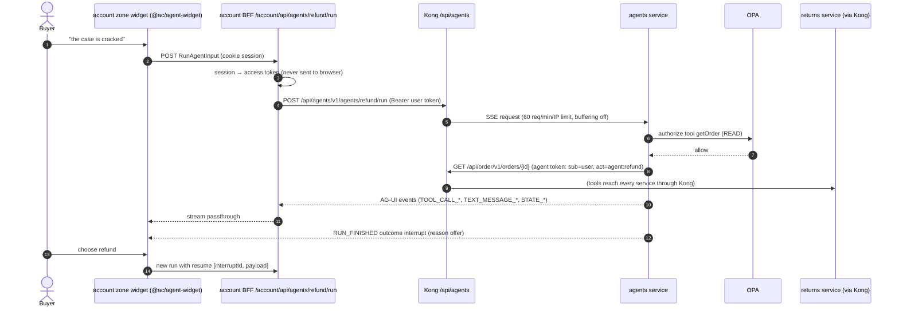

## 4.13 Contract change across repos (backend → frontend)

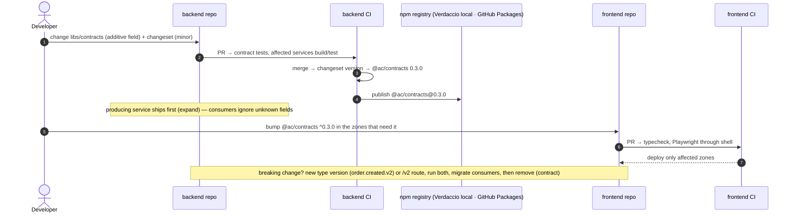

## 4.14 Per-service CI/CD pipeline (backend and frontend alike)

```mermaid
flowchart LR
  PR[Pull request] --> AFF["detect affected<br/>turbo --filter=...[origin/main]"]
  AFF --> T["lint · typecheck · unit tests<br/>(per affected service/zone)"]
  T --> IT["integration (Testcontainers)<br/>contract tests · OPA tests · agent evals if agents changed"]
  IT --> IMG["docker build per affected deployable<br/>tag = &lt;name&gt;:&lt;semver&gt;-&lt;sha&gt;"]
  IMG --> SCAN[image scan]
  SCAN --> MERGE{merge to main}
  MERGE --> PUSH["build linux/arm64 on ubuntu-24.04-arm<br/>push ghcr.io/&lt;owner&gt;/ac/&lt;name&gt;:&lt;sha&gt;"]
  PUSH --> APPROVE{"environment prod<br/>manual approval"}
  APPROVE --> DEPLOY["ac k8s deploy prod &lt;name&gt; --tag &lt;sha&gt;<br/>tags.json entry → helm upgrade<br/>only that Deployment rolls"]
  DEPLOY --> SMOKE["smoke: rollout status, /health,<br/>k6 via Kong, Playwright through shell"]
  SMOKE -- "fails" --> RB["ac k8s rollback prod &lt;name&gt;"]
```

## 4.15 Deploy one service to the k3s cluster (and roll back)

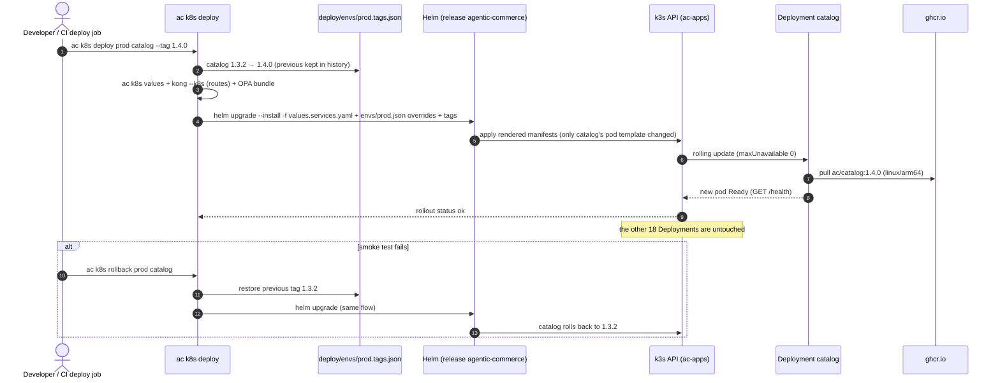

## 4.16 Request path inside the cluster (NetworkPolicy view)

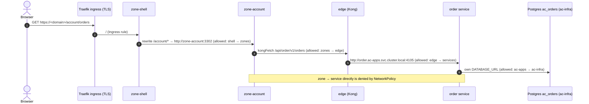
