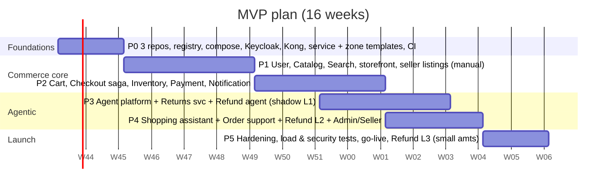

# 5. Roadmap & Delivery Plan

## 5.1 Repository topology

Three git repositories side by side in the `agentic-commerce/` workspace folder (the folder itself is not
a repo). Each repo is a pnpm 12 workspace with Turborepo, its own CI, `CLAUDE.md` and `.claude/`.

```
agentic-commerce/
├─ platform/                       (git) — architecture, infra, workspace tooling
│  ├─ docs/                        # these documents (00–08) + ADRs (docs/adr/NNNN-*.md)
│  ├─ infra/
│  │  ├─ docker-compose.yml        # postgres, redis, redpanda(+console), opensearch, keycloak, kong, opa,
│  │  │                            # minio, mailpit, grafana-lgtm, verdaccio (npm registry); langfuse (--llmops)
│  │  ├─ postgres/init/            # extensions; per-service DBs/roles are created by `ac infra init`
│  │  ├─ kong/kong.yml             # GENERATED from backend/services/*/package.json "ac" metadata
│  │  ├─ keycloak/realm-*.json · kafka/topics.json · opensearch/products-index.json · verdaccio/
│  ├─ deploy/                      # helm/agentic-infra · helm/agentic-commerce (Deployment per service/zone,
│  │                               #   NetworkPolicies, db-bootstrap Job) · terraform/oci (A1 VM + k3s)
│  │                               #   · envs/<env>.json + <env>.tags.json (release manifest)
│  ├─ terraform-aws-archive/       # ARCHIVED AWS design (not used)
│  ├─ tests/load/                  # k6 (through Kong and the shell)
│  ├─ scripts/ac.mjs · setup.sh    # workspace CLI (macOS/Linux)
│  └─ .github/workflows/           # docs, helm lint, OCI terraform validate
├─ backend/                        (git) — microservices
│  ├─ services/<name>/             # 12 services incl. agents: Dockerfile, README (service card), .env.example,
│  │                               #   src/, test/, own semver; "ac" metadata (port, database, topics, owner)
│  ├─ libs/                        # @ac/contracts, @ac/money (published) · @ac/nest-common, @ac/kafka (internal)
│  ├─ policies/                    # OPA Rego + tests + data.json, refund decision tables
│  ├─ evals/<agent>/               # agent eval datasets + red-team suites
│  ├─ scripts/gen.mjs              # pnpm gen service|agent
│  ├─ .changeset/                  # library versioning
│  └─ .github/workflows/           # affected-service matrix: test → image → deploy; libs publish; evals
└─ frontend/                       (git) — micro-frontends
   ├─ apps/<zone>/                 # shell, storefront, account, seller, admin — each a Next.js 16 app,
   │                               #   own basePath, BFF route handlers, Dockerfile (standalone), semver
   ├─ packages/                    # @ac/ui, @ac/agui-kit, @ac/agent-widget, @ac/bff
   ├─ zones.json                   # zone registry: name, port, basePath, owner (shell rewrites + tooling)
   ├─ scripts/gen.mjs              # pnpm gen zone
   └─ .github/workflows/           # affected-zone matrix: test → Playwright through shell → image → deploy
```

### Ownership

| Unit | Owner (team) | Release unit |
|---|---|---|
| `platform` repo | Platform / DevOps | Terraform plan/apply, CLI |
| `user`, `catalog`, `search` services + `storefront` zone | Discovery team | per service / zone |
| `inventory`, `order`, `payment`, `fraud` services | Transactions team | per service |
| `returns`, `notification` services + `account` zone | Post-purchase team | per service / zone |
| `seller-analytics` service + `seller` zone | Seller team | per service / zone |
| `admin` service + `admin` zone | Ops tools team | per service / zone |
| `agents` service, `policies/`, `evals/`, `@ac/agent-widget`, `@ac/agui-kit` | AI platform team | service + packages |
| `shell` zone, `@ac/ui`, `@ac/bff` | Frontend platform | zone + packages |
| `@ac/contracts`, `@ac/money` | Architecture (CODEOWNERS: producing team + architect) | Changesets |

## 5.2 Phased plan (MVP in 16 weeks, per PDF constraint)



| Phase | Weeks | Deliverables | Exit criteria |
|---|---|---|---|
| **P0 Foundations** | 1–2 | Split into `platform` / `backend` / `frontend` repos; local npm registry (Verdaccio) + Changesets for `@ac/contracts`/`@ac/money`; `docker compose` infra; **database per service** created from service metadata; Keycloak realms; generated Kong routes; service template (Dockerfile, service card, `.env`) and zone template (basePath, BFF, Dockerfile); shell + 4 zones with rewrites; per-service/per-zone CI with affected detection; OTel → Grafana; ADRs 1–10 | Every service and zone builds its own image; a zone page renders through the shell with data from a service via Kong; an outbox event reaches Kafka; contracts published and consumed by the frontend at a semver range |
| **P1 Catalog & discovery** | 3–6 | User svc + Keycloak sync, seller onboarding (Stripe Connect test mode), Catalog CRUD + images (S3 presigned), category attribute schemas, Search indexer + hybrid search + suggest, storefront (home, PLP, PDP with PPR, search) | 500k synthetic products indexed; search p95 < 150 ms at 100 RPS (k6) |
| **P2 Transactions** | 7–10 | Cart (guest + merge), checkout saga, reservations + expiry, Stripe/Razorpay intents + webhooks, ledger, order lifecycle, seller order handling (ship), Notification (email/SMS/in-app), fraud rules v1 | Flash-sale test: 1,000 concurrent buyers on 100 units → **0 oversell**; webhook replay/duplicate tests pass |
| **P3 Agent platform + Refunds** (parallel from wk 9) | 9–12 | `backend/services/agents`: AG-UI controller, LangGraph runtime + Postgres checkpointer, Tool Registry, OPA sidecar, guardrails, audit chain, budgets, kill switch; Returns svc + policy tables; Refund graph in **L1 shadow**; Langfuse + first eval dataset (≥ 300 cases) | Refund agent eval ≥ 90 % outcome agreement; red-team suite: 0 unauthorized MONEY calls |
| **P4 Agent UX + Admin/Seller** | 11–14 | Refund chat (AG-UI) at **L2**, Shopping Assistant (generative UI, frontend-tool confirm), Order Support + router, Admin: moderation queue (manual), approvals queue, agent oversight console; Seller dashboard (analytics read model), payouts job | Support can process 100 % of refund cases from agent proposals; assistant answers grounded (eval ≥ 95 % no unsupported facts) |
| **P5 Hardening & launch** | 15–16 | Load (3× peak = 300 RPS), chaos (kill Kafka/OpenAI/OpenSearch), security (OWASP ASVS L2 checklist, ZAP, dependency scan), PCI SAQ-A, GDPR flows, runbooks, DR drill (RDS PITR); Refund **L3** for ≤ ₹2k low-risk | 99.9 % readiness review; go-live |

### Post-MVP (quarters after launch)

| Phase | Scope |
|---|---|
| P6 | Seller Listing Copilot (A4), Moderation Agent (A6) L2 → L4 for low-risk categories |
| P7 | Fraud Investigation Agent (A7), Dispute Agent (A8), dual-control finance workflows |
| P8 | Seller Insights & Restock (A5), Notification Composer (A9), Ops Copilot (A10) |
| P9 | ML fraud model trained on analyst labels, personalization/recommendations, MCP server for staff tools, mobile app (React Native/Expo on the same APIs and AG-UI) |

## 5.3 Team (suggested, MVP)

| Role | Count | Focus |
|---|---|---|
| Tech lead / architect | 1 | ADRs, contracts, reviews |
| Backend (NestJS) | 3 | core services, payments, saga |
| Frontend (Next.js) | 2 | zones (storefront, account, seller, admin), shell, shared packages, agent widget |
| AI engineer | 1–2 | agent platform, graphs, evals, guardrails |
| DevOps / platform | 1 | Terraform, per-service pipelines, registry, observability — microservices + micro-frontends need a full-time platform owner |
| QA | 1 | e2e (Playwright), load (k6), eval datasets with support team |

## 5.4 Testing strategy

| Level | Tooling | Notes |
|---|---|---|
| Unit | Vitest/Jest | Domain services, state machines, policy tables |
| Contract | zod schemas in `@ac/contracts` (versioned) + consumer-driven contract tests (Pact or zod fixtures) for service pairs (Order↔Inventory, Order↔Payment) and zone BFF ↔ service | Event schema compatibility check in CI; published contract versions pinned per consumer |
| Integration | Testcontainers (Postgres, Redis, Redpanda, OpenSearch) | Outbox → Kafka → consumer idempotency |
| E2E | Playwright **through the shell** (zones stitched by rewrites) | Buyer journey across storefront → account, seller journey, refund chat with mocked LLM; cross-zone navigation |
| Load | k6 | 100 RPS steady, 300 RPS burst, flash-sale scenario |
| Payments | Stripe test clocks + CLI webhook replay | Duplicate/out-of-order webhooks |
| Agents | See [03 §3.8](03-agentic-ai.md#38-evaluation--testing-for-agents) | CI eval gate |
| Security | ZAP, `npm audit`/Snyk, Trivy images, `opa test` | |

## 5.5 Observability & SLOs

| SLO | Target | Signal |
|---|---|---|
| Search availability / latency | 99.9 %, p95 < 300 ms | Kong + service histograms |
| Checkout success (excl. card declines) | 99.5 % | saga outcome counters |
| Oversell incidents | 0 | reconciliation job `on_hand >= 0`, reservations sum check |
| Event lag | p95 < 5 s | Kafka consumer lag |
| Refund agent | time-to-resolution p50 < 10 min (auto), override rate < 10 % | agent_runs, decisions |
| Agent cost | ≤ budget/day per agent | Langfuse cost, Redis counters |

Dashboards: Grafana (RED metrics per service, Kafka lag, DB), Langfuse (traces, prompts, token cost,
eval scores), Admin agent-oversight console (business view).

## 5.6 Cost model (order-of-magnitude, token volumes)

Multiply volumes by current OpenAI pricing at build time — prices change; volumes are what we control.

| Workload | Assumption | Tokens/day (approx.) | Model tier |
|---|---|---|---|
| Product embeddings (one-time) | 500k × ~120 tokens | 60 M once, then ~1 M/day for updates | embed |
| Search query parsing | 30 % of ~50k queries/day are long, 70 % cache hit | ~1.5 M | fast |
| Shopping assistant | 1k sessions × 4 turns × ~6k tokens | ~24 M | smart (largest driver — cap turns, cache system prompt) |
| Refund agent | 5–10 % of 1k orders → ~75 cases × ~20k tokens + 1–2 images | ~1.5 M + images | smart + vision |
| Moderation | ~2k listings/day × ~3k tokens + images | ~6 M + images | fast + vision |

Levers: prompt caching (stable system prompts/tool schemas first), fast-tier routing, Redis semantic
cache for repeated Q&A, strict turn/step budgets, batch API for non-urgent backfills (embeddings,
moderation re-scans).

Infra: **≈ €0** — one Oracle Cloud Always Free Ampere A1 VM (2 OCPU / 12 GB, 100 GB boot volume; the
other half of the free 4 OCPU / 24 GB allowance runs swarm-ai) with k3s, in-cluster Postgres, Redpanda,
OpenSearch, Redis, Keycloak and MinIO; images on ghcr, TLS from Let's Encrypt. Expected footprint
≈ 6–7 GB RAM for the 19 Deployments + infra at idle. Paid costs are only external: OpenAI tokens, SMTP,
optional Langfuse Cloud. Caveats: Always-Free A1 capacity is sometimes unavailable in a region ("Out of
host capacity" — retry or another availability domain), and Oracle can reclaim idle Always-Free
instances (keep it in use, or switch the tenancy to Pay-As-You-Go, which keeps the free allowance). The
archived AWS design was dominated by MSK Serverless (~$550/month even in dev).

## 5.7 Key risks

| Risk | Impact | Mitigation |
|---|---|---|
| 16-week MVP with agents in scope | Slip | Agents start in parallel (P3) on a separate track; refund agent ships at L2 if L3 metrics not met |
| Refund abuse via agent | Financial loss | Shadow first, tight envelope, risk scoring, image forensics, sampling audits, spend caps |
| Kafka ops burden | Reliability | Single-node Redpanda (one binary, simple ops) with retention limits; outbox keeps the broker swappable |
| Single VM = no high availability | Whole site down on VM/disk failure; maintenance downtime | Nightly per-database backups (+ optional off-box copy), Terraform + Helm rebuild in < 1 h; path: add k3s nodes or move to OKE with replicated Postgres |
| Always-Free limits / reclamation | Capacity errors; idle instance reclaimed | Retry/other AD; keep it busy or switch tenancy to PAYG; everything reproducible from code |
| Microservice/micro-frontend overhead (17 deployables, 11 DBs, 3 repos) at 100 RPS | Slower delivery, higher infra cost | Templates + generators, generated Kong routes and Helm values, affected-only CI, resource limits per pod so 19 Deployments fit the 12 GB VM; re-evaluate merging low-traffic services if ops cost dominates |
| Version skew across repos (contracts, shared UI) | Runtime errors | Additive-only contract changes, semver ranges, contract tests in both repos, Renovate for `@ac/*` bumps (planned, not yet configured) |
| LLM vendor outage / price change | Degraded UX | Fallback UX, model tier abstraction, evals let us switch models safely |
| Regulatory (consumer law, GDPR Art. 22) | Legal | Human review path always available, explanations stored and shown, appeals |
| Search relevance with hybrid | Conversion | Offline relevance set (NDCG) + A/B toggles for weights |

## 5.8 ADRs to write in P0

1. Three repos (platform, backend, frontend), each a pnpm + Turborepo workspace
2. NestJS 12 + Fastify + TypeORM; versioned zod contracts published to an npm registry
3. Microservices with full isolation: database per service, outbox pattern, no shared DB
4. Kafka-compatible Redpanda for domain events, BullMQ for jobs
5. Keycloak for identity; token exchange for agents
6. OpenSearch hybrid search; embeddings at index time
7. Agents in TypeScript (LangGraph.js) inside a dedicated service; AG-UI for agent UIs
8. Governance: OPA for tool authorization, versioned policy tables, autonomy levels, audit chain
9. Payments: Stripe/Razorpay hosted fields (SAQ-A), webhooks as source of truth, double-entry ledger
10. Micro-frontends with Next.js Multi-Zones behind a shell; shared packages versioned
11. Hosting: k3s on one Oracle Cloud Always Free VM, one Deployment per service/zone, NetworkPolicies, ghcr images — **written: [ADR 0011](adr/0011-k3s-on-oracle-cloud.md)**; supersedes the earlier AWS ECS design (archived in `platform/terraform-aws-archive/`)
