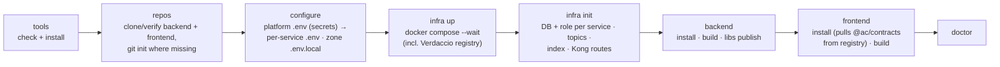
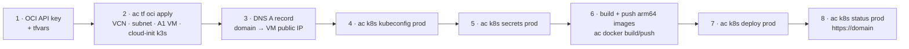

# 6. Developer Setup, Tooling & AI-Assisted Development

From a fresh **macOS or Linux** machine to all three repos running locally, plus the Claude Code skills
and subagents each repo ships for development. (Windows is not supported; use a Linux VM or dev
container if needed.)

## 6.1 Workspace layout

```
agentic-commerce/          # workspace folder (not a repo)
├─ platform/   (git)       # docs, local infra, deploy/ (Helm + OCI Terraform), workspace CLI `ac`, setup.sh
├─ backend/    (git)       # microservices, libs, policies, evals
└─ frontend/   (git)       # micro-frontend zones + shared packages
```

All cross-repo orchestration is done by the platform CLI `ac` = `node platform/scripts/ac.mjs <command>` from the
workspace folder (suggested: `alias ac="node $PWD/platform/scripts/ac.mjs"`). It has no dependencies.

## 6.2 One-command setup

```bash
./platform/setup.sh            # from the agentic-commerce/ folder
```

`setup.sh` makes sure **Node.js 22+** (24 LTS) and **pnpm 12** exist (Homebrew on macOS, nvm hints on
Linux), then runs `ac setup`:



Every step is idempotent. Non-interactive: `./platform/setup.sh setup --yes` (keys from
`OPENAI_API_KEY`, `STRIPE_SECRET_KEY`, … in the environment). If the backend/frontend repos already
have remotes, set `AC_BACKEND_REPO` / `AC_FRONTEND_REPO` (git URLs) and `ac repos` clones them.

## 6.3 Tools

| Tool | Required | macOS (Homebrew) | Linux |
|---|---|---|---|
| Git | ✅ | `git` | apt/dnf |
| Node.js ≥ 22 (24 LTS) | ✅ | `node@24` | nvm |
| pnpm 12 | ✅ | `npm i -g pnpm@12` | same |
| Docker + Compose | ✅ | `docker-desktop` cask or OrbStack | Docker Engine + compose plugin |
| GitHub CLI | optional | `gh` | cli.github.com |
| Terraform | optional (Oracle Cloud VM) | `hashicorp/tap/terraform` | HashiCorp repo |
| kubectl + Helm 3 | optional (deploy to k3s) | `kubectl`, `helm` | k8s / Helm install scripts |
| OCI CLI | optional (API key setup) | `oci-cli` | `bash -c "$(curl -L https://raw.githubusercontent.com/oracle/oci-cli/master/scripts/install/install.sh)"` |
| Claude Code | optional | `npm i -g @anthropic-ai/claude-code` | same |
| OPA, k6, Stripe CLI | — | run through Docker (`ac policy test`, `ac k6`, `ac stripe listen`) | |

`ac tools` shows status; `ac tools --install` installs missing tools (asks per tool).

## 6.4 CLI reference (`ac <command>` = `node platform/scripts/ac.mjs <command>`)

| Command | What it does |
|---|---|
| `setup` | Full pipeline above |
| `tools [--install]` | Check / install tools |
| `repos` | Verify `backend/` and `frontend/` exist next to `platform/`; clone from `AC_BACKEND_REPO` / `AC_FRONTEND_REPO` or `git init` |
| `configure` | `platform/.env` (generated secrets incl. **one DB password per service**), then writes each `backend/services/<name>/.env` (its own `DATABASE_URL`, brokers, issuers …) and each `frontend/apps/<zone>/.env.local` |
| `infra up [--llmops] [--tools]` | Start infra containers and wait for health (Langfuse / OpenSearch Dashboards optional) |
| `infra init` | For each backend service with a database: database `ac_<db>` + owner role `svc_<db>`; Kafka topics; OpenSearch index; Kong routes regenerated from service metadata |
| `infra status \| logs [svc] \| down \| reset` | `reset` deletes all volumes (asks first) |
| `libs publish` | Publish changed `@ac/contracts`, `@ac/money` versions from `backend/libs` to the local registry |
| `dev [target …]` | Watch mode; targets: `backend`, `frontend`, a service (`catalog`) or a zone (`storefront`) |
| `build`, `doctor` | Build both repos; health report for tools, config, containers, registry, services, zones, OPA |
| `new service <name> [--port N] [--no-db]` | Forwards to `backend: pnpm gen service` (service template + DB metadata) and re-runs `infra init` |
| `new agent <id>` | Forwards to `backend: pnpm gen agent` (graph, config, prompts, evals, OPA allow-list) |
| `new zone <name> --base /x [--port N]` | Forwards to `frontend: pnpm gen zone` (Next.js zone with basePath, BFF, Dockerfile; registers in `zones.json`) |
| `docker build <service\|zone>` | Build the production image of one deployable (proves independent deployability) |
| `token [realm] [user] [password]` | Dev access token (default `customers buyer buyer`; staff: `token staff support support`) |
| `policy test` | OPA unit tests for `backend/policies` (Docker) |
| `k6 [script]` | k6 load test from `platform/tests/load/` against Kong / the shell (Docker) |
| `stripe listen` | Forward Stripe test webhooks to `payment` through Kong (Docker) |
| `kong [--k8s]` | Regenerate `infra/kong/kong.yml` (host upstreams for local dev) or the cluster routes (`http://<service>.ac-apps.svc.cluster.local:<port>`) used by the `edge` ConfigMap |
| `docker build <service\|zone> [--platform linux/arm64]` · `docker push <name> --tag X` | Build one deployable's image; push to `ghcr.io/<owner>/ac/<service>` or `…/ac/zone-<zone>` |
| `tf oci <init\|plan\|apply>` | Terraform in `platform/deploy/terraform/oci` — the Oracle Cloud A1 VM with k3s |
| `k8s values` | Regenerate `deploy/helm/agentic-commerce/values.services.yaml` from service/zone metadata |
| `k8s secrets <env>` | Create/update Secrets `svc-<name>` (per service), `zone-<name>` (per zone), `ac-infra`, `ac-db-bootstrap` and optional `ghcr` pull secret from `deploy/envs/<env>.env` (gitignored; generated with random values on first use) |
| `k8s deploy <env> [name …] [--tag X]` | `helm upgrade --install` of `agentic-infra` + `agentic-commerce`; with a name + tag, updates that entry in `deploy/envs/<env>.tags.json` so only that Deployment rolls |
| `k8s rollback <env> <name>` | Restore the previous tag of one service/zone from the manifest history and redeploy |
| `k8s status <env>` · `k8s kubeconfig <env>` | Pods/rollouts per namespace · fetch the kubeconfig from the VM over SSH |
| `k8s local up\|load [names]\|down` | k3s in Docker on your laptop (container `ac-k3s`, ingress http://localhost:8088, API :6445, env `local`); `load` imports locally built images |

## 6.5 Local endpoints

| What | URL / port | Notes |
|---|---|---|
| **Shell (entry for all UI)** | http://localhost:3300 | Rewrites `/shop`, `/account`, `/seller`, `/admin` to zones |
| Zones (direct, for debugging) | storefront :3301 `/shop` · account :3302 `/account` · seller :3303 `/seller` · admin :3304 `/admin` | Always test through the shell for real navigation |
| API gateway (Kong) | http://localhost:58000/api/&lt;service&gt;/v1/… (admin :58001) | Bearer token from Keycloak |
| Services | user 4101 · catalog 4102 · search 4103 · inventory 4104 · order 4105 · payment 4106 · returns 4107 · fraud 4108 · notification 4109 · admin 4110 · seller-analytics 4111 · agents 4300 | `/health` public, `/v1/whoami` needs a token |
| npm registry (Verdaccio) | http://localhost:54873 | `@ac/*` scope only; everything else from npmjs |
| Keycloak | http://localhost:58180 | admin / `KEYCLOAK_ADMIN_PASSWORD`; realms `customers` (buyer/buyer, seller/seller), `staff` (admin, support, finance, analyst — password = username) |
| Postgres | localhost:55432 | 11 databases `ac_<db>`, each owned by `svc_<db>` with its own password |
| Redis | localhost:56379 | keys prefixed per service |
| Kafka (Redpanda) | localhost:59092 · Console http://localhost:58080 | |
| OpenSearch | http://localhost:59200 (Dashboards :55601 with `--tools`) | |
| OPA | http://localhost:58181 | loads `backend/policies` |
| MinIO (S3) | API :59000 · console http://localhost:59001 | |
| Mailpit | http://localhost:58025 (SMTP :51025) | |
| Grafana LGTM (OTel) | http://localhost:53000 · OTLP :54317 / :54318 | |
| Langfuse (`--llmops`) | http://localhost:53100 | |

## 6.6 Verification status

Verified on macOS (Apple Silicon, Docker Desktop) on 2026-10-20 after the three-repo split. Linux uses the
same code paths but was not run.

| Capability | How it was verified | Result |
|---|---|---|
| Full setup from clean state | `./platform/setup.sh setup --yes` (tools → repos → configure → infra up → init → install → libs publish → build → doctor) | exit 0 |
| Three independent repos | `ac repos` → `git init` in platform, backend, frontend (no commits) | ✔ |
| Database per service | `ac infra init` → 11 databases `ac_<db>` owned by `svc_<db>`; `svc_catalog` connecting to `ac_orders` | ✔ / `permission denied for database "ac_orders"` |
| Per-service config | 12 `services/<svc>/.env` with own `DATABASE_URL` and only declared secrets; 5 zone `.env.local` | ✔ |
| Versioned contracts across repos | backend `@ac/contracts@0.1.0`, `@ac/money@0.1.0` published to Verdaccio; frontend installs them from the registry; storefront renders prices with `@ac/money` | ✔ |
| Builds | backend 16/16 turbo tasks, frontend 9/9 | ✔ |
| All deployables running | `ac dev` → doctor: services 12/12, zones 5/5 | ✔ |
| Multi-Zones routing | shell :3300 serves `/`, `/shop`, `/account`, `/seller`, `/admin`, `/admin/agents/ping` (200, zone titles) and zone assets (`/shop/_next/…`); cross-zone links are plain `<a>` | ✔ |
| Zone agent boundary | `POST /shop/api/agents/refund/run` | 404 "not available in this zone" |
| Auth through Kong | buyer → `order` whoami 200 (realm customers), support → `admin` whoami 200 (realm staff), tampered token 401 | ✔ |
| Agent HITL through a zone | browser path shell → admin zone BFF → Kong → agents: tool call (OPA) → native interrupt → resume → success; both streams pass `@ag-ui/client` `verifyEvents`; audit chain + LangGraph checkpoints in `ac_agents` | ✔ |
| Outbox per service | row in `ac_orders.outbox` → published to `order.events` keyed by aggregate | ✔ |
| Generators | `ac new service wishlist` + `ac new zone deals --path /deals` → build, own DB `ac_wishlist`, Kong route, shell env; both answered health checks (then removed) | ✔ |
| Container images | `ac docker build catalog` (476 MB) and `storefront` (403 MB) and `edge`; containers ran as non-root `node`, catalog healthy against its own DB, storefront container → BFF → Kong → agent | ✔ |
| Load smoke | `ac k6 smoke.js`: 11 services via Kong, 5 zones via shell, agent via zone BFF — 964 checks, 0 failures, API p95 62 ms | ✔ |
| Policies / evals | `ac policy test` 11/11 · `pnpm --filter @ac/agents run evals -- --agent ping` 2/2 | ✔ |
| Terraform AWS (**archived**, `terraform-aws-archive/`) | `fmt -check`, `validate` (bootstrap, dev, prod), `terraform test` with mocked AWS (platform 3/3, db-bootstrap 1/1) | ✔ — archived, not used |
| **k3s deployment (local k3s-in-Docker, same charts as prod)** | `ac k8s local up` → `local load --infra` → `local load` (17 images) → `ac k8s deploy local` | ✔ 19 Deployments ready; infra hooks (topics, index, db-bootstrap) complete |
| Ingress routing in the cluster | Traefik :8088 → `/`, `/shop`, `/account`, `/seller`, `/admin` (zone titles, zone assets), `/api/<service>/health` for all 12 (each `db: up`), `/auth` Keycloak | ✔ |
| Auth in the cluster | Keycloak (prod mode, Postgres-backed) token via `/auth` → `order` whoami 200; issuer = public URL, JWKS via `OIDC_JWKS_REWRITE`; no token 401 | ✔ |
| Agent HITL in the cluster | ingress → zone-shell → zone-admin BFF → edge → agents → opa: interrupt → resume, `verifyEvents` valid; audit + checkpoints in `ac_agents` | ✔ |
| NetworkPolicies | zone→service direct, service→service direct, zone→zone, catalog→opa, other namespace→Postgres all **blocked**; same calls via `edge`/shell **allowed** | ✔ |
| DB isolation in the cluster | catalog's `DATABASE_URL` → own DB ok, → `ac_orders` `permission denied` | ✔ |
| Independent release + rollback | `ac k8s deploy local catalog --tag v2` → only the catalog pod replaced (18 others untouched), manifest updated; `ac k8s rollback local catalog` → previous image | ✔ |
| Backups | `pg-backup` CronJob run manually → 12 dumps (11 service DBs + keycloak) | ✔ (after fixing a NetworkPolicy-admission race in Jobs) |
| Footprint | `kubectl top`: ac-infra ≈ 2.0 GB, ac-apps ≈ 0.95 GB (18 pods), node ≈ 4.2 GB — fits the 12 GB A1 VM | ✔ |
| **Role dashboards (2026-10-23)** | real Keycloak login via shell (`/api/auth/*`, PKCE, encrypted session cookie) for buyer, seller, admin, support, finance, fraud-analyst, moderator; `ac seed` (8 services, each its own DB) | ✔ every dashboard 200, 0 unavailable widgets, real numbers; wrong role → zone 403 page **and** service 403; stopping `fraud` degrades only its tiles; screenshots checked light/dark/mobile (no overflow) |
| **Marketplace (2026-10-23)** | browser E2E (puppeteer, real Keycloak form logins, server actions, Kafka): buyer applies → compliance verifies → re-login grants `seller` → gated category requested/approved → product with live fee preview → auto-moderated → in listings + `/shop` search → fee schedule draft/submit → self-approval refused → admin approves v2; API checks of every rule (400/403/409/422) | ✔ all steps; redirects keep `/admin`, `/seller` with and without JS; product page multi-seller; no mobile overflow |
| OCI Terraform | `terraform validate`; cloud-init template rendered and parsed as YAML | ✔ — not applied (no OCI account wired yet) |
| CI workflows | YAML parses; not run (repos not on GitHub yet) | — |
| MSK IAM auth in `@ac/kafka` (archived AWS path, opt-in) | compiles; unused | — |


## 6.7 Claude Code: skills & subagents per repo

Open Claude Code **in the repo you are changing** (each repo has its own `CLAUDE.md` and `.claude/`).
For cross-repo work, open it in the workspace folder and use the platform skills.
`.claude/settings.json` in each repo pre-approves safe commands and blocks destructive ones
(volume resets, `terraform apply/destroy`, `helm uninstall`, reading `.env` files).

| Repo | Skills | Subagents |
|---|---|---|
| `platform` | `local-infra`, `k8s-deploy`, `cross-repo-change`, `contracts-release`, `release-checklist`, `architecture-decision` | `architect` (opus), `devops-engineer` (sonnet), `security-reviewer` (opus, read-only), `docs-sync` (haiku) |
| `backend` | `new-service`, `api-endpoint`, `domain-event`, `db-migration`, `saga-and-state-machine`, `service-resilience`, `langgraph-agent`, `agent-tool`, `agent-governance-review`, `agent-evals` | `backend-engineer`, `agent-engineer`, `test-engineer` (sonnet); `consistency-reviewer`, `governance-reviewer`, `security-reviewer` (opus, read-only) |
| `frontend` | `new-zone`, `zone-page`, `agui-ui`, `ui-component`, `frontend-release` | `frontend-engineer`, `frontend-test-engineer` (sonnet); `frontend-reviewer` (opus, read-only) |

Typical loops:
- *New capability in one service* → backend: `api-endpoint` / `domain-event` skill → `backend-engineer`
  → `consistency-reviewer` → `release-checklist`.
- *New agent* → backend: `langgraph-agent` + `agent-tool` + `agent-evals` → `governance-reviewer`;
  frontend: `agui-ui` in the owning zone → `frontend-reviewer`.
- *Contract change used by the UI* → platform: `cross-repo-change` (expand → publish via
  `contracts-release` → bump in frontend → contract) ([04 §4.13](04-flows.md#413-contract-change-across-repos-backend--frontend)).
- *New zone* → frontend: `new-zone` → `zone-page` → Playwright through the shell.

## 6.8 Troubleshooting

| Symptom | Fix |
|---|---|
| A zone reloads itself in a loop in `ac dev` (browser keeps navigating) | stale Turbopack dev cache: stop `ac dev`, `rm -rf frontend/apps/<zone>/.next`, start again |
| `Docker engine is not running` | Start Docker Desktop / OrbStack (Linux: `sudo systemctl start docker`) |
| `port is already allocated` | Another project uses the port: `docker ps`; change the host port in `platform/infra/docker-compose.yml` and the matching URL in `platform/.env`, then `ac configure` |
| OpenSearch exits on Linux | `sudo sysctl -w vm.max_map_count=262144` |
| Frontend install can't find `@ac/contracts` | Registry not running or libs not published: `ac infra up`, then `ac libs publish` |
| `ERR_PNPM_MINIMUM_RELEASE_AGE_VIOLATION` | pnpm 12 refuses packages < 24 h old; `@ac/*` is excluded in `frontend/pnpm-workspace.yaml`; for third-party packages keep related packages on the same minor (e.g. Nest `~12.1.3`) |
| `ERR_PNPM_IGNORED_BUILDS` | Add the package under `allowBuilds:` in that repo's `pnpm-workspace.yaml` |
| `Kafka client native module failed to load` | `pnpm rebuild @confluentinc/kafka-javascript` in `backend/` (services still boot; event publishing is off) |
| Service fails with `password authentication failed` | Its `.env` is stale: `ac configure` then `ac infra init` (re-syncs role passwords) |
| Zone page 404 through the shell | Zone not running, or `zones.json` basePath and the zone's `basePath` disagree |
| Cross-zone link does a client-side 404 | Use `ZoneLink` (hard navigation), not `next/link`, across zones |
| Kong `502` | The service isn't running on the host: `ac dev <service>`; `ac doctor` lists running apps |
| `429` on `/api/agents` | Kong's per-IP limit (60/min) for agent routes — intended LLM cost guard |
| `ac tf oci apply`: **Out of host capacity** (A1) | Always-Free Ampere capacity is exhausted in that availability domain: retry later, or set `availability_domain_index = 1` (or 2) in `terraform.tfvars` and apply again |
| VM reachable by SSH but not on 80/443 | OCI Ubuntu images ship iptables rules that reject everything but SSH; cloud-init opens 80/443/6443 — check `sudo iptables -L INPUT -n` and `cloud-init status --long`; also the VCN security list |
| AG-UI streams cut off after ~60 s in the cluster | Traefik's default read timeout; cloud-init sets 300 s via a `HelmChartConfig` — check `kubectl -n kube-system get helmchartconfig traefik -o yaml` |
| Certificate stays `Pending` / browser shows the Traefik default cert | DNS must point at the VM before Let's Encrypt can validate; `kubectl describe certificate -A`, `kubectl -n cert-manager logs deploy/cert-manager`; check port 80 is open |
| Pods `ImagePullBackOff` | Image not pushed for that tag, wrong arch (must be `linux/arm64`), or the ghcr pull secret is missing — `ac k8s secrets prod` |
| Pods `Pending` | VM out of memory/CPU: `kubectl describe pod`, lower requests in `deploy/envs/prod.json` or scale non-critical services to 0 |
| Service can't reach another service directly | Intended: NetworkPolicies allow only `edge` → services; call through Kong (`KONG_URL`) |
| Oracle stopped the instance ("idle") | Always-Free reclamation of idle instances — keep it in use or switch the tenancy to Pay-As-You-Go |

## 6.9 Deploy to Oracle Cloud (k3s)

Target: one **Always Free Ampere A1** VM (default 2 OCPU / 12 GB — the other half of the free allowance runs
swarm-ai), Ubuntu 24.04 aarch64, k3s. Design: [01 §1.8](01-hld.md#18-deployment--infrastructure--k3s-on-oracle-cloud),
decision: [ADR 0011](adr/0011-k3s-on-oracle-cloud.md).



1. **API key:** in the OCI console → *My profile → API keys → Add API key* (or `oci setup config`); note the
   tenancy OCID, user OCID, fingerprint, region and the private key path. Have an SSH public key ready.
2. **Provision:** `cp platform/deploy/terraform/oci/terraform.tfvars.example …/terraform.tfvars`, fill in the
   OCIDs (`tenancy_ocid`, `compartment_ocid`), `region`, `ssh_public_key_path`, `admin_cidr` (your IP/32 for the k3s API), `domain`,
   `acme_email`; then `ac tf oci init` and `ac tf oci apply`. Cloud-init installs k3s, opens the
   OCI Ubuntu iptables for 80/443/6443, sets Traefik timeouts to 300 s, installs cert-manager + a
   Let's Encrypt ClusterIssuer and adds swap (takes ~5 min after the apply finishes).
3. **DNS:** point the domain's A record (e.g. DuckDNS, as for swarm-ai) at the `public_ip` output.
4. **Settings + kubeconfig:** fill `platform/deploy/envs/prod.json` (`publicUrl`, `host`, `imageRegistry`
   `ghcr.io/<owner>/ac`, `defaultTag`, `tls`, `imagePullSecret`; see `envs/README.md`), then
   `ac k8s kubeconfig prod` (copies `/etc/rancher/k3s/k3s.yaml` over SSH, rewrites the server address and
   stores it as gitignored `envs/prod.kubeconfig`).
5. **Secrets:** `ac k8s secrets prod` — generates `deploy/envs/prod.env` on first run (random DB
   passwords per service, Keycloak/MinIO/Redis secrets; add `OPENAI_API_KEY`, Stripe keys there) and
   creates the Kubernetes Secrets. Re-run after editing.
6. **Images:** `ac docker build <name> --platform linux/arm64` + `ac docker push <name> --tag <tag>` for each
   service/zone (CI does this on `ubuntu-24.04-arm` runners); `docker login ghcr.io` with a token that has
   `write:packages`. If the ghcr packages are private, `ac k8s secrets` also creates the pull secret.
7. **Deploy:** `ac k8s deploy prod` installs `agentic-infra` (ns `ac-infra`) and `agentic-commerce`
   (ns `ac-apps`); the `db-bootstrap` hook creates every `ac_<db>`/`svc_<db>`. Later, one service at a time:
   `ac k8s deploy prod catalog --tag 1.4.0`; undo with `ac k8s rollback prod catalog`.
8. **Check:** `ac k8s status prod`, then `https://<domain>/` (shell), `/api/<service>/health`, `/auth`.

Test the same charts first on your laptop: `ac k8s local up`, `ac k8s local load`, `ac k8s deploy local` →
http://localhost:8088.

Backups: the `agentic-infra` backup CronJob dumps each database nightly to a PVC (14 days); copy them off the
VM (e.g. OCI Object Storage pre-authenticated request) for real disaster recovery.
