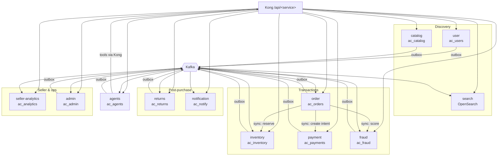
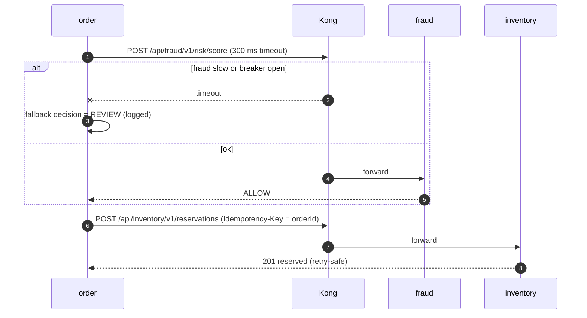
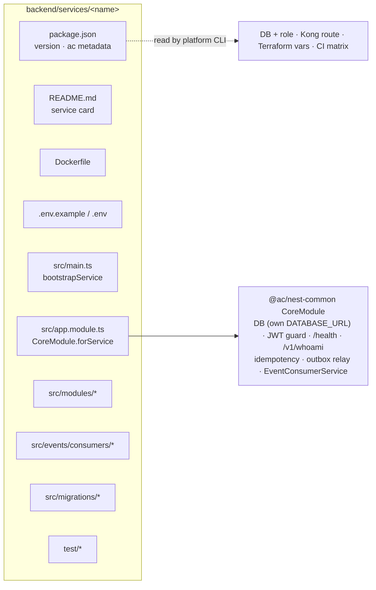

# 7. Microservices Architecture (backend repo)

Decision: **full isolation** — each service has its own codebase folder, container image, database,
credentials, CI pipeline and semantic version, and talks to others only via the API gateway (sync) or
Kafka (async). This doc is the rulebook; per-service internals are in [02-lld.md](02-lld.md).

## 7.1 Principles

1. **Bounded context per service** — one business capability, one owning team, one database.
2. **Database per service** — `ac_<db>` owned by role `svc_<db>`; no other service has credentials.
3. **Smart endpoints, dumb pipes** — Kong only routes, rate-limits and adds request ids; business rules
   live in services. Kafka only transports events.
4. **Async by default between services**; sync calls only when the caller needs the answer now
   (reserve stock, create payment intent, risk score).
5. **Design for failure** — timeouts, retries only on idempotent calls, circuit breakers, bulkheads,
   graceful degradation.
6. **Independent deployability** — any service can be released or rolled back without coordinating
   others; contract changes are additive (expand → migrate → contract).
7. **Zero trust** — every service verifies JWTs itself; the network is not a trust boundary.
8. **Same template everywhere** — generated by `pnpm gen service`, so 12 services cost little to run.

## 7.2 Service landscape

| Service | Owner | Port | Database | Sync API (via Kong) | Publishes | Consumes | Scaling signal |
|---|---|---|---|---|---|---|---|
| user | Discovery | 4101 | `ac_users` | `/users/me`, `/sellers/me`, `/kyc/*`, `/category-approvals/*` ([10](10-marketplace.md)) | `user.events` | — | RPS |
| catalog | Discovery | 4102 | `ac_catalog` + bucket `ac-catalog` (images) | `/products`, `/offers` (+ `?ids=` lookup, `PATCH /offers/{id}` → `catalog.offer_updated.v1`), `/categories`, `/brands/*`, `/brand-applications/*`, `/images/*`, `/products/:id/images` | `catalog.events` | `admin.events`, `user.events` | RPS |
| search | Discovery | 4103 | — (OpenSearch index) | `/search`, `/search/suggest` | — | `catalog.events`, `inventory.events` | RPS, p95 |
| inventory | Transactions | 4104 | `ac_inventory` | `/stock`, `/sellers/me/stock/{sku}`, `/internal/reservations` (+ `/commit`, `/release`) | `inventory.events` (`stock_reserved`, `reservation_released`, `stock_committed`, `low_stock`) | `catalog.events`, `order.events`, `payment.events` | RPS, lock waits |
| order | Transactions | 4105 | `ac_orders` | `/cart`, `/checkout`, `/orders/{id}`, `/orders/{id}/cancel`, `/sellers/me/orders`, `/seller-orders/{id}/ship` — **calls** catalog, fraud, inventory, payment | `order.events` (`created`, `confirmed`, `cancelled`, `shipped`, `delivered`) | `payment.events`, `inventory.events`, `fraud.events`, `returns.events` | RPS, checkout p95 |
| payment | Transactions | 4106 | `ac_payments` (dedicated cluster in prod) | `/payments`, `/refunds`, `/payouts`, `/webhooks/*`, `/fees/*` (fee schedule, preview) | `payment.events` | `order.events`, `returns.events` | RPS, webhook lag |
| fraud | Transactions | 4108 | `ac_fraud` | `/internal/risk/score`, `/alerts` | `fraud.events` | `order.events`, `payment.events`, `returns.events`, `user.events` | RPS, consumer lag |
| returns | Post-purchase | 4107 | `ac_returns` | `/returns`, `/refund-cases` | `returns.events` | `order.events`, `payment.events` | RPS |
| notification | Post-purchase | 4109 | `ac_notify` | `/notifications/me` | — | most topics | consumer lag |
| seller-analytics | Seller | 4111 | `ac_analytics` | `/sellers/me/analytics/*` | — | `order`, `payment`, `inventory`, `returns` events | consumer lag |
| admin | Ops tools | 4110 | `ac_admin` | `/admin/*` | `admin.events` | `catalog.events`, `fraud.events`, `agent.events` | RPS |
| agents | AI platform | 4300 | `ac_agents` | `/agents`, `/agents/{id}/run` (SSE), `/agents/registry`, `/agents/{id}/autonomy`, `/agents/runs`, `/agents/refund/runs`, `/agents/{id}/evals/latest` ([03 §3.10](03-agentic-ai.md#310-as-built-p3-2026-10-24)) | `agent.events` (`agent.run_completed.v1`, `agent.escalated.v1`) | `returns`, `fraud`, `catalog`, `admin` events; calls returns + fraud via Kong (`agents` client) | concurrent runs, run outcomes |

Every deploy unit is **one container image per service** (`ghcr.io/<owner>/ac/<service>:<tag>`, linux/arm64);
in the k3s cluster each is its own **Deployment + Service** (`<service>`, namespace `ac-apps`) with its own
Secret `svc-<service>`, resource requests/limits, probes and rollout history.

## 7.3 Communication rules

| Rule | Detail |
|---|---|
| Sync calls go through Kong | `http://kong/api/<service>/v1/...` with the caller's token (user, service client-credentials, or exchanged agent token). No direct service-to-service URLs in code. |
| Timeouts | Connect 1 s, total ≤ 2 s (checkout path), ≤ 5 s elsewhere; SSE (agents) up to 5 min |
| Retries | Only for idempotent requests (`GET`, or `POST` with `Idempotency-Key`), max 2, exponential backoff + jitter |
| Circuit breakers | Per downstream (`opossum`): open after 50 % failures over 20 requests, half-open after 10 s; fallback defined per call (e.g. fraud timeout → `REVIEW`) |
| Bulkheads | Separate HTTP agent pools per downstream; Kafka consumers in their own process loop |
| Async | Transactional outbox → Kafka; one producing service per topic; CloudEvents with `traceparent` |
| No shared database | Never read another service's DB, even read-only; use its API or a read model built from its events |
| Payload hygiene | Events carry ids + minimal data, no PII unless needed; consumers fetch details via API if authorized |

## 7.4 Data ownership & consistency

| Concern | Pattern |
|---|---|
| Multi-service business transaction | **Saga**: checkout is orchestrated by `order` with compensations (release stock, cancel intent); refunds orchestrated by `returns` |
| Publishing state changes reliably | **Transactional outbox** in the service's own DB → relay → Kafka (at-least-once) |
| Handling redelivery | **Idempotent consumers**: `processed_events(event_id, consumer)` written in the same transaction as effects |
| Mutating APIs | `Idempotency-Key` stored in `idempotency_keys` (replay same response) |
| Cross-service queries | **CQRS read models** (`seller-analytics`, `search`) or API composition in the zone BFF |
| Ordering | Kafka key = aggregate id; consumers check aggregate `version` / current state before transitions |
| Reference data copies | Consumers may cache what they need (e.g. product title snapshot in order lines) — owned copy, never updated by others |
| Deletion / GDPR | `UserErasureRequested` event; every service erases or anonymizes its own data and acknowledges |

## 7.5 Versioning

| Artifact | Rule |
|---|---|
| REST APIs | URI version `/v1`; additive changes only within a version; breaking → `/v2` served alongside `/v1` until consumers move |
| Events | Type carries version (`order.created.v1`); additive fields allowed; breaking → publish `v2` in parallel, consumers migrate, retire `v1` |
| Database | Expand → migrate → contract migrations; old and new app versions must both work during a rollout |
| Services | Each service has its own semver in `package.json`; image tag `<semver>-<sha>` |
| Libraries | Changesets; `@ac/contracts` and `@ac/money` published to the registry, consumers use semver ranges; internal libs (`nest-common`, `kafka`) are workspace-only |

## 7.6 Contract testing

- **Events:** every event type has a zod schema in `@ac/contracts` + fixtures; producer tests assert
  emitted payloads parse; consumer tests feed fixtures of all supported versions.
- **APIs:** consumer-driven contract tests for critical pairs (order→inventory, order→payment,
  order→fraud, zone BFF→service) with Pact (or zod fixtures for simple cases); provider verification
  runs in the provider's CI before deploy.
- **Compatibility gate:** CI fails if a contracts change removes or retypes a field without a new
  version.

## 7.7 Service template anatomy

Service card (`README.md`) sections: purpose & owner · API table · events published/consumed ·
database & retention · dependencies (sync) · SLOs · runbook (alerts, dashboards, common failures).

## 7.8 CI/CD per service

- Affected detection: `turbo run build test --filter=...[origin/main]` → matrix of changed services
  (a lib change fans out to its dependents).
- Per service: lint, typecheck, unit, integration (Testcontainers with its own DB), contract tests,
  image build + scan, push `<service>:<semver>-<sha>`.
- Build images for `linux/arm64` on `ubuntu-24.04-arm` runners, push to ghcr.
- Deploy: `ac k8s deploy prod <service> --tag <sha>` (GitHub environment `prod`, manual approval) updates
  that service's entry in `platform/deploy/envs/prod.tags.json` and runs `helm upgrade`; only that
  Deployment rolls (rolling update, `maxUnavailable: 0`, readiness on `/health`).
- Rollback: `ac k8s rollback prod <service>` restores the previous tag from the manifest history (or
  `kubectl rollout undo deployment/<service> -n ac-apps` in an emergency, then fix the manifest).
  Migrations are backward compatible (expand/contract), so old and new versions can run side by side.
- Agents service additionally runs `opa test` and eval datasets (release gate in [03 §3.8](03-agentic-ai.md#38-evaluation--testing-for-agents)).

## 7.9 Observability

- OpenTelemetry in every service (HTTP, pg, Kafka, Redis auto-instrumentation); `traceparent` carried in
  HTTP headers **and** CloudEvents so traces span sync + async hops.
- `X-Request-ID` from Kong logged by every service; structured JSON logs with `service`, `version`,
  `traceId`, `principal`, `actor`.
- RED dashboards per service, Kafka consumer lag per consumer group, outbox backlog per service,
  saga outcome counters; LLM traces in Langfuse.

## 7.10 Resilience patterns

| Pattern | Applied to |
|---|---|
| Timeout + retry with jitter | All sync calls (idempotent only) |
| Circuit breaker + fallback | order→fraud (fallback REVIEW), BFF→search (fallback category browse), agents→OpenAI (fallback classic form) |
| Bulkhead | Pools per downstream; agents isolated in its own service so LLM latency can't starve checkout |
| Queue-based load leveling | Notifications, moderation, embeddings via Kafka/BullMQ |
| Rate limiting | Kong per route; stricter for `/api/agents` |
| Health checks | `/health` (DB check) for Kubernetes readiness/liveness probes and Kong; readiness waits for DB + Kafka |
| Resource limits | requests/limits per Deployment so one runaway service can't starve the 12 GB node |
| Dead-letter | `dlq.events` after N failed consumer attempts, alert + replay tool |

## 7.11 Security

- Every service re-verifies JWTs against Keycloak JWKS (both realms) and enforces roles/scopes.
- Service-to-service: client-credentials tokens; agents: RFC 8693 exchanged tokens (`act` claim) with
  narrowed scopes; services log principal + actor.
- Per-service DB credentials and secrets: per-service `.env` locally; in the cluster one Kubernetes
  Secret `svc-<service>` per service (its own `DATABASE_URL` + only its declared secrets), created by
  `ac k8s secrets <env>` from a gitignored `platform/deploy/envs/<env>.env`.
- **NetworkPolicies**: a service accepts traffic only from `edge` (Kong) — direct service-to-service calls
  are blocked at the network layer, enforcing "sync calls go through Kong"; `ac-infra` (Postgres, Kafka,
  OpenSearch, Redis) accepts only `ac-apps`.
- `payment` is the only service with gateway secrets; `agents` the only one with OpenAI keys.

## 7.12 Pros & cons at this scale (honest assessment)

| Pros | Cons | Mitigation |
|---|---|---|
| Teams own and release services independently | 100 RPS / 1k orders/day does **not** need 12 services — a modular monolith would carry the load | Accepted by decision; keep services thin and template-generated |
| Fault isolation: a broken agents release can't take down checkout | 17 deployables + 11 databases → more infra cost and ops | One k3s node on Oracle Cloud Always Free (≈ €0), small requests/limits per pod, single replicas, generated charts; no HA on one node (see [01 §1.9](01-hld.md#19-nfr--design-mapping)) |
| Independent scaling (search, agents) | Distributed transactions → sagas, eventual consistency, harder debugging | Outbox, idempotency, tracing across HTTP + Kafka, saga outcome dashboards |
| Security isolation (payment secrets, PCI scope, dedicated DB cluster) | Network hops add latency on the checkout path | Only 3 sync hops in checkout, tight timeouts, fallbacks |
| Agents isolated with their own governance and budgets | Contract/version management across services and repos | Versioned contracts, contract tests, additive changes, dependency bots (Renovate — planned) |
| Clear ownership maps to teams and Claude Code subagents | More local resource usage | Run only the services you work on (`ac dev catalog`), infra in Docker |

Re-evaluation trigger: if a pair of services always changes and deploys together for 3+ months, consider
merging them; if one service's load or risk profile diverges (e.g. refund agent), consider splitting it.
