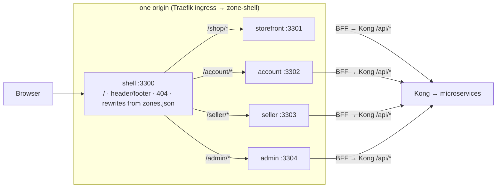
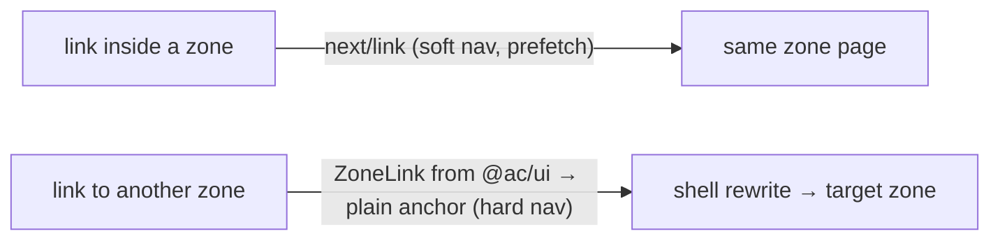
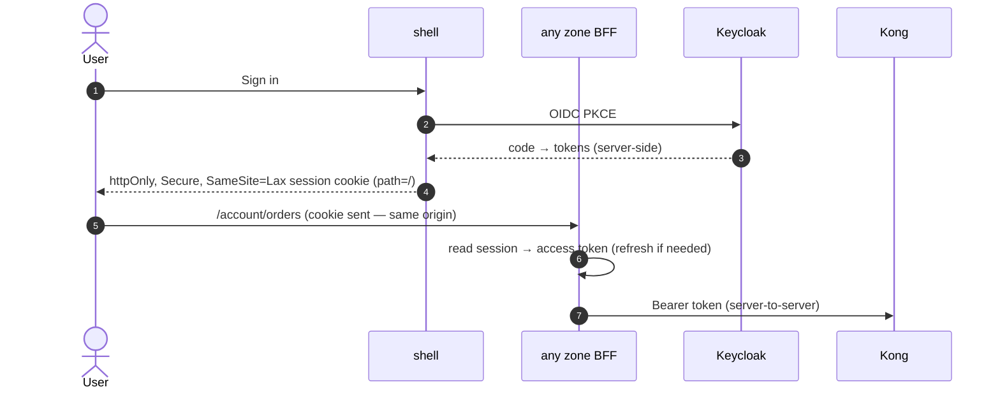
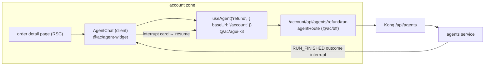

# 8. Micro-Frontends Architecture (frontend repo)

Decision: **Next.js 16 Multi-Zones + shared widgets**. Each UI domain is a separate Next.js app ("zone")
with its own routes, BFF, build, image and release. A **shell zone** owns `/` and the global chrome and
stitches the zones together on one origin. Shared code (design system, AG-UI client, agent widget, BFF
helpers) ships as versioned packages.

## 8.1 Why Multi-Zones

| Option | Fit |
|---|---|
| **Multi-Zones** (chosen) | Official Next.js pattern; works with App Router, RSC, Server Actions, PPR; each zone is a normal Next app — easy to build, test, deploy independently; composition at the routing layer (no runtime JS federation) |
| Module Federation 2.0 | Runtime composition of components, but App Router/RSC support is limited; would push hosts/remotes off RSC; runtime version skew |
| single-spa / iframes | Framework-agnostic but loses SSR/RSC benefits and costs UX/perf |
| One Next.js app with route groups (previous design) | Simplest, but one deploy unit and shared ownership for all teams |

## 8.2 Zone map

| Zone | Port | basePath | Owner | Pages | Agents hosted (widget) | Services used (via BFF → Kong) |
|---|---|---|---|---|---|---|
| shell | 3300 | `/` | Frontend platform | home, global layout, 404, sign-in entry | — | user (session/profile summary) |
| storefront | 3301 | `/shop` | Discovery | search, category, PDP, cart, checkout | Shopping Assistant (A2), help drawer → Order Support (A3) | search, catalog, inventory, order, payment, agents |
| account | 3302 | `/account` | Post-purchase | orders, order detail, returns, refund chat, profile | Refund & Returns (A1), Order Support (A3) | order, returns, user, notification, agents |
| seller | 3303 | `/seller` | Seller | dashboard, listings, inventory, orders, payouts | Listing Copilot (A4), Insights & Restock (A5) | catalog, inventory, order, seller-analytics, payment, agents |
| admin | 3304 | `/admin` | Ops tools | moderation, approvals (agent interrupts), disputes, fraud console, agent oversight | Fraud Investigator (A7), Dispute (A8), approval cards for A1/A6 | admin, fraud, returns, catalog, agents |

The registry lives in `frontend/zones.json` (name, port, basePath, owner). The shell builds its
rewrites from it; the platform CLI reads it for ports and generates the zone Deployments in the Helm
values (`ac k8s values`).

## 8.3 Routing & assets

- Each zone sets `basePath` (`/shop`, …), so its pages **and** assets (`/shop/_next/...`) live under its
  prefix — no asset collisions between zones.
- The shell's `next.config.ts` rewrites `/<basePath>` and `/<basePath>/:path*` to the zone origin
  (`ZONE_<NAME>_URL` — localhost ports locally, `http://zone-<name>:<port>` Kubernetes Service names in the
cluster). Rewrites are resolved at **build time** (standalone output), so the shell image is built with
the cluster URLs as defaults (`ZONE_STOREFRONT_URL=http://zone-storefront:3301`, …).
- The shell owns everything not claimed by a zone (home, 404).
- Health: each zone exposes `/<basePath>/api/health` for Kubernetes probes and `ac doctor`.

## 8.4 Cross-zone navigation

- Within a zone: `next/link`. Across zones: `ZoneLink` (renders `<a>`; a soft navigation would 404 because
  the target route isn't in this zone's router).
- Header/footer come from `@ac/ui` and are rendered by every zone, so chrome stays consistent; the
  header's nav items are `ZoneLink`s.
- Prefetch across zones is disabled (hard navs); zones may add `<link rel="prefetch">` for the most
  likely next zone's entry HTML only.

## 8.5 Shared packages & versioning

| Package | Contents | Consumed by |
|---|---|---|
| `@ac/ui` | design tokens (CSS variables, light/dark), Tailwind v4 preset, Header/Footer, `ZoneLink`, primitives | all zones |
| `@ac/agui-kit` | AG-UI 1.0 event reducer, `runAgentStream`, `useAgent` hook (native interrupts, resume) | agent-widget, zones |
| `@ac/agent-widget` | `AgentChat` component, tool-result renderer registry, interrupt cards (approve/reject, upload, offer) | storefront, account, seller, admin |
| `@ac/bff` | server-only helpers: `kongFetch` (session → bearer), `agentRoute` route handler, session utilities | all zones' route handlers |
| `@ac/contracts`, `@ac/money` | published from the backend repo (registry) | zone BFFs and UI types/formatting |

Packages are versioned with Changesets inside the frontend repo; zones depend on workspace versions and
release whenever they choose to pick up a new package version. Breaking package changes require a
major version and are rolled out zone by zone.

## 8.6 Auth & session across zones

- One origin → one cookie for all zones; **tokens never reach browser JS**.
- Every zone's BFF reads the same session (shared secret `AUTH_SECRET`, `@ac/bff` session helpers).
- Authorization is enforced by the services; zones only hide UI by role.

## 8.7 BFF pattern

- Each zone has route handlers / Server Actions under its basePath (`/shop/api/...`) — the zone's
  private backend: aggregates calls to several services, shapes data for its pages, applies caching.
- BFFs call **only Kong**, never service ports or databases; they never hold business rules (those
  stay in services).
- Agents: `POST /<zone>/api/agents/<id>/run` = `agentRoute` from `@ac/bff` — validates the agent id,
  attaches the session token, streams the AG-UI SSE response through unchanged.

## 8.8 Agent widgets per zone

- The widget renders text, tool chips/generative components (by tool name) and **native AG-UI
  interrupt cards**; prices/amounts come from tool results, never from model text.
- Thread ids are business ids (`refund:<caseId>`) so the same conversation can be reopened from any
  zone that has the context (e.g. admin approval of a refund started in account).

## 8.9 State sharing rules

| Allowed | Not allowed |
|---|---|
| URL (path, query), cookies (session, locale, cart id), server data via BFF | A client-side store shared between zones (Redux/Zustand across apps) |
| Server-owned state (cart in `order` service) | localStorage contracts between zones |
| Events through the backend (Kafka) for cross-domain effects | Zones calling each other's BFFs |

Cart badge in the header: each zone reads the cart count through its BFF (`order` service) — no shared
client store.

### 8.9.1 Cart, checkout and orders (P2)

| Route | Zone | What | Backend |
|---|---|---|---|
| `/shop/p/[id]` buy box | storefront | qty + Add to Cart / Buy Now for the in-stock lowest offer; every other seller row has Add to Cart; display stock ("Only N left") | order `POST /cart/items`, inventory `GET /stock` |
| `/shop/cart` | storefront | Shopping Cart: price-changed / stock notices per line, qty (auto-submit), delete, per-seller free-delivery hint, Proceed to Buy | order `GET/PATCH/DELETE /cart…` |
| `/shop/checkout` | storefront | signed-in; delivery address (last one remembered in an encrypted httpOnly cookie `ac_addr`), summary per seller, "Place your order and pay" with an `Idempotency-Key` kept in the form (double submit = one order); rejections (TOTAL_CHANGED, OUT_OF_STOCK → cart with lines flagged, RISK_BLOCKED …) | order `POST /checkout` |
| `/shop/pay/[paymentId]` | storefront | agentic pay **TEST MODE** card form (test-card chips), stock-hold countdown, then polls `/shop/api/payments/[id]` (server proxy) until the webhook settled the payment | payment `GET /payments/:id`, `POST /payments/:id/testpay` |
| `/shop/order/[orderId]/thanks` | storefront | "Order placed, thank you!" | order `GET /orders/:id` |
| `/account/orders/[orderId]` | account | order details: per-shipment tracker (Ordered → Shipped → Out for delivery → Delivered), carrier + tracking no., address, payment, timeline, Cancel order (until shipped) | order `GET /orders/:id`, `POST /orders/:id/cancel` |
| `/seller/orders` | seller | Manage Orders tabs, ship-by badges, Confirm shipment (carrier + tracking no.) | order `GET /sellers/me/orders`, `POST /seller-orders/:id/ship` |
| `/seller/inventory` | seller | offers with available units, set on-hand units | catalog `GET /sellers/me/listings`, inventory `GET /stock`, `PUT /sellers/me/stock/:skuId` |

- **Guest cart id**: 128 random bits in the httpOnly cookie `ac_cart` (`@ac/bff` `ensureCartSession`), sent as
  `X-Cart-Session` by the BFF only. The shell's auth callback merges it into the buyer's cart on login
  (`mergeGuestCart`) and deletes the cookie; `/shop/cart` retries through `/shop/api/cart/merge` if the order
  service was down at login.
- **Header badge**: every customer-facing zone layout calls `cartCount()` (1.5 s timeout, 0 when unavailable).
- Order cards are parsed with a lenient local schema in the account zone (string status, optional `orderId`,
  `paymentId`) so new lifecycle statuses never break Your Orders.

### 8.9.2 Returns, refund review and agent oversight (P3)

| Zone | Route | What | API (via the zone BFF) |
|---|---|---|---|
| account | `/account/returns/new?orderId=` | Return or replace items: items + qty, reason (plain language → `ReasonCode`), description, refund/replacement, optional photo; policy summary from the live refund policy | order `GET /orders/:id`, returns `POST /returns`, `GET /refund-policy` |
| account | `/account/returns`, `/account/returns/[id]` | list + status page: timeline, plain-language explanation, approved amount, add photo, appeal. Never shows risk scores or rule names | returns `GET /returns/mine`, `GET /returns/:id`, `POST /returns/:id/appeal` |
| account | `/account/api/returns/[id]/evidence` (POST), `/account/api/evidence/[id]/image` (GET) | photo upload after the return is created (type/size checked client- and server-side); private photo proxy (`proxyBinary`, token server-side) | returns `POST /returns/:id/evidence`, `GET /evidence/:id/image` |
| admin | `/admin/support` + `/admin/support/[caseId]` | live queue; case page: quoted (untrusted) buyer text, evidence photos, policy result (allowed outcomes, rule hits, refundable, dual-control badge), agent proposal panel only when the API includes it (L2+, or admin), approve (outcomes limited to policy, amount ≤ refundable) / reject; 409 → "someone else decided"; shared by support and finance (`requireRoles`) | returns `GET /refund-cases/queue`, `GET /refund-cases/:id`, `POST …/approve|reject` (20 s timeout — approval may execute the refund) |
| admin | `/admin/finance` | "Refunds awaiting second approval" (dual control) → same case page | returns `GET /refund-cases/queue?role=finance` |
| admin | `/admin/agents` | registry + autonomy control (L0–L4, audited reason, confirm before L3+, kill switch), L1 shadow agreement, offline eval gate (accuracy, red-team unauthorised MONEY calls), recent runs, tool-call trail | agents `GET /agents/registry`, `PUT /agents/:id/autonomy`, `GET /agents/:id/evals/latest`, `GET /agents/runs`; returns `GET /refund-cases/shadow-report` |

Client components import only client-safe modules (`lib/return-text.ts`); anything touching `@ac/bff` stays in
server modules (`lib/returns.ts`), otherwise Next fails with "server-only cannot be imported from a Client Component".

## 8.10 Performance

- Shared vendor code (React, Next runtime) is downloaded per zone; keep versions aligned across zones
  (same `next`/`react` versions via workspace catalog) so CDN and browser caches stay warm.
- PPR + Cache Components per zone; product pages revalidated by tag on `ProductUpdated`.
- Hard navigation cost between zones (~1 full page load) — group journeys inside one zone
  (search → PDP → cart → checkout all in storefront).
- Budgets per zone: LCP < 2.5 s, JS < 200 KB gz per route; checked in CI.

## 8.11 Deployment & release

- One image per zone (Next.js standalone output, `ghcr.io/<owner>/ac/zone-<zone>`, linux/arm64), one
  **Deployment + Service `zone-<zone>`** per zone in namespace `ac-apps`, Secret `zone-<zone>`. The Traefik
  ingress sends `/` to `zone-shell`, which rewrites to the other zone Services.
- NetworkPolicies: zones accept traffic only from the shell; the shell only from the ingress controller;
  zones may call only `edge` (Kong).
- Deploy one zone: `ac k8s deploy prod storefront --tag <sha>`; rollback: `ac k8s rollback prod storefront`.
- Affected-zone CI: change in `apps/account` → only the account image; change in a shared package →
  all zones that depend on it.
- Zones are released independently; the shell rarely changes (only when a zone is added or chrome
  changes). Rollback = previous tag from `platform/deploy/envs/<env>.tags.json` (`ac k8s rollback`).

## 8.12 Testing

| Level | Tooling | Scope |
|---|---|---|
| Unit / component | Vitest + Testing Library | packages and zone components (reducer, widget, ZoneLink) |
| Zone integration | Playwright against a single zone with mocked BFF | pages, forms, widget interrupts |
| Cross-zone E2E | Playwright **through the shell** (port 3300) | buyer journey storefront → account, header nav, session across zones |
| Accessibility / perf | axe, Lighthouse CI | per zone budgets |

## 8.13 Pros & cons

| Pros | Cons | Mitigation |
|---|---|---|
| Teams own a journey end to end (zone ↔ services) and release independently | Hard navigations between zones (no SPA transition) | Journeys designed to stay within a zone; consistent chrome |
| Smaller builds and blast radius per zone | Duplicated framework bytes per zone | Aligned versions, CDN caching |
| Works with RSC/PPR/Server Actions — no runtime federation complexity | Shared UI changes need rollout across zones | Versioned `@ac/ui`, Changesets, visual regression tests |
| Agent widgets live next to the journey they serve | Cross-zone UX consistency needs discipline | Design system + `frontend-reviewer` subagent |
| Same-origin session keeps auth simple and secure | Local dev runs 5 Next servers | `ac dev storefront` runs only shell + the zone you work on |
