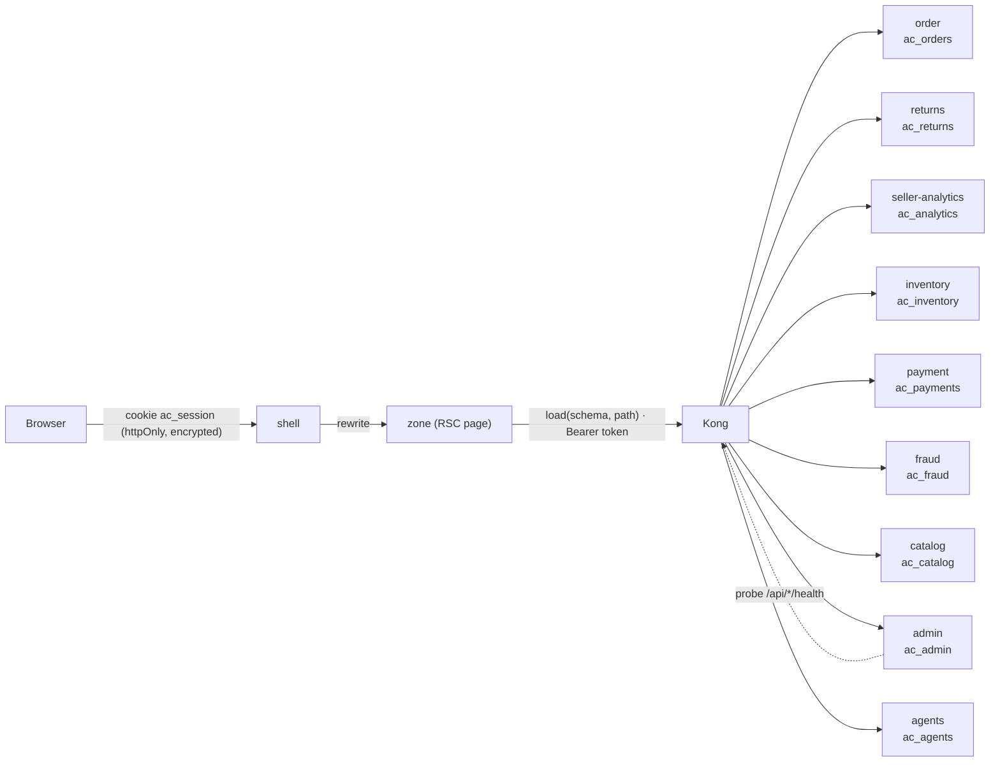
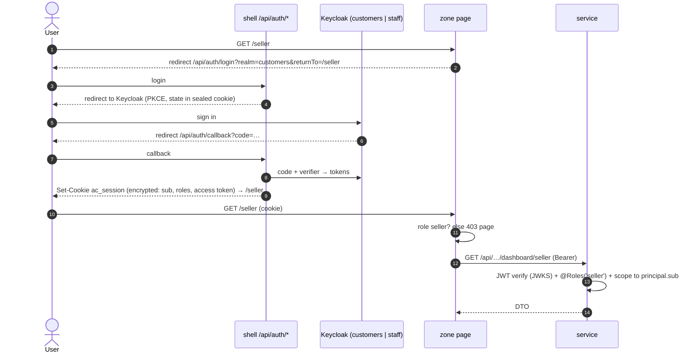

# 9. Role dashboards

One dashboard per Keycloak role, each hosted by the zone that owns that domain and fed by the services that own
the data. Contracts: `@ac/contracts` **0.2.0** (`libs/contracts/src/dashboards.ts`).

| Role (realm) | Dashboard | Zone | Widgets → owning service (endpoint under `/api/<service>/v1/dashboard…`) |
|---|---|---|---|
| `buyer` (customers) | My orders & returns | `/account` | KPIs + recent orders → **order** `/buyer` · refund cases → **returns** `/buyer` · refund-agent chat (AG-UI) |
| `seller` (customers) | Seller dashboard | `/seller` | KPIs, daily sales, top products, payouts → **seller-analytics** `/seller` · to-ship → **order** `/seller` · stock to watch → **inventory** `/seller` |
| `admin` (staff) | Platform overview | `/admin` | GMV/orders → **order** `/platform` · catalogue → **catalog** · disputes/moderation → **admin** `/overview` · fraud → **fraud** · refunds → **returns** `/support` · **service health** → **admin** `/platform-health` (probes every service via Kong) |
| `support` (staff) | Refund approvals | `/admin/support` | queue of agent-escalated refund cases with proposal + rationale, KPIs, resolved/day → **returns** `/support` |
| `finance` (staff) | Finance | `/admin/finance` | captured/refunded/payouts, captured/day, ledger balance, upcoming payouts → **payment** `/finance` · dual-control refunds → **returns** `/finance` |
| `fraud-analyst` (staff) | Fraud | `/admin/fraud` | KPIs, score distribution, top rules, recent alerts → **fraud** |
| `moderator` (staff) | Moderation | `/admin/moderation` | queue with agent verdict/confidence/reasons, verdicts, auto-approval rate → **admin** `/moderation` · catalogue status → **catalog** |
| `admin` (staff) | Agent oversight | `/admin/agents` | registered agents + autonomy, tool calls (allowed/denied) by tool, recent calls, **audit-chain integrity** → **agents** (real audit data, never seeded) |

`admin` sees every staff dashboard; other staff see only theirs (`/admin` redirects them to their first one).


## Amazon-style design (2026-10-23)

All zones use one Amazon-like design language from `@ac/ui` (our own brand, `agentic.commerce`): navy header
(`#131921`) with department search, *Hello, name / Account & Lists*, *Returns & Orders* and cart; role-aware
sub-nav (`#232f3e`: Shop · Your Orders · Buy Again · Customer Service · Sell/Seller Central, or *Console* for
staff); grey page (`#eaeded`), white cards, teal links, yellow pill buttons, Arial. Building blocks: `Button`,
`TextLink`, `Breadcrumb`, `Tabs`, `SnapshotStrip/SnapshotItem`, `AccountTile`, `ProductThumb` (generated
category thumbnails — the demo catalogue has no images), plus the dashboard set (`KpiTile`, `Panel`,
`DataTable`, `StatusBadge`, `BarChart`, `HBarChart`). Dark mode is kept (selected steps, not a filter).

| Page | Amazon pattern | Data (owner) |
|---|---|---|
| `/account` Your Account | tile grid (Your Orders, Buy Again, Returns & refunds, Login & security → Keycloak account console, Customer Service, Your Seller Account), returns in progress, recent orders | order `/orders/mine`, returns `/dashboard/buyer` |
| `/account/orders` Your Orders | tabs Orders · Buy Again · Not Yet Shipped · Cancelled with counts, *N orders placed in past 3 months/6 months/year*, order cards (grey header: placed / total / ship to / order #; status line; items with thumbnail, seller, qty; Buy it again; Track package · Return or replace · Cancel · Get help), pagination | order `GET /v1/orders/mine?tab&range&page`, `GET /v1/orders/mine/buy-again`; return status per card from returns — composed in the zone by order number |
| `/account/help` Customer Service | assistant chat, pre-filled from an order card ("help with ORD-…", "return items from ORD-…") | agents (ping placeholder until the refund agent ships) |
| `/seller` Seller Central home | own sub-header, **Global Snapshot** (sales today & 30 d, open orders & late, account health, payments, inventory), Actions, Sales chart, Manage Orders with ship-by badges, Account Health (refund rate < 10 %, late shipment rate < 4 %), Payments with recent transfers, Inventory alerts, Top products, News | seller-analytics (`today`, sales, payouts), order (`shipping`, to ship), inventory |
| `/admin/*` Console | same chrome, breadcrumb, left rail with orange active marker | unchanged |
| `/shop?q=` | header search lands here (sample catalogue until the search service ships) | — |

Contracts **0.3.0** (additive): `BuyerOrdersPageSchema`, `BuyAgainSchema`, optional `SellerSalesDashboard.today`,
optional `SellerOrdersDashboard.shipping`. Order service gained `order_lines` + ship-to columns via a new
expand-only migration (`OrderLines1761300000000`).

Marketplace queues and pages (seller onboarding, Brand Registry, category approvals, fee schedule,
moderation actions) are described in [10-marketplace.md](10-marketplace.md).

## Data flow



- **Each widget is independent.** `load()` in `@ac/bff` never throws: a slow or failing service renders an
  "unavailable" tile for its widget only (4 s timeout); the page and every other widget still work.
- **Contract-validated on both sides.** Services parse their response with the contract schema before
  returning; zones parse again before rendering — a drifted response becomes a visible "did not match the
  contract" tile, not a broken page.
- **Server-rendered.** Pages are React Server Components; charts are SVG rendered on the server (no chart
  library in the browser). Each bar carries a native tooltip; every chart has a table view.

## Authentication & authorisation



- One login for all zones: zones share the shell's origin, so the cookie set by the shell is read by every
  zone's server code (never by browser JS). Access tokens live 15 min; afterwards the user is sent through
  Keycloak again, which is silent while the SSO session lasts.
- **Roles are enforced twice**: the zone hides dashboards the user may not open, and every service endpoint
  checks `@Roles(...)` itself and scopes data to the caller (`principal.sub`) — the zone check is UX, the service
  check is security.
- In k8s, server-side calls to Keycloak go to `AUTH_INTERNAL_BASE` (in-cluster) while the browser and the token
  issuer use the public URL; services do the same for JWKS via `OIDC_JWKS_REWRITE`.

## Demo data

`@ac/demo-data` generates one deterministic world (20 sellers, 200 buyers, ~260 products, 1,500 orders over
60 days, refunds, payouts, stock, fraud alerts, moderation items). **Each service seeds only its own database**
with its slice (`pnpm --filter @ac/<svc> seed`), so the data is consistent across services without any
cross-database access. The demo `buyer` and `seller` Keycloak users have fixed ids that the world uses.

```bash
ac seed                 # local: every service with a seed script
ac k8s seed local       # cluster: runs node dist/seed.js inside each service's pod
```
Agent audit data is never seeded — the oversight dashboard only shows real tool calls.

## Next steps

- Actions on dashboards (approve/reject refunds, decide moderation items, release payouts) via the owning
  service's command APIs with `Idempotency-Key`, OPA/dual control for money — then they become the HITL
  surface for agent interrupts.
- Replace seeded read models with event-fed ones (seller-analytics consumes order/payment/returns events).
- Date-range filters (one row above the charts) once the read models support them.
