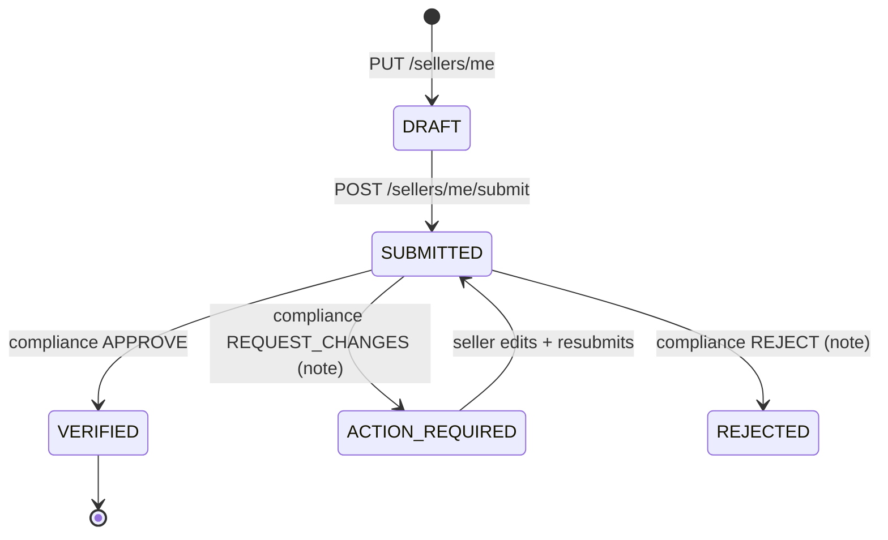
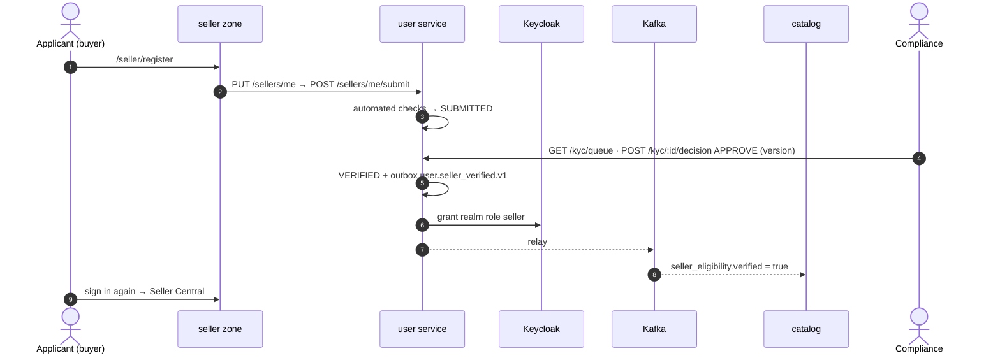
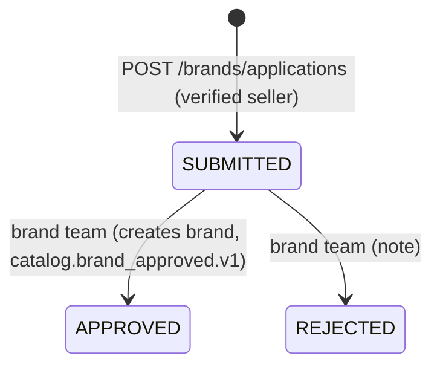
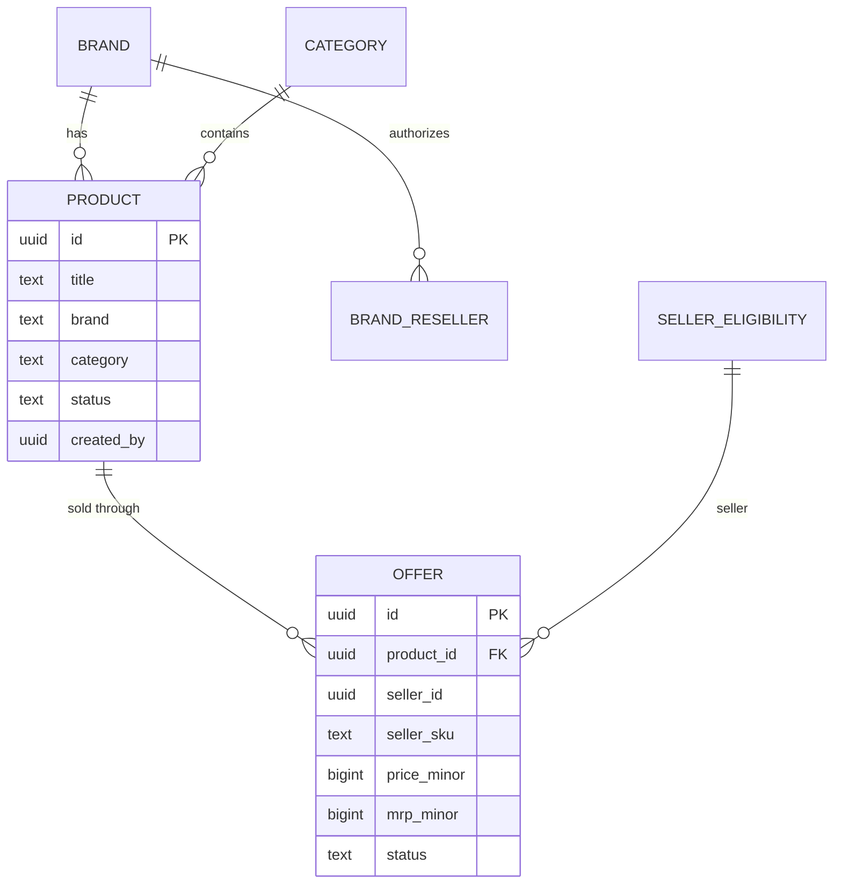
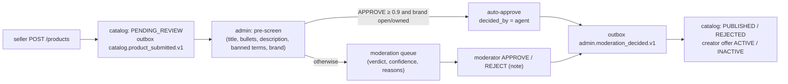
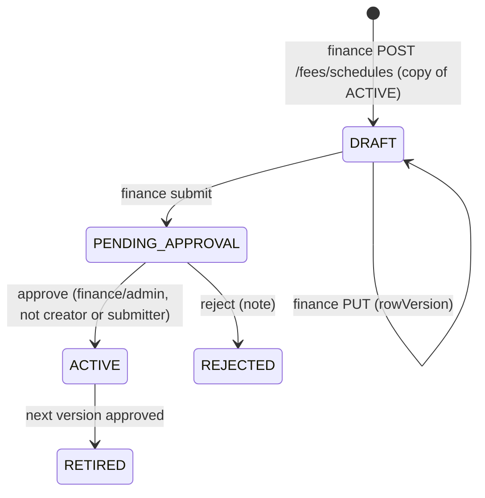
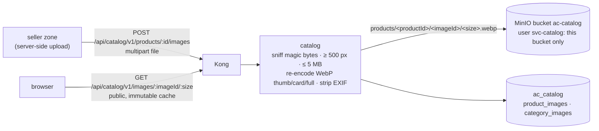

# 10. Marketplace model — who lists, who approves, what it costs

How companies, manufacturers and brand owners get products onto agentic.commerce, who approves each step,
and the fee (commission) the platform charges. Modelled on Amazon (Seller Central, Brand Registry, shared
catalogue, category approvals, referral + closing fees). Decision record: [ADR 0012](adr/0012-marketplace-model.md).
Contracts: `@ac/contracts` **0.4.0** (`libs/contracts/src/marketplace.ts`, events in `Events`); 0.4.1 adds optional `version`, `productId`, `brand`, `category` to moderation queue items.

## 10.1 Actors

| Actor | Who | Realm / role | What they can do |
|---|---|---|---|
| **Applicant** | anyone with a customer account (a person or a company) | customers / `buyer` | apply for a seller account (business, GSTIN, PAN, address, bank) |
| **Seller** | a company whose KYC is verified — a manufacturer, brand owner, distributor or retailer | customers / `seller` (granted automatically on verification) | request gated categories, apply for Brand Registry, create products, add offers on existing products, see fees |
| **Brand owner** | a seller whose brand application was approved | customers / `seller` + owner of a brand | controls the brand's product content; if the brand is *restricted*, decides which sellers may resell it |
| **Compliance** | staff | staff / `compliance` | verify or reject seller KYC |
| **Brand team** | staff | staff / `brand-team` | approve Brand Registry applications |
| **Category team** | staff | staff / `category-team` | approve sellers for gated categories |
| **Moderation agent + moderator** | rules pre-screen (the LangGraph moderation agent later) + staff | staff / `moderator` | approve or reject new products |
| **Finance** | staff | staff / `finance` (maker) and `finance`/`admin` (checker) | draft fee schedules; a *different* person approves |
| **Admin** | staff | staff / `admin` | everything staff can do |

A *manufacturer* is not a separate kind of account: it is a seller with `businessType = MANUFACTURER`
that usually also registers its brand. A *company* is the legal entity behind a seller account
(legal name + GSTIN). One Keycloak user = one seller account (multi-user seller accounts are future work).

## 10.2 Who owns what (services)

| Data | Service (database) | Why there |
|---|---|---|
| seller account, KYC, category approvals | **user** (`ac_users`) | it is the identity of the selling business; grants the Keycloak `seller` role |
| categories, brands, brand applications, authorized resellers, products, offers, listing rules, seller eligibility (read model) | **catalog** (`ac_catalog`) | listing rules must be checked where the listing is written |
| moderation queue and decisions | **admin** (`ac_admin`) | existing moderation workflow |
| fee schedules, fee calculation, per-order fees, FEE ledger entries | **payment** (`ac_payments`) | fees are money — next to captures, payouts and the ledger |

No service reads another's database. Catalog learns about verified sellers and approved categories from
`user.events`; admin learns about new products from `catalog.events`; catalog learns moderation results
from `admin.events`. The only synchronous call is user → catalog `GET /categories` (cached, 3 s timeout).

## 10.3 Seller onboarding and KYC



- **Automated checks** run on submit and are shown to compliance (icon + label): GSTIN format and
  checksum (mod 36), PAN equals GSTIN characters 3–12, GSTIN state code matches the address state, IFSC
  format. Checks inform; a human decides. External GSTN/bank verification APIs are future work.
- **On VERIFIED** the user service, in one transaction, sets the status and writes
  `user.seller_verified.v1` to the outbox; after commit it grants the realm role `seller` through the
  Keycloak Admin API (client `user-service`, `manage-users`). The user's next sign-in carries the role
  (the zone tells them to sign in again).
- PAN and bank account are masked in every response (`panMasked`, `accountLast4`).
- Decisions carry the `version` the reviewer saw → `409` if someone else decided first.



## 10.4 Gated categories

Some categories need a licence before a seller may list in them (e.g. food → FSSAI licence). The list lives
in catalog (`GET /categories`: `gated`, `requirement`).

`NOT_REQUESTED → PENDING` (seller `POST /sellers/me/categories/:category {licenseNumber}`)
`→ APPROVED | REJECTED` (category team). APPROVED emits `user.category_approved.v1` → catalog eligibility.
Non-gated categories are `NOT_REQUIRED`.

## 10.5 Brand Registry



- Application: brand name, Indian trademark number (registered or pending), relationship (owner,
  manufacturer, authorized agent), optional evidence URL, *restrict resellers* flag.
- Checks: trademark number format, brand name not already registered or pending, applicant verified.
- **The brand owner controls content**: only the owner may create new products under a registered brand
  (`BRAND_NOT_OWNED`). For a **restricted** brand, other sellers may add offers only if the owner has
  authorized them (`PUT /brands/:brandId/resellers/:sellerId`), else `BRAND_RESTRICTED`.
- Unregistered (generic) brands stay open: anyone verified may create products and offers.

## 10.6 Shared catalogue: one product, many offers



- A **product** (Amazon's ASIN) exists once; its page shows the lowest price in the buy box and
  *Other sellers on agentic.commerce (N)*.
- A seller either **creates a product** (`POST /products`, with their first offer) — goes to moderation —
  or **sells an existing published product** (`POST /offers`) — no moderation, rules only.
- Listing rules (422 `ListingRejection.code`): `SELLER_NOT_VERIFIED`, `CATEGORY_NOT_APPROVED`,
  `BRAND_NOT_OWNED`, `BRAND_RESTRICTED`, `PRODUCT_NOT_PUBLISHED`, `DUPLICATE_OFFER`, `PRICE_ABOVE_MRP`.
- Stock stays with **inventory** (per offer/SKU); catalog only records the quantity the seller declared in
  `catalog.offer_created.v1` for inventory to pick up.

## 10.7 Listing moderation — agent + moderator



The pre-screen is deterministic rules today, standing in for the LangGraph moderation agent
([03](03-agentic-ai.md)); when the agent ships it replaces the rules behind the same queue, with the same
rule: it may only auto-approve low-risk listings and everything else goes to a person.

## 10.8 Fees (commission)

Amazon-style, all amounts in paise, GST charged on fees:

| Fee | How it is calculated | v1 (seeded) |
|---|---|---|
| **Referral fee** | % of the sale price, per category (`referralBps`), at least `minReferralMinor` per unit | electronics 8 %, fashion 17 %, home 12 %, grocery 5 %, outdoor 9 %, beauty 10 %, books 6 %, jewellery 15 % (min ₹20), others 12 % |
| **Closing fee** | fixed per unit by price band | ≤ ₹300: ₹5 · ≤ ₹500: ₹10 · ≤ ₹1,000: ₹20 · above: ₹40 |
| **Payment collection fee** | % of the sale (`paymentFeeBps`) | 2 % |
| **GST** | on the sum of the fees (`gstBps`) | 18 % |

Per order line:

```
sale     = price × qty
referral = max(round(sale × referralBps / 10 000), minReferral × qty)
closing  = band(price) × qty
payment  = round(sale × paymentFeeBps / 10 000)
gst      = round((referral + closing + payment) × gstBps / 10 000)
seller earns = sale − (referral + closing + payment + gst)        (round = half up)
```

Example: a ₹1,299 jacket (fashion) → referral ₹220.83, closing ₹40, payment ₹25.98, GST ₹51.63 →
fees ₹338.44 (26.1 %), seller earns ₹960.56.

### Versioned schedule with maker-checker



- Only one DRAFT/PENDING schedule at a time; approving sets `effectiveFrom = now` and retires the previous
  ACTIVE schedule. The person who created or submitted a version can never approve it (403).
- Each order's fees are stored with the **schedule version** used (`order_fees`) and posted to the ledger as
  `FEE` entries — changing the schedule never changes past orders.
- Sellers see the rate card (`GET /fees/schedule`), a **live fee preview** while pricing
  (`POST /fees/preview`), and **fees on their sales** for the last 30 days (`GET /sellers/me/fees`);
  finance sees platform fee revenue on the finance dashboard.

## 10.9 Where it appears in the app

| Who | Page | Zone |
|---|---|---|
| any customer | *Sell on agentic.commerce* → application form | `/seller/register` |
| applicant / seller | application & KYC status, checks, resubmit | `/seller/account` |
| seller | category approvals | `/seller/categories` |
| seller / brand owner | Brand Registry, authorized resellers | `/seller/brands` |
| seller | listings; *Add a product* and *Sell this product* with live fee preview | `/seller/listings`, `/seller/listings/new`, `/seller/listings/sell` |
| seller | rate card, fee calculator, my fees | `/seller/fees` |
| shopper | real catalogue search, product page with all offers | `/shop`, `/shop/p/[id]` |
| compliance | seller verification queue | `/admin/compliance` |
| brand team | Brand Registry queue | `/admin/brands` |
| category team | category approvals queue | `/admin/categories` |
| moderator | moderation queue with Approve / Reject | `/admin/moderation` |
| finance / admin | fee schedule versions, draft editor, maker-checker approval | `/admin/fees` |

Demo logins (local): customers `buyer/buyer` (no seller account — try onboarding), `seller/seller`
(verified seller, brand owner); staff `compliance/compliance`, `brands/brands`, `category/category`,
`moderator/moderator`, `finance/finance`, `admin/admin`.

## 10.10 Events

| Type | Producer → consumers | Data |
|---|---|---|
| `user.seller_verified.v1` | user → catalog | sellerId, displayName, businessType |
| `user.category_approved.v1` | user → catalog | sellerId, category |
| `catalog.brand_approved.v1` | catalog → (search, analytics later) | brandId, name, ownerSellerId, restricted |
| `catalog.product_submitted.v1` | catalog → admin | productId, seller, title, brand, category, description, bullets |
| `catalog.offer_created.v1` | catalog → inventory (later) | offerId, productId, sellerId, sellerSku, quantity |
| `admin.moderation_decided.v1` | admin → catalog | productId, APPROVE/REJECT, note, decidedBy agent/human |

## 10.11 Pros, cons and future work

| | |
|---|---|
| **Pros** | Every approval has an owner team and an audit trail (who, when, note, version); listing rules are enforced in one service; brand owners get control without staff in the loop; fee changes are versioned, dual-controlled and never rewrite history; sellers see exactly what they will earn before listing. |
| **Cons** | More moving parts (four services, six events); eligibility in catalog is eventually consistent (seconds after verification); the seller role needs a re-login; KYC checks are format-level only. |
| **Future** | GSTN / penny-drop bank verification APIs; document upload to MinIO (trademark certificate, licences); multi-user seller accounts; LangGraph moderation and KYC-assist agents behind the same queues; fee promotions and per-seller fee overrides (also maker-checker); inventory consuming `catalog.offer_created.v1`; search indexing products and offers. |

## 10.12 Product images

Decision record: [ADR 0013](adr/0013-product-images.md). Contracts **0.5.0** (`ImageSize`, `imageUrl()`, `productImageUrl()`,
`categoryImageUrl()`, `ProductImageSchema` + `attribution`, optional `ProductCard.imageId`, `ProductDetail.images`, `Category.hasImage`).



| | |
|---|---|
| **Storage** | the catalog service's own bucket `ac-catalog`; MinIO user `svc-catalog` with a policy limited to that bucket (created by `ac infra init` locally and by the `db-bootstrap` hook Job in k8s, from `"objectStore": true` in the service metadata). Credentials `S3_*` only in the catalog service's env/Secret. |
| **Sizes** | WebP, longest side `thumb` 160 px · `card` 400 px · `full` 1000 px; never upscaled; auto-rotated; metadata (EXIF/GPS) stripped. |
| **URLs** (public, through Kong) | `GET /images/:imageId/:size` — bytes, `Cache-Control: public, max-age=31536000, immutable`, ETag/304 · `GET /products/:id/image/:size` — 302 to the primary image (5 min cache) or 404 · `GET /categories/:id/image/:size` — 302 to the banner. A new upload always gets a new id, so cached bytes never go stale. |
| **Uploads** | `POST /products/:id/images` (multipart field `file`) by the seller who created the product or the owner of its registered brand: JPEG/PNG/WebP (magic bytes, not the file name), ≤ 5 MB (`413 TOO_LARGE`), shortest side ≥ 500 px (`422 TOO_SMALL`), ≤ 5 per product (`422 TOO_MANY_IMAGES`), others `403 NOT_OWNER`. `DELETE /products/:id/images/:imageId`, `PUT /products/:id/images/order { imageIds }` (first = primary). |
| **Demo photos** | 92 curated photos for the 34 demo product types + 8 category banners (`@ac/demo-data` `images.json`): Wikimedia Commons and Flickr (via Openverse), **CC0, public domain or CC BY only** (no SA/ND/NC). Stored once under `stock/<key>/` and shared by every product of that type (1–3 per product, rotated so variants differ). `ac seed catalog` downloads them once (cached in `backend/.cache/demo-images`, gitignored), then re-runs are offline. |
| **Credit** | `ProductImage.attribution` (creator, licence, licence URL, source page, title) for stock photos — every page that shows one credits it (CC BY requires it); `null` for seller uploads. |
| **Future** | image moderation (the moderation agent checks new images, e.g. "low-quality images", "duplicate image across sellers"); images added to an already published product are live immediately today. CDN in front of `/api/catalog/v1/images/*`. |
