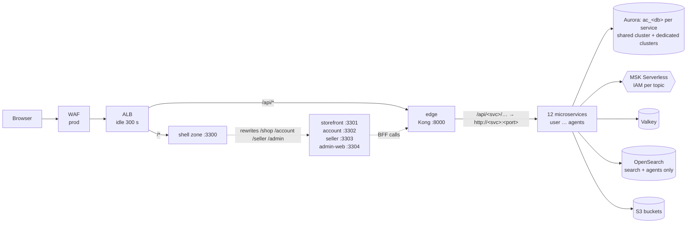

> **ARCHIVED — not in use.** AWS is not available for this project (decision 2026-10-23). The active
> deployment target is **k3s on an Oracle Cloud VM** — see [`../deploy/README.md`](../deploy/README.md).
> This code still validates (`terraform validate`, mocked `terraform test`) and is kept only as a reference
> design for a future AWS move. Nothing in the CLI, CI or docs points here any more.

# AWS infrastructure (Terraform)

Every backend **microservice**, every **micro-frontend zone** (Next.js Multi-Zones) and the **Kong edge**
runs as its own ECS Fargate service with its own image, log group, IAM roles, secrets, autoscaling and
deployment circuit breaker. Every service with data owns its **own database**. Nothing here is shared
between services except the network, the Kafka cluster (with per-topic IAM), Valkey and OpenSearch.



Service-to-service traffic uses **ECS Service Connect**: every task is reachable as
`http://<name>:<port>` inside the cluster (the same names/ports as local development).

## Layout

```
platform/terraform/
├─ bootstrap/                 S3 state bucket (versioned, KMS, S3-native locking)
├─ envs/dev, envs/prod        roots: sizing + isolation knobs only
└─ modules/
   ├─ platform/               wires everything; catalog.tf = THE service/zone catalog
   │  ├─ catalog.tf           var.services / var.zones / var.edge
   │  ├─ main.tf              ECS services, databases, secrets, bootstrap tasks
   │  ├─ iam.tf               least-privilege task roles generated from the catalog
   │  └─ tests/plan.tftest.hcl  mocked `terraform test` (no AWS credentials needed)
   ├─ ecs-service/            one ECS service (task def, roles, logs, autoscaling, optional ALB rule, sidecars)
   ├─ ecs-cluster/            cluster, Service Connect namespace, ALB, WAF, ECR repos ac/<service>, ac/zone-<zone>, ac/edge
   ├─ aurora/                 one Aurora PostgreSQL Serverless v2 cluster
   ├─ db-bootstrap/           one-off ECS task creating svc_<db> roles + ac_<db> databases (+ test)
   ├─ data/                   Valkey, OpenSearch, MSK Serverless
   ├─ network/                VPC (3 AZ), NAT, S3 gateway endpoint
   ├─ secrets/                Secrets Manager: ac/<env>/<owner>/<NAME>
   └─ storage/                S3: images, evidence, audit (Object Lock), kafka-archive, policies
```

## Deployables

Adding a service or zone = **one entry** in `modules/platform/catalog.tf` (or an env override of
`services` / `zones`). Everything else (ECR repo, ECS service, role, secrets, database, bootstrap SQL,
Kafka IAM) is derived from it.

### Backend microservices (`var.services`)

| Service | Port | Database (cluster) | Produces | Consumes | Extra access | Own secrets |
|---|---|---|---|---|---|---|
| user | 4101 | `ac_users` | user.events | — | — | database-url |
| catalog | 4102 | `ac_catalog` | catalog.events | admin.events | S3 images rw | database-url |
| search | 4103 | — (OpenSearch) | — | catalog, inventory | OpenSearch rw | — |
| inventory | 4104 | `ac_inventory` | inventory.events | order, payment | — | database-url |
| order | 4105 | `ac_orders` | order.events | payment, fraud, returns | — | database-url |
| payment | 4106 | `ac_payments` (**dedicated cluster in prod**) | payment.events | order, returns | S3 audit put | database-url, STRIPE_SECRET_KEY, STRIPE_WEBHOOK_SECRET, RAZORPAY_KEY_ID, RAZORPAY_KEY_SECRET |
| returns | 4107 | `ac_returns` | returns.events | order, payment | S3 evidence rw | database-url |
| fraud | 4108 | `ac_fraud` | fraud.events | user, order, payment, returns | — | database-url |
| notification | 4109 | `ac_notify` | — | all domain topics | SES | database-url |
| admin | 4110 | `ac_admin` | admin.events | catalog, fraud, agent | S3 images/evidence read | database-url |
| seller-analytics | 4111 | `ac_analytics` | — | order, payment, inventory, returns | S3 kafka-archive put | database-url |
| agents | 4300 | `ac_agents` | agent.events | returns, fraud, catalog, admin | S3 evidence/images read, audit put, OpenSearch read, **OPA sidecar** | database-url, OPENAI_API_KEY, LANGFUSE_PUBLIC_KEY, LANGFUSE_SECRET_KEY, KEYCLOAK_AGENTS_CLIENT_SECRET |

Every producer may also write `dlq.events`. Consumer groups must be named `<service>.<consumer>` (IAM
allows only `group/<service>.*`), which matches `EventConsumerService` in the backend.

### Micro-frontend zones (`var.zones`)

| Zone (ECS service) | Port | basePath | On ALB | Health check | Own secrets |
|---|---|---|---|---|---|
| shell | 3300 | `` | **yes** (`/*`) | `/api/health` | AUTH_SECRET, AUTH_KEYCLOAK_SECRET |
| storefront | 3301 | `/shop` | no | `/shop/api/health` | same (own copies) |
| account | 3302 | `/account` | no | `/account/api/health` | " |
| seller | 3303 | `/seller` | no | `/seller/api/health` | " |
| admin-web | 3304 | `/admin` | no | `/admin/api/health` | " |

The shell receives `ZONE_STOREFRONT_URL=http://storefront:3301`, `ZONE_ACCOUNT_URL`, `ZONE_SELLER_URL`,
`ZONE_ADMIN_URL=http://admin-web:3304` and rewrites its paths to them. All zones get `PORT`,
`HOSTNAME=0.0.0.0`, `ZONE_NAME`, `BASE_PATH`, `NEXT_PUBLIC_APP_URL`, `AUTH_URL`, `KONG_URL=http://edge:8000`
(server-side BFF calls) and `OIDC_ISSUERS`.

### Edge

`edge` = Kong 3.9 DB-less, image `ac/edge` (`FROM kong:3.9.4` + `kong.cloud.yml` → `/kong/kong.yml`,
generated by `ac kong --cloud`, upstreams `http://<service>:<port>`). On the ALB for `/api/*`.

## Isolation model

| Concern | How |
|---|---|
| Compute | 1 ECS service per microservice / zone; independent image tags (`image_tags`), deploys, rollbacks, scaling |
| Data | `ac_<db>` database per service owned by `svc_<db>`; `CONNECT` revoked from PUBLIC; `dedicated_db_services` moves a service onto its own Aurora cluster |
| Secrets | `ac/<env>/<owner>/<NAME>`; a service's execution role can read **only** its own secrets |
| Messaging | MSK IAM: write only own topics (+ dlq), read only subscribed topics, groups `<service>.*` |
| AWS APIs | task role generated from the catalog (S3 buckets, OpenSearch, SES only where declared) |
| Network | private subnets; data stores accept only the app security group; only ALB is public |

## Prerequisites

Terraform ≥ 1.10, AWS CLI v2 with credentials for the target account, Docker (buildx) for images.

## 1. Bootstrap remote state (once per account)

```bash
cd platform/terraform/bootstrap
cp terraform.tfvars.example terraform.tfvars
terraform init && terraform apply          # prints the state bucket name
```

Put the bucket in `platform/.env`: `TF_STATE_BUCKET=<bucket>` and `AWS_REGION=ap-south-1`.

## 2. Plan / apply an environment

```bash
cp platform/terraform/envs/dev/terraform.tfvars.example platform/terraform/envs/dev/terraform.tfvars
ac tf dev init        # = node platform/scripts/ac.mjs tf dev init (backend bucket from TF_STATE_BUCKET)
ac tf dev plan
ac tf dev apply
```

Dev **creates the account-wide ECR repositories** (`manage_ecr_repositories = true`); prod looks them up
(set it to `true` only if prod lives in its own AWS account). Images are built once and promoted.

### First apply (empty ECR)

ECS services can't start before images exist:

```bash
ac tf dev apply -target=module.platform.module.cluster     # ECR repos, ALB, cluster
# build + push every image (step 3), then:
ac tf dev apply
```

## 3. Images: build, push, release one service

```bash
ac docker build catalog                      # backend service → image ac/catalog
ac docker build storefront                   # frontend zone   → image ac/zone-storefront
ac docker build edge                         # Kong + kong.cloud.yml
REPO=$(terraform -chdir=platform/terraform/envs/dev output -json ecr_repository_urls | jq -r .catalog)
aws ecr get-login-password | docker login --username AWS --password-stdin "${REPO%%/*}"
docker tag ac/catalog:latest "$REPO:$GIT_SHA" && docker push "$REPO:$GIT_SHA"
ac tf dev apply -var 'image_tags={catalog="'$GIT_SHA'"}'   # releases ONLY catalog
```

Images are **ARM64** (`cpu_architecture = "ARM64"`); build with `--platform linux/arm64`. Health checks use
`wget` (present in node:alpine / busybox images); Kong uses `kong health`.

## 4. Databases: run db-bootstrap

Terraform generates each service's password and `DATABASE_URL` (secret `ac/<env>/<service>/database-url`,
JSON keys `url`, `username`, `password`, `dbname`, `host`, `port`; tasks receive `DATABASE_URL` from key `url`).
The AWS provider can't create roles/databases, so a one-off task does it (idempotent; re-run after adding a
service or rotating a password):

```bash
terraform -chdir=platform/terraform/envs/dev output -json db_bootstrap_run_commands
# → { "shared": "aws ecs run-task --cluster … --task-definition agentic-commerce-dev-shared-db-bootstrap …" }
```

The script (SSM parameter `/<name>/db-bootstrap/script`) creates `svc_<db>` (LOGIN), `ac_<db>` owned by it,
revokes PUBLIC access, and installs `vector`, `pgcrypto`, `pg_trgm`. Logs: `/ecs/<name>/db-bootstrap`.

## 5. Secrets, OPA bundle, Kong config

```bash
terraform -chdir=platform/terraform/envs/dev output secrets_to_set      # third-party secrets per owner
aws secretsmanager put-secret-value --secret-id ac/dev/payment/STRIPE_SECRET_KEY --secret-string sk_test_…

opa build -b platform/policies -o agents.tar.gz                           # agents' OPA sidecar bundle
aws s3 cp agents.tar.gz s3://$(terraform -chdir=platform/terraform/envs/dev output -json buckets | jq -r .policies)/bundles/agents.tar.gz

ac kong --cloud && ac docker build edge                                   # gateway routes → image
```

## Contracts other repos must match

| Who | Must use |
|---|---|
| backend services | `DATABASE_URL` (full URL, `sslmode=require`), `PORT`, `SERVICE_NAME`, `KAFKA_BROKERS` + `KAFKA_SASL_MECHANISM=aws-msk-iam` (implemented in `@ac/kafka`: OAUTHBEARER tokens via `aws-msk-iam-sasl-signer-js`), `REDIS_URL` (`rediss://`), `OIDC_ISSUERS`, `OPENSEARCH_URL`, `S3_BUCKET_<KEY>`, `OPA_URL=http://127.0.0.1:8181` (agents); `/health` endpoint; consumer groups `<service>.*` |
| frontend zones | listen on `PORT` / `HOSTNAME`; `basePath` as in the zones table; `<basePath>/api/health`; shell reads `ZONE_*_URL`; BFF uses `KONG_URL` |
| platform CLI | `ac kong --cloud` upstreams `http://<service>:<port>`; `ac docker build <name>` tags `ac/<service>`, `ac/zone-<zone>`, `ac/edge` (`--platform linux/arm64` for Fargate ARM); `ac tf` passes `TF_STATE_BUCKET`/`AWS_REGION` |

## Tests

```bash
cd platform/terraform/modules/platform && terraform init -backend=false && terraform test
cd ../db-bootstrap && terraform init -backend=false && terraform test
```

Mocked providers: they check the plan shape (18 ECS services, 11 databases, per-owner secrets, dedicated
clusters, generated bootstrap SQL) without AWS credentials. `terraform validate` runs for every root in CI.

## Cost notes (dev, rough, verify with the AWS Pricing Calculator)

| Item | Approx. / month | Notes |
|---|---|---|
| MSK Serverless | **~$550** (cluster-hours) + throughput | the largest dev cost; for a cheap dev consider provisioned MSK `kafka.t3.small` ×2 or Redpanda/Confluent and point `KAFKA_BROKERS` at it |
| Fargate (13 running tasks, ARM, Spot) | ~$20–40 | 18 services; 5 non-critical start at 0 (`scale_to_zero_noncritical`); smallest sizes 0.25 vCPU/0.5 GB |
| NAT gateway (single) | ~$35 + data | |
| ALB | ~$20 | |
| Aurora Serverless v2 (0.5 ACU min) | ~$45 | one shared cluster in dev; each dedicated cluster adds the same again |
| OpenSearch t3.small | ~$30 | |
| Valkey t4g.micro | ~$12 | |
| Secrets Manager (~29 secrets) | ~$12 | $0.40/secret |

Prod adds per-AZ NAT, WAF, 2 Aurora instances per cluster (shared + payment), 2 cache/search nodes and
≥ 2 tasks per service.

## Not created here

Keycloak (use a managed IdP or a separate stack and set `oidc_issuers`), Langfuse, CloudFront, Route 53.
